# Video Editör · Video Editor

## Kullanım Kılavuzu · User Guide

Sürüm / Version **3.3.0** · Windows 10/11 (x64) · düzenleme tamamen çevrimdışı, AI asistanı isteğe bağlı (yerleşik yerel model veya Foundry Local) / editing fully offline, AI assistant optional (built-in local model or Foundry Local)

**Diller / Languages:** [🇹🇷 Türkçe](#tr) · [🇬🇧 English](#en)

---

## 🇹🇷 Türkçe

**İçindekiler:** [Başlarken](#tr-start) · [Ekran düzeni](#tr-layout) · [5 adımda ilk video](#tr-quick) · [Nasıl yapılır?](#tr-howto) · [AI asistanı](#tr-ai) · [Dışa aktarma](#tr-export) · [Projeler](#tr-projects) · [Dil ve tema](#tr-lang) · [Kısayollar](#tr-keys) · [İpuçları](#tr-tips) · [Sorun giderme](#tr-trouble) · [SSS](#tr-faq)

### 1. Başlarken

- **Kurulum dosyası ile (önerilen):** `VideoEditor-3.3.0-Setup-x64.exe` dosyasına çift tıklayın. Sihirbaz Türkçe açılır (İngilizce seçilebilir). **Yönetici yetkisi gerekmez**: yalnızca sizin Windows kullanıcınız için `%LOCALAPPDATA%\Programs\Video Editor` klasörüne kurulur, Başlat menüsüne kısayol ekler (masaüstü kısayolu ve `.vedproj` proje dosyalarını açma isteğe bağlıdır). Başka bir klasör seçerseniz ve bu klasör Windows kullanıcı klasörünüzün dışındaysa, bilgisayarı birden fazla kişi kullanıyorsa diğer hesaplar program dosyalarını değiştirebileceği için sihirbaz sizi uyarır (kendi kullanıcı klasörünüz daha güvenlidir). Kaldırmak için **Ayarlar → Uygulamalar → Yüklü uygulamalar → Video Editör** (kaldırırken ayarlarınızı ve indirdiğiniz yapay zeka modelini silip silmeyeceğiniz sorulur; varsayılan: silme). Betikle kurulum: `VideoEditor-3.3.0-Setup-x64.exe /S /D=C:\Araclar\VideoEditor` (sessiz; ek seçenekler: `/LANG=en`, `/DESKTOP`, `/NOASSOC`). Kurulum dosyası imzasızdır (aşağıdaki SmartScreen notuna bakın).
- **Ya da taşınabilir klasörle:** `VideoEditor.exe` dosyasına çift tıklayın. **Kurulum, yönetici yetkisi ve internet gerekmez.** Klasörü istediğiniz yere taşıyabilirsiniz; isterseniz klasördeki `Masaustu-Kisayolu-Olustur.cmd` dosyasına çift tıklayarak masaüstü kısayolu oluşturun.
- **Ya da hiç kurmadan — web sürümü:** <https://ahmetcanalaca.github.io/videoeditor/> adresini Chrome veya Edge'de açın. Aynı arayüz ve düzenleme araçları; videolarınız tarayıcıda işlenir ve **yüklenmez** (isteğe bağlı Foundry video analizi hariç: her seferinde onayınızla küçültülmüş bir kopya kendi Azure kaynağınıza gider), düzenlemek için API anahtarı veya hesap gerekmez, ilk açılıştan sonra internetsiz çalışır. Farklar: yalnızca tarayıcının çözebildiği biçimler (MP4 / MOV / MKV / WebM / TS; AVI / WMV yok), dışa aktarma tarayıcının kaydetme penceresiyle MP4 (H.264 + AAC) olarak yazılır, `Ctrl+N` / `Ctrl+T` / `Ctrl+W` tarayıcıya aittir ve proje dosyası açılırken medya yeniden seçtirilir. **AI asistanı** web sürümünde de vardır: **hiçbir şey kurmadan, sayfanın içinde çalışan bir model** (Tarayıcıda yapay zekâ; bkz. 5.10), kendi anahtarınızla bulut sağlayıcıları (OpenAI, Azure OpenAI, Foundry — isteğe bağlı Content Understanding video analiziyle —, Anthropic, Gemini), bu bilgisayarda çalışan ve tarayıcılara izin veren bir model sunucusu (Ollama, LM Studio) ya da **Foundry Local** (isteğe bağlı, bir kez kuracağınız küçük bir tarayıcı eklentisiyle; bkz. 5.7). Ayrıntı: [web/README.md](web/README.md).

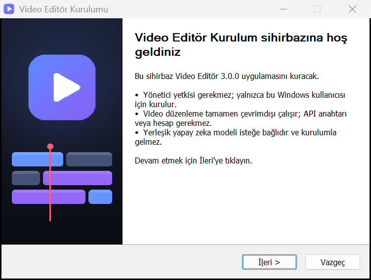
- Uygulama **Türkçe** ve **koyu tema** ile açılır. Dil ve tema üst çubuktan değişir; seçiminiz hatırlanır.
- Orijinal videolarınız **asla değiştirilmez**. Yaptığınız şey bir düzenleme listesidir; sonuç, dışa aktarırken yeni bir MP4 dosyasına yazılır.
- Uygulama imzasızdır. İlk açılışta Windows "bilgisayarınızı korudu" derse **Ek bilgi → Yine de çalıştır** deyin. Kurumsal güvenlik yazılımı engellerse BT biriminizden izin isteyin.

### 2. Ekran düzeni

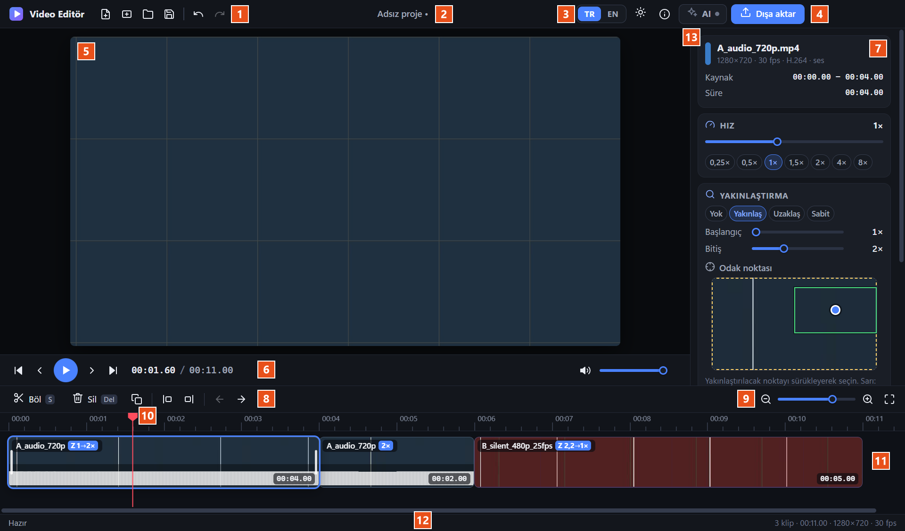

| # | Bölge | Ne işe yarar |
|---|---|---|
| 1 | Dosya ve düzenleme düğmeleri | Yeni proje · Video ekle · Projeyi aç · Kaydet · Geri al · Yinele |
| 2 | Proje adı | Kaydedilmemiş değişiklik varsa adın yanında `•` görünür |
| 3 | Dil, tema, hakkında | `TR` / `EN` · güneş/ay (koyu ↔ açık tema) · ⓘ Hakkında |
| 4 | Dışa aktar | Sonucu MP4 olarak kaydeder (`Ctrl+E`) |
| 5 | Önizleme | Zoom, hız ve görüntü ölçüsü çıktıyla aynı hesaplanır. Boşken videoları buraya sürükleyin |
| 6 | Oynatma çubuğu | Başa git · Önceki kare · Oynat/Duraklat · Sonraki kare · Sona git · zaman kodu · önizleme sesi |
| 7 | Sağ panel (klip özellikleri) | Seçili klibin **Hız**, **Yakınlaştırma**, **Ses** ve **Solma** ayarları. Küçük pencerede kaydırılır |
| 8 | Zaman çizelgesi araçları | Böl · Sil · Çoğalt · Başı / Sonu oynatma kafasına kırp · Sola / Sağa taşı |
| 9 | Zaman çizelgesi yakınlaştırma | Yalnızca **görünümü** büyütür/küçültür, videoyu etkilemez · Sığdır |
| 10 | Cetvel ve oynatma kafası | Kırmızı çizgi şu anki andır. Cetvelde tıklayıp sürükleyerek gezinin |
| 11 | Klipler | Küçük resimler ve ses dalgası · hız/zoom rozetleri (`2×`, `Z 1→2×`) · kenarlarda kırpma tutamaçları · sürükleyerek sıralama. Aynı videodan gelen klipler aynı renktedir |
| 12 | Durum çubuğu | Durum mesajı · klip sayısı · toplam süre · çıktı boyutu · kare hızı |
| 13 | AI düğmesi | İsteğe bağlı AI asistanı panelini açar/kapatır (`Ctrl+K`). Nokta: yeşil = hazır, gri = kapalı (bkz. [AI asistanı](#tr-ai)) |

### 3. 5 adımda ilk video

1. **Video ekleyin:** dosyaları pencereye sürükleyip bırakın ya da `Ctrl+O` / **Video ekle** deyin (birden fazla dosya seçebilirsiniz). Videolar zaman çizelgesine arka arkaya dizilir.
2. **Gezinin:** `Boşluk` ile oynatın; cetvelde tıklayıp sürükleyerek oynatma kafasını istediğiniz yere götürün. Tek kare için `←` `→`.
3. **Düzenleyin:** `S` ile bölün, klibi seçip `Del` ile silin, klip kenarlarından kırpın, sağ panelden hız/zoom/ses ayarlayın.
4. **Dışa aktarın:** `Ctrl+E` → **Gözat…** ile kayıt yerini seçin → **Dışa aktar**.
5. Bitince **Oynat** ile sonucu izleyin veya **Klasörde göster** deyin.

### 4. Nasıl yapılır?

#### 4.1 Kesme / kırpma (baştan ve sondan)
Klibe tıklayıp seçin (mavi çerçeve), sonra:
- **Tutamaçla:** klibin sol veya sağ kenarındaki beyaz tutamacı sürükleyin. Durum çubuğunda yeni başlangıç–bitiş ve süre görünür. `Esc` sürüklemeyi iptal eder.
- **Oynatma kafasıyla:** oynatma kafasını istediğiniz kareye getirin; `Q` klibin **başını**, `W` klibin **sonunu** oynatma kafasına kırpar.
- Kare kare ilerlemek için `←` `→`, bir saniye atlamak için `Shift+←` `Shift+→`.
- Kırpma geri alınabilir: tutamacı geri sürükleyerek kırpılan kısmı yeniden açabilirsiniz.

#### 4.2 Bölme (split)
Oynatma kafasını klibin içine getirin → `S` veya **Böl**. Klip ikiye ayrılır, sağdaki parça seçili olur. Bölme noktasında görüntü, ses ve zoom kesintisizdir.

#### 4.3 Ortadan bir bölümü silme
1. Silinecek bölümün başında `S`, sonunda tekrar `S` ile iki kez bölün.
2. Ortadaki parçayı seçip `Del` tuşuna basın. Sağdaki klipler otomatik sola kayar, boşluk kalmaz.
3. Yanlış olduysa `Ctrl+Z`.

#### 4.4 Birleştirme (merge)
- Birden fazla video ekleyin; sırayla dizilirler.
- Sırayı değiştirmek için klibi **sürükleyip** yeni yerine bırakın (bırakma çizgisi görünür) ya da klibi seçip `Alt+←` / `Alt+→` kullanın.
- Farklı çözünürlük, en-boy oranı veya kare hızındaki videolar çıktı ölçüsüne **otomatik uyarlanır**: görüntü bozulmadan, gerekirse siyah bantla ortalanır. Çıktı ölçüsü varsayılan olarak **ilk klibe** göre belirlenir; **Dışa aktar** penceresinden değiştirebilirsiniz.
- Aynı videonun bir bölümünü tekrar kullanmak için klibi `Ctrl+D` ile çoğaltın.
- Sesi olmayan videolar da birleştirilebilir; o bölümler sessiz kalır.

#### 4.5 Hızlandırma / yavaşlatma
- Klibi seçin → sağ panelde **Hız**: kaydırıcıyı sürükleyin veya hazır düğmelere basın: `0,25×` · `0,5×` · `1×` · `1,5×` · `2×` · `4×` · `8×`.
- Aralık **0,25×–8×**'tir. Klip zaman çizelgesinde kısalır/uzar; **ses perdesi korunur** (ses incelmez/kalınlaşmaz).
- Videonun yalnızca bir bölümünü hızlandırmak için önce o bölümü `S` ile ayırın, sonra yalnızca o klibin hızını değiştirin.
- Yavaş çekimde ara kare üretilmez, kareler tekrarlanır. En akıcı yavaş çekim için yüksek kare hızlı (60 fps) kaynak kullanın.

#### 4.6 Yakınlaştırma / uzaklaştırma (zoom in / zoom out)
Klibi seçin → sağ panelde **Yakınlaştırma**:

| Düğme | Etkisi |
|---|---|
| **Yok** | Zoom yok |
| **Yakınlaş** | Klip boyunca 1× → 2× (zoom in) |
| **Uzaklaş** | Klip boyunca 2× → 1× (zoom out) |
| **Sabit** | Tüm klip boyunca sabit 2× |

- Hazır düğmeler, klipte zaten bir zoom değeri varsa onu hedef alır; yoksa 2× kullanır.
- **İnce ayar:** **Başlangıç** ve **Bitiş** kaydırıcıları (1×–4×). İkisi farklıysa zoom klip süresince yumuşak ve sabit oranla ilerler.
- **Odak noktası:** küçük resim üzerinde yakınlaşılacak noktaya tıklayın veya sürükleyin. **Sarı kesik çizgili kutu** başlangıç görünümünü, **yeşil kutu** bitiş görünümünü gösterir.
- **Yalnızca belli bir anı yakınlaştırmak** için önce klibi bölün, zoom'u sadece o parçaya uygulayın.
  Örnek "yakınlaş – bekle – uzaklaş": klibi üç parçaya bölün → 1. parça **Yakınlaş**, 2. parça **Sabit**, 3. parça **Uzaklaş**. Bölme odak noktasını kopyaladığı için üçü de aynı noktaya odaklanır.
- Zoom görüntüyü kırpıp büyütür; kaynak çözünürlüğü yüksekse (1080p, 4K) sonuç daha net olur.
- Zoom'lu bölümlerin dışa aktarması daha uzun sürer (özellikle 4K, bkz. [İpuçları](#tr-tips)).

#### 4.7 Ses
Sağ panelde **Ses**: kaydırıcı **%0–%200**; **Sessiz** kutusu klibin sesini kapatır. Önizleme sesi en fazla %100 çalar, **%100'ün üstündeki değer dışa aktarmada tam olarak uygulanır**. Oynatma çubuğunun sağındaki hoparlör yalnızca önizleme sesidir, çıktıyı etkilemez. Videoda ses yoksa kontroller pasif olur.

#### 4.8 Solma (fade)
Sağ panelde **Solma**: **Girişte** ve **Çıkışta** (en fazla 3 sn). Klibin başında/sonunda görüntü karardan açılır/kararır ve ses de yumuşakça açılır/kısılır. İlk klibe **Girişte**, son klibe **Çıkışta** solma vererek yumuşak açılış ve kapanış elde edersiniz.

#### 4.9 Klibi sıfırla, çoğalt, taşı
- **Klibi sıfırla:** hız, zoom, odak noktası, ses ve solmayı varsayılana döndürür (kırpma korunur).
- **Çoğalt** (`Ctrl+D`): klibin kopyasını hemen arkasına ekler.
- **Taşı:** `Alt+←` / `Alt+→` veya sürükleyip bırakın.

#### 4.10 Geri al / yinele
`Ctrl+Z` geri alır, `Ctrl+Y` (veya `Ctrl+Shift+Z`) yineler; 200 adıma kadar. Bir kaydırıcıyı sürüklemek tek adım sayılır.

### 5. AI asistanı (isteğe bağlı)

Asistan, panele yazdığınız komutu sizin yerinize uygular: "ilk 10 saniyeyi kes", "0:30'dan 0:40'a kadar yakınlaştır", "son 5 saniyeyi yavaşlat", "1:00–1:30 arasını 2 kat hızlandır" — ve **v3 ile videoya bakarak**: "köpeği yakınlaştır", "soldaki arabanın olduğu yerleri kes". Yaptığı zaman çizelgesi değişikliklerinin hepsi **tek adımda geri alınır** (`Ctrl+Z`); dışa aktarma ayarları geri alma geçmişine dahil değildir, **Dışa aktar** penceresinde görünür ve oradan değiştirilir. Asistanın beyni olarak **yerleşik yerel modeli** (anahtarsız, hesapsız, hiçbir şey bilgisayardan çıkmaz; bkz. 5.3), **Foundry Local**'i (**v3.3:** Microsoft'un modelleri bilgisayarınızda çalıştıran ücretsiz aracı; bkz. 5.7) ya da kendi bulut/yerel sağlayıcınızı seçersiniz. **v3.1:** Foundry'de isteğe bağlı **video analizi** (Azure Content Understanding) açıksa asistan videoda *neyin gösterildiğini ve neyin konuşulduğunu* da okuyabilir ("'teşekkürler' dediği yeri kes"; bkz. 5.9). **Model kurulmadıysa (veya başka bir sağlayıcı ayarlanmadıysa) panel devre dışı kalır; video düzenlemek için asla gerekmez.**

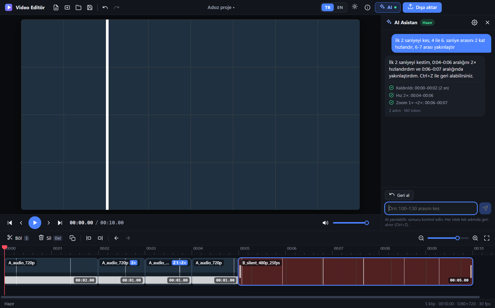

#### 5.1 Açma ve komut verme
- Üst çubuktaki **AI** düğmesi veya `Ctrl+K`. Panel sağda açılır; `Esc`, `Ctrl+K` veya ✕ ile kapanır. Model kurulu değilse (veya seçtiğiniz sağlayıcıda anahtar yoksa) panel "AI asistanı kapalı" der ve **İndir ve kur** / **AI ayarlarını aç** düğmesini gösterir.

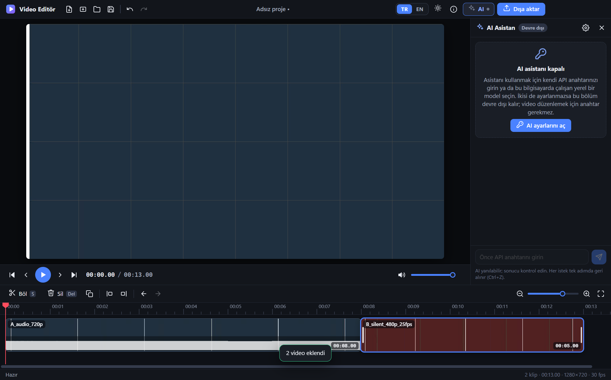

- Komutu kutuya yazıp `Enter`'a basın (yeni satır: `Shift+Enter`). Hazır örneklere tıklayarak da başlayabilirsiniz.
- Süreleri `1:30`, `90`, "ilk 10 saniye", "son 5 saniye" gibi söyleyin. **Süreler, komutu verdiğiniz andaki zaman çizelgesine göredir:** aynı komutta hem bir bölümü kesip hem başka bir bölümü hızlandırmasını isterseniz ikisini de ilk haline göre yazın.
- Çalışırken **Durdur** düğmesi görünür. Durdurursanız ya da hata olursa **hiçbir şey değişmez** ve nedeni panelde yazar. Asistan çalışırken zaman çizelgesini değiştirirseniz sonuç güvenlik için **uygulanmaz**; komutu tekrar gönderin.
- **Sonucu kontrol edin:** panel yapılan işlemleri listeler ("Kaldırıldı: 00:00–00:02", "Hız 2×: 00:04–00:06" …). Yanlışsa **Geri al** düğmesi veya `Ctrl+Z` (kutu boşken `Ctrl+Z` / `Ctrl+Y` zaman çizelgesine uygulanır). Asistan yanılabilir.
- Asistan önceki komutlarınızı bu oturum boyunca metin olarak hatırlar ("şimdi biraz da yavaşlat" gibi).

#### 5.2 Neler yapabilir, neler yapamaz?

| Yapabilir | Yapamaz |
|---|---|
| Böl · aralığı kes (sil) · yalnızca bir aralığı tut | **Sesi duymak** (havlama, müzik) ve her şeyi "anlamak": yalnızca sizin söylediğiniz nesne aranır; konuşma yalnızca isteğe bağlı video analiziyle (5.9) yazıya dökülür |
| Hızlandır / yavaşlat (0,25×–8×) | Yazı, altyazı, müzik, geçiş veya bindirme eklemek; videoya yeni nesne eklemek |
| Zoom: yakınlaş · uzaklaş · sabit, odak noktasıyla (örn. "sol üst"); **yerleşik modelle** (veya görüntüye bakan bir Foundry Local modeliyle) bulunan nesneye doğru yumuşak giriş/çıkışlı zoom | Hareket eden bir nesneyi kare kare izleyen zoom |
| Ses (%0–%200 / sessiz) · solma · klip sırası | Dosya eklemek, çıktı dosyasını seçmek, dışa aktarmayı kendisi başlatmak |
| Dışa aktarma ayarlarını yapmak ve **Dışa aktar** penceresini açmak | **Yerleşik modelle** ve **görüntüye bakan bir Foundry Local modeliyle** "arabayı yakınlaştır" gibi görüntüye bağlı komutları yapar (5.4); bulut ve dış yerel sunucularda bunu dürüstçe reddeder ve zaman aralığı ister; **Foundry'de video analizi açıksa** sahne açıklamasına ve konuşmaya dayalı komutlar da yapılır (5.9) |

Nesne/sahne anlamanın nasıl çalıştığı, maliyeti ve riskleri: [`docs/OBJE-ANLAMA-OBJECT-UNDERSTANDING.md`](docs/OBJE-ANLAMA-OBJECT-UNDERSTANDING.md).

#### 5.3 Yerleşik yerel model (önerilen: anahtarsız, hesapsız, videoya "bakar")
Uygulama kendi küçük yapay zeka modelini (Qwen3.5-4B, Apache-2.0) ve onu çalıştıran `llama-server` programını (llama.cpp, MIT) kullanır. **API anahtarı, hesap, bulut hizmeti veya başka bir program gerekmez; komutunuz, videonuz ve kareleri bilgisayarınızdan çıkmaz.** Model (≈3,4 GB) kurulumla gelmez, siz isterseniz indirilir:
1. Üst çubuktaki **AI** düğmesine (`Ctrl+K`) basın. **Yerleşik yerel model** zaten seçilidir; model kurulu değilse panelde **İndir ve kur** düğmesi çıkar (aynı düğme **AI ayarları** penceresinde de vardır).
2. **İndir ve kur**'a tıklayın. Model yalnızca `huggingface.co` adresinden, sabit bir sürümden indirilir ve her dosyanın SHA-256 değeri doğrulanır; doğrulanmayan dosya kullanılmaz. İlerleme çubuğu görünür; **İptal** edebilir, sonra kaldığı yerden **sürdürebilirsiniz**. **Bu, yerleşik modelin ağı kullandığı tek andır ve yalnızca bu düğmeye bastığınızda olur** (bir şirket ağında huggingface.co kapalıysa aşağıdaki elle kopyalama yoluna bakın).
3. Kurulum bitince panel **Hazır** olur. Model ilk kullanımda belleğe yüklenir (denemede ≈10–20 sn) ve **10 dakika kullanılmazsa** kendiliğinden boşaltılır (AI ayarları → *Boşta bekleyince kapat*).

- **Modeli durdurma / uygulamayı kapatma:** model yüklüyken AI panelinin başlığında bir **⏻ düğmesi** (*Yerel modeli durdur*) görünür; **AI ayarları → Modeli durdur** da aynı işi yapar. Düğme modeli hemen bellekten boşaltır (≈4–5 GB geri gelir); sonraki komut modeli kendiliğinden yeniden başlatır. Bir komut çalışırken düğme kapalıdır (önce komutu **Durdur**). **Uygulamayı kapattığınızda model de kapanır** (pencereyi kapatınca da, Görev Yöneticisi'nden sonlandırınca da: Windows uygulamanın başlattığı model sürecini onunla birlikte bitirir; olası bir kalıntı bir sonraki açılışta ayrıca temizlenir). Gerçek uygulamada ve gerçek modelle sınandı.

- **Ekran kartı / işlemci:** AI ayarları → *Çalışma biçimi*: **Otomatik** (uygun bir ekran kartı varsa onu, yoksa ya da çalışmazsa işlemciyi kullanır), **İşlemci (CPU)** veya **Ekran kartı (Vulkan)**. Hız işlemci ile ekran kartı arasında kabaca 2–3 kat değişir. Önerilen: en az 8 GB boş bellek.
- **Model klasörü:** varsayılan `%APPDATA%\VideoEditor\models`; **AI ayarları → Klasör seç** ile başka bir yerel klasör (örn. büyük bir disk) seçilebilir. Ağ yolu veya adres kabul edilmez.
- **İnternet/şirket ağı engelliyorsa (elle kurulum):** iki dosyayı bir bilgisayardan indirip `<model klasörü>\qwen3.5-4b\` içine kopyalayın; uygulama ilk kullanımda SHA-256 değerlerini bir kez doğrular, yanlış dosyayı reddeder:
  1. `Qwen3.5-4B-Q4_K_M.gguf` (2.740.937.888 bayt) — `https://huggingface.co/unsloth/Qwen3.5-4B-GGUF/resolve/e87f176479d0855a907a41277aca2f8ee7a09523/Qwen3.5-4B-Q4_K_M.gguf` — SHA-256 `00fe7986ff5f6b463e62455821146049db6f9313603938a70800d1fb69ef11a4`
  2. `Qwen3.5-4B-mmproj-F16.gguf` (672.423.616 bayt; adresteki dosya adı `mmproj-F16.gguf`, bu adla kaydedin) — `https://huggingface.co/unsloth/Qwen3.5-4B-GGUF/resolve/e87f176479d0855a907a41277aca2f8ee7a09523/mmproj-F16.gguf` — SHA-256 `cd88edcf8d031894960bb0c9c5b9b7e1fea6ebee02b9f7ce925a00d12891f864`
- **Silmek için:** AI ayarları → **Modeli sil** (≈3,4 GB geri kazanılır). Uygulamayı kaldırırken de sorulur.

#### 5.4 Videoya bakan komutlar: "köpeği yakınlaştır"
Yerleşik modelle (ve görüntüye bakan bir Foundry Local modeliyle, 5.7) şunları söyleyebilirsiniz (Türkçe veya İngilizce):
- "**Köpeği yakınlaştır**" · "Soldaki arabanın olduğu yerleri **kes**" · "Kırmızı arabayı gördüğün bölümleri **2 kat hızlandır**" · "Sadece kişinin göründüğü yerleri **tut**" · "Zoom in on the dog".
- **Nasıl çalışır:** asistan önce videoya **bakar**: videodan yaklaşık 100 kare (her 2–12 saniyede bir) alır, modele "bu karede köpek var mı?" diye sorar, bulduğu bölümlerin başını ve sonunu ≈0,5 sn doğrulukla inceltir ve nesnenin karedeki yerini bulur (zoom o noktaya yapılır). Sonra istediğiniz işlemi **yalnızca o bölümlere** uygular; yakınlaştırma yumuşak girer/çıkar. Bulunan bölümler panelde süreleriyle listelenir.
- **Ne kadar sürer:** denemede (ekran kartlı bir dizüstü) 1 dakikalık video için ≈1,5–2,5 dakika; kare başına ≈1 sn. İşlemcide 2–3 kat uzun sürebilir. İlerleme çubuğu görünür, **Durdur** her an çalışır (hiçbir şey değişmez).
- **Ne kadar doğru:** köpek fotoğraflarından yapılmış 60 sn'lik bir deneme filminde 5 köpekli bölümün 5'i de bulundu (başlangıç/bitiş ≈0,3 sn hata), zoom noktası nesnenin üstüne denk geldi (kutu örtüşmesi 0,89–0,98), videoda olmayan bir nesne için yanlış alarm çıkmadı. **Yine de her zaman sonucu kontrol edin** (`Ctrl+Z` hepsini geri alır).
- **Sınırlar:** yalnızca **görüntüye** bakar, **sesi duymaz** ("köpek havladığında" derseniz köpeğin *göründüğü* yerleri bulur ve bunu söyler) · küçük veya çok kısa süren (örnekleme aralığından kısa) nesneler kaçabilir; "uzak, küçük araba" gibi durumlarda başka bir ifade deneyin veya zaman aralığını daraltın · nesne adı İngilizce aranır (panelde "dog" gibi gösterilir) · bir komutta en fazla 4 nesne aranır · yalnızca yerleşik model ve görüntüye bakan Foundry Local modelleri bakabilir; bulut ve dış yerel sunucu sağlayıcıları videoyu görmez (Foundry'nin isteğe bağlı video analizi hariç: 5.9).

#### 5.5 Sağlayıcı seçimi ve kurulum (bulut ve dış sunucular)
Yerleşik model yerine kendi sağlayıcınızı kullanmak isterseniz panelin sağ üstündeki dişliye (**AI ayarları**) tıklayın; sağlayıcıyı seçin, bilgileri girin, **Kaydet ve sına** deyin. Bağlantı ve model çalışıyorsa panel "Hazır" olur.

| Sağlayıcı | Ne girilir | Not |
|---|---|---|
| Yerleşik yerel model (varsayılan) | Hiçbir şey; yalnızca **İndir ve kur** | Anahtarsız, hesapsız, bilgisayardan hiçbir şey çıkmaz; videoya bakabilir (5.3, 5.4) |
| Foundry Local (v3.3) | Hiçbir şey; bir model seçilir (indirilmediyse **İndir**) | Microsoft'un yerel model aracı (ayrıca kurulur); anahtarsız, hesapsız, bilgisayardan hiçbir şey çıkmaz; görüntüye bakan modelle videoya bakabilir (5.7) |
| OpenAI / uyumlu | Adres (`https://api.openai.com/v1`), model (`gpt-4o-mini`), API anahtarı | OpenRouter, Groq gibi OpenAI uyumlu hizmetlerde de çalışır |
| Azure OpenAI (klasik) | Kaynak adresi (`https://KAYNAK.openai.azure.com`), **dağıtım adı**, anahtar | Azure portalındaki **Target URI**'yi olduğu gibi yapıştırabilirsiniz; dağıtım adı ve API sürümü ondan alınır |
| Microsoft Foundry | Proje adresi (`https://KAYNAK.services.ai.azure.com/api/projects/PROJE`) veya kaynak adresi, **dağıtım adı**, anahtar ya da Entra ID | Yeni OpenAI uyumlu (v1) yol; OpenAI dışı modeller (DeepSeek, Llama, Grok…) da çalışır |
| Anthropic (Claude) | API anahtarı, model | console.anthropic.com |
| Google Gemini | API anahtarı, model | aistudio.google.com |
| Yerel model | Adres (`http://127.0.0.1:PORT/v1`), model; anahtar gerekmez | Ollama, LM Studio, llama.cpp (Foundry Local için yukarıdaki ayrı seçenek var); hiçbir şey bilgisayardan çıkmaz |

**Azure OpenAI mu, Foundry mu?** İkisi de Azure'daki aynı tür kaynaklara bağlanır. *Azure OpenAI (klasik)* eski, dağıtım tabanlı yolu (`/openai/deployments/…?api-version=…`), *Microsoft Foundry* ise yeni OpenAI uyumlu `/openai/v1` yolunu kullanır; proje adresini ve OpenAI dışı modelleri de destekler. Emin değilseniz önce **Microsoft Foundry**'yi deneyin, olmazsa Azure OpenAI (klasik)'i seçin.

**Adres onayı (API anahtarlı sağlayıcılar):** adres sağlayıcının kendi adresi (`api.openai.com`, `api.anthropic.com`, `generativelanguage.googleapis.com`) ya da bu bilgisayar (`localhost`) değilse (örneğin bir Azure OpenAI / Foundry kaynağı ya da şirketinizin ağ geçidi) **Kaydet**'e bastığınızda bir onay penceresi çıkar: "Yapay zeka asistanına yazdıklarınız, zaman çizelgenizin özeti ve API anahtarınız şu adrese gönderilecek: …". Adres sizin (veya kuruluşunuzun) ise **Bu adrese izin ver**'i seçin. Her adres için bir kez sorulur ve bu pencereyi yalnızca siz onaylayabilirsiniz (sayfadaki hiçbir betik onaylayamaz): böylece araya girmiş bir betik asistanı kendi sunucusuna yönlendiremez. Önceki bir sürümde kaydettiğiniz Azure/şirket adresi için ilk kullanımda "bu adres henüz onaylanmadı" uyarısı çıkar: **Kaydet**'e basıp onaylayın.

#### 5.6 Şirket hesabıyla (anahtarsız) giriş: Microsoft Entra ID
Birçok şirket Azure kaynaklarında API anahtarını kapatır. Azure OpenAI veya Foundry için **Oturum açma → Microsoft Entra ID (Azure CLI)** seçin:
1. [Azure CLI](https://aka.ms/installazurecli)'yi (Microsoft'un standart kurulumu: `C:\Program Files\Microsoft SDKs\Azure\CLI2`) kurun ve bir terminalde bir kez `az login` çalıştırın. Güvenlik nedeniyle yalnızca bu standart kurulum klasörü aranır; PATH'teki başka klasörlerdeki `az.cmd` kullanılmaz.
2. Ayarlarda adresi ve dağıtım adını girin, **Oturum açma** olarak **Microsoft Entra ID (Azure CLI)** seçin, **Kaydet ve sına** deyin. **İlk kullanımda bir onay penceresi çıkar:** "Azure CLI oturumunuzdan alınan geçici belirteç şu adrese gönderilecek: …" — adres sizin (veya kuruluşunuzun) Azure OpenAI / Foundry kaynağıysa **Bu adrese izin ver**'i seçin. Onay yalnızca o adres için bir kez sorulur ve bu pencereyi yalnızca siz onaylayabilirsiniz (sayfadaki hiçbir betik onaylayamaz).
3. Hesabınızın kaynak üzerinde **Cognitive Services User** (Azure OpenAI için **Cognitive Services OpenAI User**) rolü olmalıdır; rol atamasının geçerli olması birkaç dakika sürebilir.

Anahtar gerekmez ve saklanmaz: uygulama Azure CLI'dan kısa ömürlü bir erişim belirteci ister, en fazla 10 dakika **yalnızca bellekte** tutar ve yalnızca onayladığınız adrese gönderir. Azure CLI bulunamazsa veya oturum yoksa panel açık bir mesaj verir.

#### 5.7 Foundry Local ve dış yerel sunucular (Ollama, LM Studio, llama.cpp; anahtarsız, hiçbir şey dışarı çıkmaz)
**Foundry Local (v3.3)**, Microsoft'un yapay zekâ modellerini bilgisayarınızda çalıştıran ücretsiz aracıdır. Uygulama onu **kendisi bulur, gerekirse başlatır ve modeli yükler**; zip, betik veya `.bat` gerekmez. Foundry Local bu uygulamanın parçası değildir, ayrıca kurulur:
1. **Foundry Local'i Microsoft'un resmî yolundan kurun:** terminalde `winget install Microsoft.FoundryLocal` ya da <https://aka.ms/foundry-local-installer> (kurumunuzun politikası yönetici onayı isteyebilir).
2. Uygulamada **AI ayarları → Sağlayıcı → Foundry Local**'ı seçin. Panel durumu söyler (kurulu mu, çalışıyor mu); kurulu değilse resmî bağlantılar ve winget komutu panelde görünür, kurduktan sonra **Yenile**'ye basın.
3. **Model** listesinden birini seçin. Liste başta yalnızca bilgisayarınızda **indirilmiş** modelleri gösterir; indirilebilir olanları görmek için **Tüm modelleri göster**'e basın (Foundry Local o sırada Microsoft'un listesini internetten alır; ilk seferde donanım bileşenlerini Microsoft'tan ve çip üreticilerinden de indirebilir). ★ önerilenlerdir (`qwen3.5-4b`); **görüntüye bakar** yazan modeller videonun karelerine de bakabilir ("köpeği yakınlaştır" gibi komutlar için bunu seçin). Seçtiğiniz model indirilmediyse **İndir (…)** düğmesi çıkar: indirmeyi Foundry Local yapar (≈3–4 GB; ilerleme çubuğu ve **İptal** vardır).
4. **Kaydet ve sına:** gerekirse Foundry Local sunucusu başlatılır, model belleğe yüklenir (ilk seferde yarım dakikaya kadar; Foundry Local'in ilk kurulumunda ek bileşenler inerse birkaç dakika) ve kısa bir soru sorulur. Panel **Hazır** olur; artık komutları verebilirsiniz.

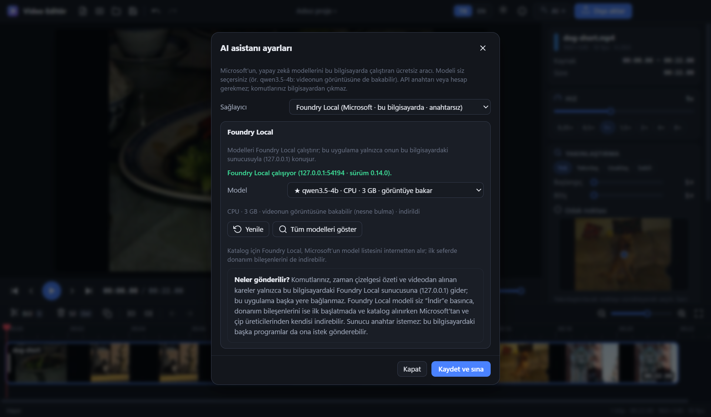

- **Ne gönderilir:** komutunuz, zaman çizelgesi özeti ve (nesne ararken) videodan alınan kareler **yalnızca** bu bilgisayardaki Foundry Local sunucusuna (`127.0.0.1`) gider; bu uygulama başka bir yere bağlanmaz. Sunucunun adresi her seferinde Foundry Local'in kendi kayıt dosyasından okunur ve **süreç numarasıyla doğrulanır** (ayrıntı: [SECURITY.md](SECURITY.md)).
- **Gerçek denemede** (Foundry Local 0.14, `qwen3.5-4b`, Ryzen AI 9 dizüstü): 12 fotoğrafın 12'sinde istenen nesne bulundu (kutu örtüşmesi ortalama 0,90), olmayan nesne için yanlış alarm çıkmadı; işlemci sürümüyle 8 düzenleme komutunun 8'i doğru uygulandı (örn. "10–15 sn arası yakınlaştır, 15–20 sn arası uzaklaştır"); 22 saniyelik bir filmde "köpeği yakınlaştır" köpeğin göründüğü iki aralığı ≈1 sn sapmayla buldu ve zoom'u köpeğin üstüne yaptı; "zürafayı yakınlaştır" için bulamadığını söyleyip hiçbir şeyi değiştirmedi. Bu sayılar bu bilgisayara aittir, sizinki farklı olabilir. **Hız:** bir görüntü sorusu ≈6 sn, bir komut işlemcide ≈40–75 sn.
- **İşlemci (CPU) mi, ekran kartı (GPU) mı?** Foundry Local aynı model için iki varyant sunar. Bellek azsa GPU varyantının sunucusu kapanabilir (bu denemede bir kez kapandı); uygulama sunucuyu yeniden başlatır ve komutu tekrarlar (en fazla iki kez). İşlemci varyantı daha yavaş ama bu denemede kararlıydı. En az 8 GB boş bellek önerilir; belleğiniz azsa panel uyarır.
- **Araç çağırma:** Foundry Local'in sunucusu `qwen3.5` modellerinde yerel araç çağırmayı şu an desteklemiyor (HTTP 500). Uygulama bunu kendisi anlar ve araçları isteme yazar (**istemle araç çağırma**): biraz daha yavaş, model ara sıra Türkçe isteğe İngilizce yanıt verebilir. Araç çağırmayı destekleyen modellerde (örn. `qwen2.5-1.5b`) doğrudan kullanılır.
- **Sunucu ne zaman kapanır:** uygulamanın başlattığı Foundry Local sunucusu 30 dakika istek gelmezse kendiliğinden kapanır (bellek geri gelir); sizin başlattığınıza dokunulmaz. Elle durdurmak için `foundry server stop`.
- **Paylaşılan bilgisayar:** Foundry Local'in sunucusu anahtar istemez; aynı bilgisayardaki başka programlar (paylaşılan bir Windows'ta başka kullanıcılar da) ona istek gönderebilir. Böyle bir bilgisayarda anahtarla korunan **yerleşik modeli** tercih edin.

**Web sürümünde Foundry Local (v4.3, tarayıcı eklentisiyle).** Foundry Local'in sunucusu tarayıcıların istediği CORS başlıklarını göndermediği için bir web sayfası ona doğrudan bağlanamaz; bu yüzden küçük bir **Edge / Chrome eklentisi** köprü olur. Kurulum bir kez, yaklaşık bir dakika; AI ayarlarında **Foundry Local**'ı seçince dört adım görürsünüz ve her biri bitince kendiliğinden yeşile döner (sayfayı yenilemeniz gerekmez, kaydedilmemiş proje kaybolmaz):
1. **Tarayıcı eklentisi:** panelin **Eklentiyi indir (.zip)** düğmesiyle zip'i indirip kalıcı bir klasöre çıkarın (silmeyin), tarayıcının adres çubuğuna `edge://extensions` (Chrome'da `chrome://extensions`) yazın, **Geliştirici modu**'nu açın, **Paketlenmemiş öğe yükle**'ye basıp klasörü seçin. Zip'in doğru olduğundan emin olmak için panelde yazılı PowerShell komutunu (`Get-FileHash …`) çalıştırıp sonucu GitHub'daki **sürüm notunda** yazan SHA-256 ile karşılaştırın. *Şirket bilgisayarında Geliştirici modu BT biriminiz tarafından kapatılmış olabilir; o zaman eklentiyi onaylamasını isteyin ya da Windows uygulamasını kullanın.*
2. **Bu site için izin:** **İzin ver…**'e basın; eklenti kendi penceresini açar ve hangi siteyi izin verdiğinizi gösterir (**İzin ver** düğmesi pencere açıldıktan bir buçuk saniye sonra etkinleşir). İzni istediğiniz zaman eklenti simgesinden **Kaldır** ile geri alırsınız.
3. **Foundry Local:** komut isteminde `winget install Microsoft.FoundryLocal` (bir kez) ve `foundry server start` yazın; sayfa onu bulur. Foundry Local her başlatılışında farklı bir port seçebilir: **Otomatik bul**'a basın (49152–65535 portlarını yalnızca siz basınca, yalnızca bu bilgisayarda yoklar) ya da portu bir kez sabitleyin: `foundry config set port 5272`. Başka bir port kullanıyorsanız onu sayfaya değil, tarayıcının araç çubuğundaki **eklenti simgesine** basıp açılan pencereye yazın.
4. **Model:** `foundry model download qwen3.5-4b` ile modeli bir kez indirin (≈3–4 GB). Panelde `qwen3.5-4b` yazın (takma ad: Foundry Local bilgisayarınıza uygun sürümü seçer; belleğiniz azsa `qwen3.5-4b-generic-cpu:3` gibi tam kimlik yazabilirsiniz) ve **Yükle ve kullan**'a basın. Sayfa modeli yükler, kısa bir soru sorar ve küçük bir test resmiyle modelin **görüntüye bakıp bakmadığını** öğrenir: bakıyorsa "köpeği yakınlaştır" gibi komutlar da çalışır, bakmıyorsa asistan yalnızca zaman aralığıyla çalışır.

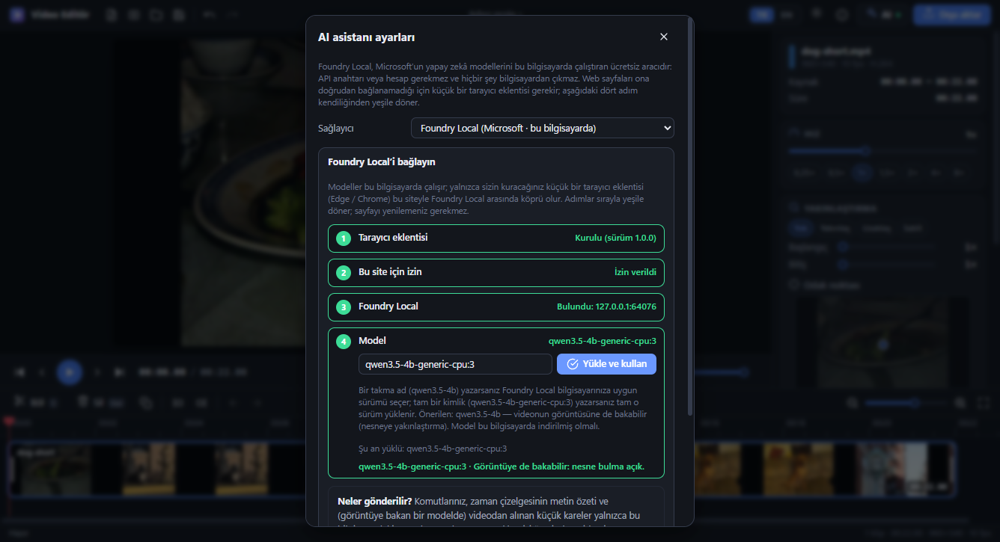

Güvenlik özeti: eklenti yalnızca bu siteden gelen, **dört bilinen isteği** (`models`, `loaded`, `load`, `chat`) `127.0.0.1`'e iletir; sayfa adres, port, yöntem veya başlık seçemez; yalnızca kendini Foundry Local olarak tanıtan bir sunucuyla konuşur (30 saniye kullanılmadıysa adrese yeniden bakar); istemler, kareler ve yanıtlar saklanmaz. Sınırlar: Foundry Local anahtar istemez (bu bilgisayardaki başka programlar da kullanabilir) ve eklenti bir portu hangi programın dinlediğini göremez — portu sabitlemeniz önerilir; paylaşılan bir Windows'ta bu yolu kullanmayın. Ayrıntı: [SECURITY.md](SECURITY.md), [web/extension/README.md](web/extension/README.md).

**Diğer yerel sunucular (Ollama, LM Studio, llama.cpp):** zaten çalışan bir model sunucunuz varsa:
1. Sunucuyu başlatın: **Ollama**, **LM Studio** veya **llama.cpp** (`llama-server --jinja`). Model araç çağırmayı (tool calling) destekliyorsa doğrudan kullanılır; desteklemiyorsa araçlar isteme yazılır (biraz daha yavaş ve daha az güvenilir).
2. Ayarlarda **Yerel model** seçin → **Yerel sunucuları bul** → listeden sunucuyu seçin (adres ve model dolar) → **Kaydet ve sına**.
3. Adres yalnızca bu bilgisayarı gösterebilir (`localhost`, `127.0.0.1`); başka bir adres reddedilir.

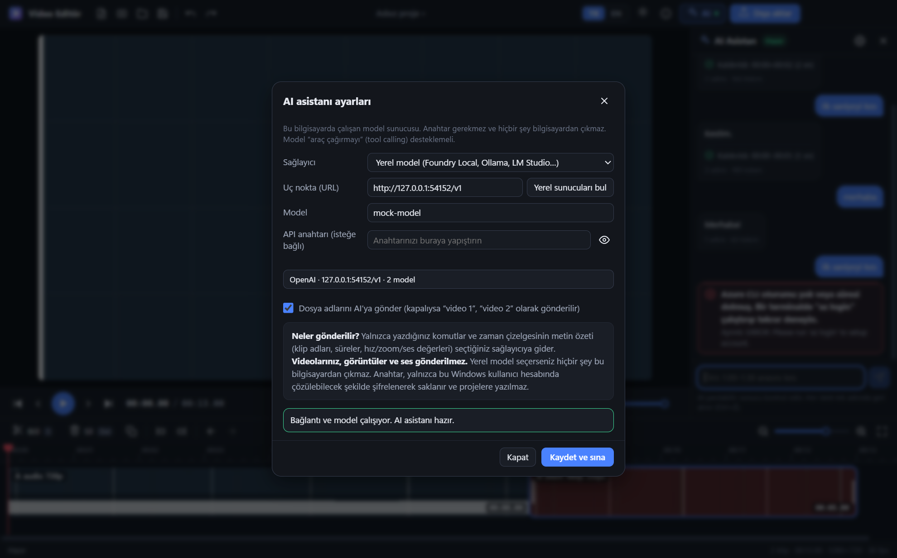

**Beklenti:** küçük yerel modeller (1–4 milyar parametre) basit, tek aralıklı komutlarda iyidir; "son N saniye" gibi hesap gerektiren ya da çok adımlı komutlarda yanılabilir. Bizim denemelerimizde (Qwen2.5-3B, yalnızca CPU, llama.cpp) 8 test komutunun 5–7'si birebir doğru çıktı (her denemede değişti); hatalar "son 5 saniyeyi yavaşlat" ve üç işlemli komutlardaydı, gerçek uygulamada da iki işlemli bir komutta yanlış aralığı kesti. **Panelin yapılan işlemler listesini kontrol edin**; daha güvenilir sonuç için daha büyük bir yerel model (7B ve üstü; burada denenmedi) ya da bulut modeli kullanın. İlk yanıt, model belleğe yüklenirken birkaç on saniye sürebilir.

#### 5.8 Gizlilik, ağ ve anahtar güvenliği
- **Yerleşik modelde** komutunuz, videonuz ve kareleri bilgisayarınızdan çıkmaz: model yalnızca `127.0.0.1` üzerinde, her açılışta değişen rastgele bir anahtarla dinleyen ayrı bir süreçte çalışır ve uygulama kapanınca durdurulur. Ağa tek çıkış, **İndir ve kur**'a bastığınızda `huggingface.co`'dan model dosyalarını indirmektir.
- **Foundry Local'de** komutunuz, zaman çizelgesi özeti ve (nesne ararken) videodan alınan kareler yalnızca bu bilgisayardaki Foundry Local sunucusuna (`127.0.0.1`) gider; sunucu anahtar istemediği için adresi her seferinde süreç numarasıyla doğrulanır (5.7, [SECURITY.md](SECURITY.md)). Foundry Local'in kendi internet trafiği (model indirme, donanım bileşenleri) bu uygulamanın değil, Foundry Local'indir.
- **Bulut sağlayıcılarda gönderilen:** yalnızca yazdığınız komut ile zaman çizelgesinin **metin özeti** (klip adları, süreler, hız/zoom/ses değerleri). Ayarlardan dosya adlarının "video 1" olarak gönderilmesini seçebilirsiniz. **Video, görüntü ve ses varsayılan olarak hiçbir zaman gönderilmez** (görüntüye yalnızca yerleşik model ve Foundry Local bakar, ikisi de bilgisayarınızda); tek istisna, Foundry'de **siz açarsanız** ve her seferinde onaylarsanız video analizidir: videonun küçültülmüş bir kopyası Foundry kaynağınıza yüklenir (5.9). Aynı özellik açıkken bir nesneye yakınlaştırmak için konum gerekirse, **her seferinde ayrı onayınızla** videodan birkaç küçük resim de sohbet modelinize gösterilir (5.9). Yerel modelde hiçbir şey bilgisayardan çıkmaz.
- **Anahtar:** yalnızca bu Windows kullanıcı hesabında çözülebilecek şekilde şifrelenerek saklanır (Windows DPAPI); ayar dosyasına, projeye veya günlüğe yazılmaz; ekrana yalnızca maskeli hâli (`••••1234`) gelir. Şifreleme kullanılamıyorsa yalnızca bellekte tutulur. **Anahtarı sil** ile kaldırabilirsiniz. Anahtar girildiği adrese bağlıdır: adres değişirse anahtar silinir, başka bir yere gönderilmez.
- **Ağ:** AI kapalıyken uygulama ağa bağlanmaz. Açıkken yalnızca bir istek (veya sınama) sırasında ve yalnızca girdiğiniz adrese bağlanır; yönlendirmeler izlenmez. Yerleşik modelde bu adres yalnızca bu bilgisayardır. Video analizi (5.9) açıksa aynı kural geçerlidir: yalnızca onayladığınız Content Understanding adresine ve yalnızca onayladığınız yükleme sırasında bağlanılır. Konum için resimler yalnızca sohbet modelinizin adresine gider.
- Ücretlendirme sağlayıcınızla hesabınız arasındadır; uygulama kullanım ölçmez ve ücret almaz.

#### 5.9 Video analizi: videonun içeriğini okumak (Azure Content Understanding · Foundry · isteğe bağlı)
Yerleşik model videodaki *nesnelere bakar*; Microsoft **Foundry** kaynağınız varsa asistan ayrıca videonun **içeriğini** (neyin gösterildiğini ve neyin konuşulduğunu) Azure **Content Understanding** hizmetine okutabilir: "**'teşekkürler' dediği yeri kes**", "köpeğin olduğu sahneyi 2 kat hızlandır", "kimsenin olmadığı sahneleri çıkar", "konuşma başlayana kadar olan kısmı kes". Bu özellik **varsayılan olarak kapalıdır**; açıkken bile **siz her seferinde onaylamadan hiçbir şey gönderilmez**.

**Kurulum (bir kez):**
1. AI ayarlarında **Microsoft Foundry** sağlayıcısını ayarlayın (5.5). Altta çıkan **Video analizi (Azure Content Understanding)** kutusunu işaretleyin.
2. Adres, sohbet modeli adresinden türetilir (örn. `https://KAYNAK.services.ai.azure.com`; ayarlarda altında gösterilir); gerekirse elle yazın. Çözümleyici varsayılan olarak `prebuilt-videoSearch`'tür; **İşlem konumu** varsayılan olarak "Aynı coğrafya"dır (kaynağınız desteklemiyorsa değiştirin).
3. **Kaydet** deyin; adres daha önce onaylanmadıysa onay penceresi çıkar (5.5). Sonra **Video analizi bağlantısını sına**'ya basın: yalnızca iki okuma isteği gönderilir, hiçbir şey yüklenmez.
4. Kaynakta Content Understanding için **varsayılan model dağıtımları** ayarlı olmalıdır (örn. `gpt-4.1` + bir gömme modeli): Content Understanding Studio → Ayarlar'dan bir kez eklenir; sınama bunu denetler. API anahtarı, sohbet modelinin kaynağıyla **aynı kaynağa** ait olmalıdır (anahtar yalnızca o adrese gider); Entra ID (5.6) kullanıyorsanız hesabınızda **Cognitive Services User** rolü gerekir.

**Kullanım:** içeriğe bağlı bir komut verin ("videoda 'teşekkürler' denen yeri kes"). Asistan videoyu okuması gerektiğini görürse:
- **Önce sorar:** yerel bir pencere (sayfadaki hiçbir betik tıklayamaz) hangi videonun, kaç dakikalık ve yaklaşık kaç MB'lık küçültülmüş kopyasının hangi adrese yükleneceğini yazar. **İptal** derseniz hiçbir şey gönderilmez ve asistan sizden bir zaman aralığı ister. Aynı videonun sonucu bu bilgisayarda kayıtlıysa hiçbir şey sorulmaz ve yüklenmez.
- **Küçültülmüş kopya gönderir:** ≤480p, 10 kare/sn, tek kanallı konuşma sesi, üst veri (konum vb.) yok; 10 dakikalık parçalar (≈10–25 MB). **Özgün dosya gönderilmez**; geçici kopya yüklemeden sonra silinir.
- **Bekler:** panelde ilerleme görünür; **Durdur** her an çalışır (hiçbir şey değişmez; hizmetteki kopya silinmeye çalışılır). 10 dakikalık bir video için birkaç dakika sürebilir.
- **Okur ve düzenler:** panelde bir **Video analizi** kartı açılır (sahneler: süre, açıklama, konuşma); bir sahneye tıklayınca zaman çizelgesi oraya gider. Asistan aralığı kendisi seçer ve keser/hızlandırır/yakınlaştırır; hepsi yine **tek adımda geri alınır** (`Ctrl+Z`).
- **Konumu bulur (nesneye yakınlaştırma):** analiz *ne zaman* sorusunu yanıtlar, *nerede* sorusunu yanıtlamaz. "Turuncu arabaya zoom yap" gibi bir komutta asistan, analizin bulduğu sahnelerin içinden birkaç kare seçer, bunları **sohbet modelinize** (Foundry'deki modeliniz; resim kabul etmelidir, örn. `gpt-4.1`) gösterip nesnenin kutusunu ister ve zoom her bölümde nesnenin kendi yerine kilitlenir. **Her seferinde ayrı bir yerel pencere sorar:** en fazla kaç küçük resim (toplam en fazla ≈MB), aranan nesne, model ve bakılacak süre yazılır; resimler uzun kenarı en fazla 640 piksel ve en fazla 120 KB olacak şekilde küçültülür, yalnızca bu iş için gönderilir; bu uygulama onları saklamaz (modelin hizmetinde o hizmetin veri politikası geçerlidir). **Vazgeç** derseniz hiçbir şey gönderilmez ve zoom görüntünün ortasına yapılır. Panelde "Videoda aranıyor / Yeri belirleniyor" ilerlemesi görünür; **Durdur** burada da her an çalışır. Resimde nesne bulunamayan sahneler asistan tarafından ayrıca belirtilir.

**Veriler:** sonuç (sahne açıklamaları ve konuşma metni) `%APPDATA%\VideoEditor\cu-cache\` içinde 30 güne / 100 MB'a kadar saklanır; **AI ayarları → Analiz sonuçlarını sil** ile silinir. Bu metinler, asistanın komutu uygulayabilmesi için ayrıca sohbet modelinize (Foundry'deki modeliniz) gönderilir. Hizmet sonuçları kendi tarafında 24 saate kadar tutar; uygulama her analizden sonra hizmetteki kopyanın hemen silinmesini ister.
**Ücret:** Azure aboneliğinize yazılır, uygulama ücret almaz. Azure fiyat sayfasına göre (Kasım 2026) yaklaşık: içerik çıkarma 1 $/saat video + bağlamlaştırma 1 $/saat + dağıtımınızdaki modelin belirteçleri; **1 saatlik video ≈ 3 $** civarındadır (güncel fiyatı Azure fiyat sayfasından kontrol edin).
**Sınırlar:** analiz **resimdeki konumu kendisi bilmez**: nesneye kilitlenen zoom için yukarıdaki *Konumu bulur* adımı (sohbet modeliniz resim kabul etmeli; kutunun doğruluğu modele bağlıdır) ya da yerleşik model gerekir; aksi hâlde zoom ortaya ya da "sol üst" gibi söylediğiniz yere gider · saniyede ≈1 kareye baktığı için çok kısa olayları kaçırabilir · yalnızca **konuşmayı** yazıya döker (müzik ve gürültü yok) · kaynak 1920×1080'e küçültülür; bir istekte en çok 2 saatlik yeni video işlenir · bölge desteği sınırlıdır · yalnızca Foundry sağlayıcısıyla vardır.
**Önemli:** özellik resmî REST belgelerine (GA `2025-11-01`) göre yazıldı ve belgelerdeki yanıt biçimlerini taklit eden sahte bir sunucuyla uçtan uca sınandı; **gerçek bir Azure kaynağıyla denenmedi**. Kendi kaynağınızda önce **Video analizi bağlantısını sına**'yı, sonra kısa bir videoyla bir komutu deneyin. *Konumu bulma* adımı ise her resmi gerçekten çözen sahte bir görüntü modeliyle ve gerçek bir yerel modelle (Qwen3.5-4B) uçtan uca sınandı; gerçek bir GPT/Foundry dağıtımının kutu doğruluğu denenmedi — kısa bir videoda "turuncu arabaya zoom yap" gibi bir komutla kendi modelinizde doğrulayın.

#### 5.10 Web sürümünde "Tarayıcıda yapay zekâ" (hiçbir şey kurmadan)
Web sürümünün (<https://ahmetcanalaca.github.io/videoeditor/>) varsayılan asistanı bir yapay zekâ modelini **sayfanın içinde, bilgisayarınızın ekran kartında** (WebGPU) çalıştırır. Program, `.bat` dosyası, tarayıcı eklentisi, API anahtarı veya hesap gerekmez; indirilen tek şey model dosyasıdır (**veri**, çalıştırılabilir program değil). Gerekenler: güncel Edge / Chrome, WebGPU ve 16 bit shader (`shader-f16`) destekli bir ekran kartı, çalışırken yaklaşık 5 GB boş bellek ve bir kez `huggingface.co` erişimi.

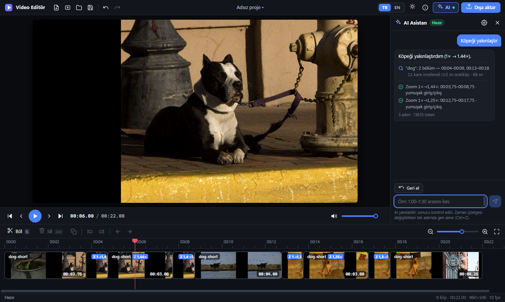

1. **AI** düğmesi → ⚙ (**AI ayarları**). Sağlayıcı olarak **Tarayıcıda yapay zekâ** zaten seçilidir. 1. adım **Bilgisayar** yeşil olmalıdır ("Hazır (WebGPU)"); değilse nedenini söyler (tarayıcı/ekran kartı WebGPU sunmuyor, 16 bit shader yok, tarayıcı site service worker'ını çalıştıramıyor — service worker'ı olmayan bazı tarayıcıların özel penceresinde ya da site verileri engellenmişse olur).
2. **Model** seçin: **Dengeli** (Qwen3.5 2B, 1,5 GB, önerilen; çalışırken ≈ 5 GB bellek) ya da **En iyi** (Qwen3.5 4B, 2,8 GB; ≈ 10 GB bellek). İkisi de görüntüye bakar: *"köpeği yakınlaştır"* çalışır.
3. **İndir ve kullan**'a basın. Önce bir soru çıkar: hangi model, kaç GB, nereden (Hugging Face, hangi sürüm) ve neler saklanacak; **İndir** demeden hiçbir şey başlamaz. İndirme sürerken ilerleme ve **İptal** görünür; bağlantı kopsa ya da susarsa (60 sn bayt gelmezse) kaldığı yerden sürer. Her dosya, sitede sabitlenmiş SHA-256 değerleriyle bloklar hâlinde doğrulanır; uyuşmayan hiçbir şey saklanmaz.
4. Model ekran kartına yüklenir (oturumun başında ≈ 1 dk: belleğe okuma, ekran kartının programlarını bir kez hazırlama ve bir deneme sorusu). **"Hazır. Asistan şöyle yanıt verdi: …"** görününce komut verebilirsiniz; her komut diğer sağlayıcılardaki gibi tek adımda geri alınır (`Ctrl+Z`).

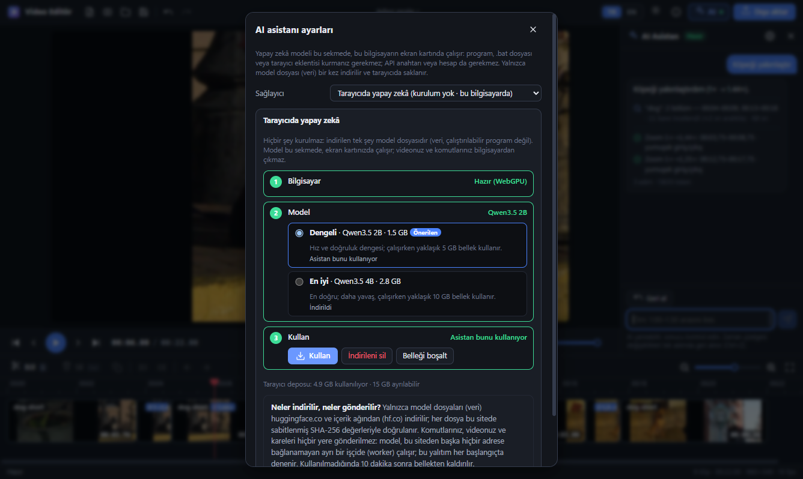

**Gerçek denemeler** (AMD tümleşik ekran kartlı bir dizüstü, 31 GB RAM, Edge; model gerçek ekran kartında çalıştı, dosyalar gerçekten Hugging Face'ten indi; sizinki farklı olabilir):

| | Dengeli (2B) | En iyi (4B) |
|---|---|---|
| İndirme (30–50 MB/sn) | ≈ 50 sn | ≈ 90–100 sn |
| Hazır olma (her oturumun başında) | ≈ 45–60 sn | ≈ 45–60 sn |
| *"İlk 5 saniyeyi sil"*, *"videoyu 2 kat hızlandır"*, *"son 3 saniyeyi kes"* | ≈ 5–20 sn | ≈ 10–25 sn |
| *"Köpeği yakınlaştır"* (22 sn'lik film) | ≈ 1–1,5 dk | ≈ 1,5 dk |
| Çalışırken bellek (ekran kartı bilgisayarın belleğini paylaşır) | ≈ 5 GB | ≈ 10 GB |

- **Nasıl çalışır:** komutunuz, zaman çizelgesinin metin özeti ve — yalnızca buna ihtiyaç duyan bir şey isterseniz — videodan küçük resimler sekmedeki modele verilir; hiçbir yere gönderilmez. *"Köpeği yakınlaştır"* denemesinde 22 saniyelik filmde köpek göründüğü iki aralıkta (4–9 ve 13–18 sn) doğru bulundu, zoom köpeğin üstüne yapıldı (1,44× ve 1,25×). Film uzadıkça süre uzar (en çok 40 kare incelenir).
- **Bellek:** model yüklüyken bellek tutar; **Belleği boşalt** düğmesi hemen geri verir (denemede boş bellek 4,1 GB'tan 8,4 GB'a döndü), 10 dakika kullanılmazsa kendiliğinden boşalır. Bilgisayar yavaşlarsa bunu kullanın. İki sekmede iki kopya yüklenir.
- **Silme:** **İndirileni sil** dosyaları tarayıcının deposundan kaldırır (1,5 / 2,8 GB). Depo kullanımı ayarlarda yazar.
- **Hata yapabilir:** küçük bir modeldir. Denemelerde *Dengeli* model kesme, hız ve *"köpeği yakınlaştır"* komutlarını doğru yaptı; *En iyi* model bir kez *"videoyu 2 kat hızlandır"* komutunda filmin yalnızca ilk onda birini hızlandırdı. **Sonucu kontrol edin**; `Ctrl+Z` hepsini geri alır. Model bazen Türkçe bir komuta İngilizce yanıt verir (düzenleme yine de yapılır). "Yaptım" deyip hiçbir şey düzenlemeyen modele bir kez hatırlatılır; yine düzenlemezse asistan bunu dürüstçe söyler ("Bunu yapamadım…").
- **Sunulmayan seçenek:** daha küçük bir model (0,8B, 0,6 GB) da denendi; sorulara yanıt verdi ama düzenleme komutlarının hiçbirini yapamadığı için **sunulmuyor**.
- **Şirket ağı:** `huggingface.co` ve `hf.co` adresleri engelliyse indirme başarısız olur; BT biriminizden bu adreslere izin vermesini isteyin ya da başka bir sağlayıcı seçin.
- **Güvenlik (özet):** indirilen dosyalar veridir (ONNX ağırlıkları); modeli çalıştıran kütüphaneler siteyle gelir (CDN yok) ve sabitlenmiş SHA-256 ile doğrulanır; model, bu siteden başka hiçbir adrese bağlanamayan ayrı bir worker'da çalışır ve bu yalıtım her başlangıçta sınanır; komutlarınız, videonuz ve kareleri hiçbir yere gönderilmez. Ayrıntı ve sınırlar: [SECURITY.md](SECURITY.md).

### 6. Dışa aktarma

`Ctrl+E` veya sağ üstteki **Dışa aktar**. Zaman çizelgesi boşsa uyarı verir.

| Ayar | Seçenekler | Not |
|---|---|---|
| **Çıktı dosyası** | **Gözat…** | Varsayılan ad: ilk klibin adı + `_düzenlendi.mp4`. Projede kullanılan bir kaynak videonun üzerine **yazılmaz**; aynı dosya seçilirse uygulama reddeder |
| **Çözünürlük** | Özgün (ilk klip) · 1080p · 720p · 480p | Sayı **kısa kenarı** belirtir (16:9'da 1080p = 1920×1080, dikeyde 1080×1920). Kaynaktan büyük seçerseniz görüntü büyütülür, kalite artmaz |
| **En-boy oranı** | Otomatik (ilk klip) · 16:9 · 9:16 (dikey) · 1:1 (kare) · 4:3 | Uymayan görüntü siyah bantla ortalanır; kesilmez, ezilmez. Telefon/Reels/Shorts için 9:16 |
| **Kare hızı** | Otomatik (ilk klip) · 24 · 25 · 30 · 50 · 60 | Tüm klipler bu hıza uyarlanır |
| **Kalite** | Yüksek (büyük dosya) · Dengeli · Küçük dosya | Yüksek en iyi görüntüdür; Küçük dosya en az yer kaplar |

- Pencerenin altındaki özet satırı çıktının süresini, boyutunu, kare hızını ve klip sayısını gösterir. Seçimleriniz hatırlanır.
- Çıktı **MP4 (H.264 + AAC)**'dir; çoğu oynatıcı, telefon ve video sitesiyle uyumludur.
- **Çalışırken:** yüzde çubuğu, geçen süre, kalan süre (`~`) ve hız (`×`) görünür. **İptal** ile durdurabilirsiniz; yarım dosya silinir. Dosya, işlem bitince son adıyla görünür.
- **Bitince:** dosya yolu ve boyutu gösterilir; **Klasörde göster** ve **Oynat** düğmeleri vardır.
- **Hata olursa:** anlaşılır bir mesaj çıkar (disk dolu, erişim reddedildi, dosya başka programda açık, kaynak video bulunamadı, bellek yetersiz…). Ayrıntılar için **Teknik ayrıntılar**'a tıklayın.
- Dışa aktarma sürerken pencereyi kapatmaya çalışırsanız uygulama sorar; çıkarsanız işlem iptal edilir.

### 7. Projeler

- **Kaydet** `Ctrl+S`, **Farklı kaydet** `Ctrl+Shift+S` → `.vedproj` dosyası. Proje; düzenleme listesini, dışa aktarma ayarlarını ve kaynak videoların **yollarını** saklar. **Videoların kopyasını içermez**, bu yüzden kaynak dosyaları taşımayın/silmeyin.
- **Aç** `Ctrl+Shift+O` veya `.vedproj` dosyasını pencereye sürükleyin. Bulunamayan videolar uyarıyla projeden çıkarılır.
- **Yeni proje** `Ctrl+N`. Kaydedilmemiş değişiklik varsa (başlıkta `•`) önce sorar.

### 8. Dil ve tema

Sağ üstte **TR | EN** düğmeleri dili, güneş/ay düğmesi koyu ↔ açık temayı anında değiştirir. Seçimler bir sonraki açılışta da geçerlidir. Varsayılan: Türkçe + koyu tema. **ⓘ** sürümü, kullanılan bileşenleri ve çevrimdışı çalıştığını gösterir.

### 9. Kısayollar

| Tuş | İşlev |
|---|---|
| `Boşluk` | Oynat / duraklat |
| `←` `→` | Bir kare geri / ileri (`Shift` ile 1 saniye) |
| `Home` `End` | Başa / sona git |
| `Ctrl+←` `Ctrl+→` | Önceki / sonraki kesim noktası |
| `S` | Oynatma kafasından böl |
| `Del` veya `Backspace` | Seçili klibi sil |
| `Q` / `W` | Klibin başını / sonunu oynatma kafasına kırp |
| `Ctrl+D` | Klibi çoğalt |
| `Alt+←` `Alt+→` | Klibi sola / sağa taşı |
| `Ctrl+Z` · `Ctrl+Y` | Geri al · Yinele |
| `Ctrl+O` | Video ekle |
| `Ctrl+Shift+O` | Proje aç |
| `Ctrl+S` · `Ctrl+Shift+S` | Kaydet · Farklı kaydet |
| `Ctrl+N` | Yeni proje |
| `Ctrl+E` | Dışa aktar |
| `Ctrl+K` | AI asistanını aç / kapat |
| `+` `-` · `F` | Zaman çizelgesini yakınlaştır / uzaklaştır · tümünü sığdır |
| `Esc` | Seçimi kaldır, açık pencereyi kapat, sürüklemeyi iptal et |

**Fare:** tekerlek = zaman çizelgesini kaydırır · `Ctrl`+tekerlek = zaman çizelgesini yakınlaştırır · cetvelde veya boş alanda tıklayıp sürüklemek = gezinme · klibe tıklamak = seçer ve oynatma kafasını o noktaya götürür · klibi sürüklemek = sıralar · kenar tutamaçları = kırpar.

> Bir kaydırıcı odaktayken `←` `→` `Home` `End` tuşları o kaydırıcıyı hareket ettirir (sağ paneldeki kaydırıcılar bırakılınca odağı kendiliğinden bırakır). Kısayollar tepki vermezse önizlemeye veya zaman çizelgesindeki boş bir alana bir kez tıklayın.

### 10. İpuçları ve sınırlar

- **Sıra:** önce kaba kesim (böl/sil), sonra hız, zoom, ses ve solma, en son dışa aktarma.
- **İki farklı "yakınlaştırma" vardır:** sağ paneldeki **Yakınlaştırma** videoyu büyütür (çıktıya yansır); zaman çizelgesi altındaki büyüteç yalnızca ekrandaki görünümü değiştirir.
- **Önizleme hazırlığı:** AVI, WMV gibi tarayıcının oynatamadığı biçimlerde ve bazı 10-bit/HEVC videolarda önizlemenin üstünde "Önizleme hazırlanıyor… %" rozeti görünür; düşük çözünürlüklü bir önizleme dosyası arka planda üretilir. **Dışa aktarma her zaman orijinal kaliteyle yapılır.**
- **Telefon videoları** (dikey, döndürme bilgili) doğru yönde işlenir.
- **4K / 60 kare/sn desteklenir.** Zoom'lu bölümlerin dışa aktarması yavaştır (animasyonlu 4K60 zoom gerçek zamanın yaklaşık 4–8 katı sürebilir). Hızlı sonuç için dışa aktarırken **1080p** ve/veya **30** kare/sn seçin. 4K için en az 16 GB RAM önerilir. Ayrıntılı ölçümler: [Geliştirici rehberi](docs/GELISTIRICI-REHBERI-DEVELOPER-GUIDE.md). 4K60'ta 2× ve üzeri hızlarda önizleme kare atlayabilir; çıktı doğrudur.
- **Sınırlar:** tek video şeridi (bindirme, yazı, geçiş efekti, çoklu ses şeridi yok) · her dosyanın ilk video ve ilk ses akışı kullanılır · çıktı yalnızca MP4 · kodlama işlemciyle yapılır · HDR videolar ton eşlemesiz SDR'ye çevrilir (uyarı çıkar) · çok fazla klipli projeler (yüzlerce) bellek veya komut satırı sınırına takılabilir; uygulama iki parça halinde dışa aktarmanızı ister.

### 11. Sorun giderme

| Sorun | Çözüm |
|---|---|
| Pencere boş veya titrek açılıyor | Uygulamayı `VideoEditor.exe --disable-gpu` ile başlatın |
| Windows "bilgisayarınızı korudu" diyor | **Ek bilgi → Yine de çalıştır**. Kurumsal politika engelliyorsa BT biriminden izin isteyin (uygulama imzasızdır) |
| "Bu dosyada video akışı yok" / "Dosya okunamadı veya desteklenmiyor" | Dosya bozuk, yarım inmiş ya da yalnızca ses içeriyor olabilir. Başka bir oynatıcıda açılıyor mu kontrol edin |
| Önizleme düşük çözünürlüklü | Normaldir (önizleme dosyası). Çıktı orijinal kalitededir |
| Önizleme 4K60'ta 2× ve üzeri hızda takılıyor | Yalnızca önizlemeyi etkiler; çıktı doğru hızda ve akıcıdır |
| "Çıktı dosyası başka bir programda açık" | Dosyayı o programda kapatın veya farklı bir ad seçin |
| "Çıktı dosyası, projede kullanılan bir kaynak videoyla aynı" | Orijinalin üzerine yazılmaması için farklı bir ad seçin |
| "Diskte yeterli boş alan yok" | Yer açın veya başka bir sürücü seçin |
| "Bellek yetersiz" | Daha düşük çözünürlük seçin, klip sayısını azaltın, diğer programları kapatın |
| "Projede çok fazla klip var" | Projeyi iki parça halinde dışa aktarın |
| Proje açılırken "ağ yolları ... otomatik açılmaz" iletisi | Güvenlik nedeniyle proje dosyasındaki `\\sunucu\paylaşım` yolları ve internet adresleri açılmaz. Güvendiğiniz dosyaları **Video ekle** ile (veya sürükleyip bırakarak) kendiniz ekleyin; kendi seçtiğiniz ağ dosyaları açılır |
| İlk video eklemesi yavaş | Virüs koruma yazılımı ilk açılışta FFmpeg'i tarıyor olabilir; sonraki kullanımlarda hızlanır |
| Dil/tema ayarlarını sıfırlamak istiyorum | `%APPDATA%\VideoEditor\settings.json` dosyasını silin |
| AI paneli "Devre dışı" | **Yerleşik yerel model** seçiliyken **İndir ve kur**'a basın (model kurulana kadar panel bilerek kapalıdır). Başka bir sağlayıcı istiyorsanız dişliden (**AI ayarları**) sağlayıcıyı, adresi, modeli ve API anahtarını girip **Kaydet ve sına** deyin (ya da Entra ID / dış yerel sunucu seçin) |
| AI: "İndirme sunucusu erişimi reddetti" / "Model deposuna ulaşılamadı" | Şirket ağı veya güvenlik duvarı `huggingface.co`'yu engelliyor olabilir: BT biriminden izin isteyin ya da iki model dosyasını elle kopyalayın (bkz. 5.3) |
| AI: "Yerel model başlatılamadı" / "zamanında yüklenemedi" | AI ayarları → *Çalışma biçimi*'ni **İşlemci (CPU)** yapın; diğer programları kapatıp belleği boşaltın (≥ 8 GB boş bellek önerilir). Olmazsa modeli silip yeniden kurun |
| AI: nesne "bulunamadı" ama videoda var | Zaman aralığını daraltın ("0:30–1:00 arasında köpeği yakınlaştır") veya nesneyi başka sözcükle söyleyin; çok küçük ya da birkaç saniyeden kısa görünen nesneler kaçabilir (bkz. 5.4) |
| Kurulum "Video Editör çalışıyor" diyor | Uygulamayı kapatın (Görev Yöneticisi'nde `VideoEditor.exe` kalmadığından emin olun) ve **Yeniden dene**'ye tıklayın |
| AI: "API anahtarı geçersiz veya yetkisiz" | Anahtarı ve adresi kontrol edin; Azure'da model alanına **dağıtım adını** yazdığınızdan emin olun. Anahtar başka bir adres için girilmişse güvenlik için silinir, yeniden girin |
| AI: "Azure CLI bulunamadı" / "oturumu yok" | Azure CLI'yı standart (Microsoft) kurulumuyla kurun, terminalde `az login` çalıştırın; hesabınızda **Cognitive Services User** rolü olmalı. Olmuyorsa API anahtarı seçeneğini kullanın |
| AI: "Bu adres Microsoft Entra ID oturumu için henüz onaylanmadı" | AI ayarlarını açıp **Kaydet**'e basın ve çıkan onay penceresinde adrese izin verin (5.6) |
| AI: "Bu adres henüz onaylanmadı (istemleriniz ve API anahtarınız yalnızca onayladığınız adrese gider)" | AI ayarlarını açıp **Kaydet**'e basın ve çıkan onay penceresinde adrese izin verin (5.5) |
| AI: "Model sunucusuna ulaşıldı ama isteği kabul etmedi" (parantez içinde HTTP kodu, örn. 400) | Sunucu isteği reddetti: biraz sonra yeniden deneyin. Sürerse şirket proxy'si/güvenlik duvarı isteği değiştiriyor olabilir: BT birimine HTTP kodunu bildirin veya model dosyalarını elle kopyalayın (5.3) |
| AI: "model araç çağırmayı desteklemiyor" | Araç çağırmayı (tool calling) destekleyen bir model seçin (Qwen2.5, Llama 3.1, Phi-4-mini, GPT-4o …) |
| AI: "Yerel sunucuya ulaşılamadı" | Ollama / LM Studio'nun çalıştığından emin olun; **Yerel sunucuları bul** ile adresi bulun. Yanıt çok yavaşsa daha küçük bir model seçin. Foundry Local için ayrı seçeneği kullanın (5.7): uygulama onu kendisi bulur |
| AI: "Foundry kaynağında Content Understanding için varsayılan model dağıtımları ayarlı değil" | Content Understanding Studio'da (contentunderstanding.ai.azure.com → Ayarlar) kaynağı bir kez ekleyip varsayılan model dağıtımlarını (örn. gpt-4.1 + bir gömme modeli) seçin; sonra **Video analizi bağlantısını sına**'ya basın (5.9) |
| AI: "Kaynağınız seçtiğiniz işlem konumunu desteklemiyor" / "Content Understanding adresi, sohbet modelinizin kaynağıyla aynı olmalı" | AI ayarlarında **İşlem konumu**nu değiştirin (örn. "Dünya geneli") ya da Content Understanding adresini sohbet modelinizin kaynağıyla aynı yapın; API anahtarı yerine Entra ID de kullanabilirsiniz (5.9) |
| AI: "Sohbet modeli resim kabul etmiyor, bu yüzden konum bulunamadı" | Konumu bulmak için sohbet modelinizin resim (görüntü girişi) kabul etmesi gerekir (örn. gpt-4.1, gpt-4o). Kabul etmeyen modelde zoom görüntünün ortasına yapılır; asistana "ortaya yakınlaştır" ya da "sol üst" gibi bir yer de söyleyebilirsiniz (5.9) |

Geçici dosyalar `%TEMP%\VideoEditor-cache` klasöründe tutulur ve uygulama kapanırken silinir.

### 12. Sık sorulan sorular

- **İnternet, API anahtarı veya hesap gerekir mi?** **Hayır.** Video düzenlemek için uygulama tamamen çevrimdışı çalışır, telemetri ve otomatik güncelleme yoktur; videolarınız bilgisayarınızdan çıkmaz (tek istisna: Foundry'de siz açarsanız ve her seferinde onaylarsanız video analizi, bkz. 5.9). **Yerleşik yapay zeka modeli** de anahtarsız ve hesapsızdır; yalnızca modeli ilk kez kurarken internet gerekir (bir kez, ≈3,4 GB, `huggingface.co`'dan; isterseniz dosyaları elle kopyalayın, bkz. 5.3). **Foundry Local** (5.7) da anahtarsız ve hesapsızdır; Foundry Local'i ve modelini kendi yolundan (Microsoft'tan) siz indirirsiniz. Kendi bulut sağlayıcınızı (OpenAI, Azure OpenAI, Foundry, Anthropic, Gemini) kullanmak isterseniz kendi API anahtarınız (veya Entra ID oturumunuz) gerekir; o zaman yalnızca komutunuz ile zaman çizelgesinin metin özeti seçtiğiniz sağlayıcıya gider, video gitmez (bkz. [AI asistanı](#tr-ai)).
- **Orijinal videolarım değişir mi?** Hayır. Çıktı her zaman yeni bir dosyadır.
- **Hangi biçimleri açar?** MP4, M4V, MOV, MKV, WebM, AVI, WMV, FLV, MPG/MPEG, TS, M2TS, MTS, 3GP, OGV, VOB, MXF. Çıktı her zaman MP4'tür.
- **Komut satırından / "Birlikte aç" ile açabilir miyim?** Evet: `VideoEditor.exe video1.mp4 video2.mp4 proje.vedproj`. Uygulama zaten açıksa dosyalar açık pencereye eklenir.
- **4K 60 kare/sn destekleniyor mu?** Evet; ayrıntılar [Geliştirici rehberi](docs/GELISTIRICI-REHBERI-DEVELOPER-GUIDE.md) içindeki tabloda.
- **AI asistanı videodaki nesneyi (köpek, araba, kişi…) tanıyabilir mi?** **Evet, yerleşik modelle** (ve görüntüye bakan bir Foundry Local modeliyle, 5.7): videodan kareler alıp nesneyi arar ve komutu yalnızca bulunan bölümlere uygular (bkz. 5.4). Sesi duymaz; bulut ve dış yerel sunucu sağlayıcıları videoyu görmez. Foundry'de isteğe bağlı **video analizi** (5.9) videonun içeriğini (sahne açıklamaları ve konuşma) okur; resimdeki konumu bilmez. Arka plan ve maliyet: [`docs/OBJE-ANLAMA-OBJECT-UNDERSTANDING.md`](docs/OBJE-ANLAMA-OBJECT-UNDERSTANDING.md).
- **Yerleşik model diskte ne kadar yer kaplar, nerede durur?** ≈3,4 GB; varsayılan `%APPDATA%\VideoEditor\models` (AI ayarlarından başka bir yerel klasör seçilebilir). **Modeli sil** ile veya uygulamayı kaldırırken silinir.
- **Kurulum dosyası mı, taşınabilir klasör mü?** İkisi aynı uygulamadır. Kurulum dosyası Başlat menüsü kısayolu, "Yüklü uygulamalar" kaydı ve kolay kaldırma ekler; taşınabilir klasör hiçbir şey yazmadan çalışır (USB bellek gibi). İkisi de yönetici yetkisi istemez.
- **Azure OpenAI ile Foundry arasındaki fark ne?** Bkz. [5.5](#tr-ai): Azure OpenAI (klasik) eski dağıtım tabanlı yolu, Foundry yeni OpenAI uyumlu yolu kullanır; Foundry proje adresini ve OpenAI dışı modelleri de destekler.
- **Birden fazla ses/altyazı akışı?** Şimdilik her dosyanın yalnızca ilk video ve ilk ses akışı kullanılır.

Teknik ayrıntılar, ölçümler ve yayınlama notları için [Geliştirici rehberine](docs/GELISTIRICI-REHBERI-DEVELOPER-GUIDE.md) bakın.

---

## 🇬🇧 English

**Contents:** [Getting started](#en-start) · [Screen layout](#en-layout) · [First video in 5 steps](#en-quick) · [How do I…?](#en-howto) · [AI assistant](#en-ai) · [Exporting](#en-export) · [Projects](#en-projects) · [Language & theme](#en-lang) · [Shortcuts](#en-keys) · [Tips & limits](#en-tips) · [Troubleshooting](#en-trouble) · [FAQ](#en-faq)

### 1. Getting started

- **Installer (recommended):** double-click `VideoEditor-3.3.0-Setup-x64.exe`. The wizard opens in Turkish (English can be chosen). **No administrator rights are needed**: it installs only for your Windows user into `%LOCALAPPDATA%\Programs\Video Editor` and adds a Start menu shortcut (a desktop shortcut and opening `.vedproj` project files are optional). If you choose another folder that is outside your Windows user profile, the wizard warns you, because on a computer that several people use other accounts could change the program files there (your own profile folder is safer). To remove it use **Settings → Apps → Installed apps → Video Editör** (the uninstaller asks whether to delete your settings and the downloaded AI model too; default: keep). Scripted install: `VideoEditor-3.3.0-Setup-x64.exe /S /D=C:\Tools\VideoEditor` (silent; extra options: `/LANG=en`, `/DESKTOP`, `/NOASSOC`). The installer is not code-signed (see the SmartScreen note below).
- **Or the portable folder:** double-click `VideoEditor.exe`. **No installation, no administrator rights and no internet connection are needed.** You can move the folder anywhere; optionally double-click `Masaustu-Kisayolu-Olustur.cmd` in the folder to create a desktop shortcut.
- **Or no installation at all — the web edition:** open <https://ahmetcanalaca.github.io/videoeditor/> in Chrome or Edge. Same interface and editing tools; your videos are processed inside the browser and **not uploaded** (except for the optional Foundry video analysis: each time with your confirmation a reduced copy goes to your own Azure resource), no API key or account is needed to edit, and after the first visit it works offline. Differences: only formats the browser can decode (MP4 / MOV / MKV / WebM / TS; no AVI / WMV), export is an MP4 (H.264 + AAC) written through the browser's save dialog, `Ctrl+N` / `Ctrl+T` / `Ctrl+W` belong to the browser, and a project file asks you to pick the media again when it is opened. The **AI assistant** is there too: **a model that runs inside the page, with nothing to install** (AI in the browser; see 5.10), cloud providers with your own key (OpenAI, Azure OpenAI, Foundry — with optional Content Understanding video analysis —, Anthropic, Gemini), a model server on your computer that allows browsers (Ollama, LM Studio), or **Foundry Local** (optional, through a small browser extension that you install once; see 5.7). Details: [web/README.md](web/README.md).

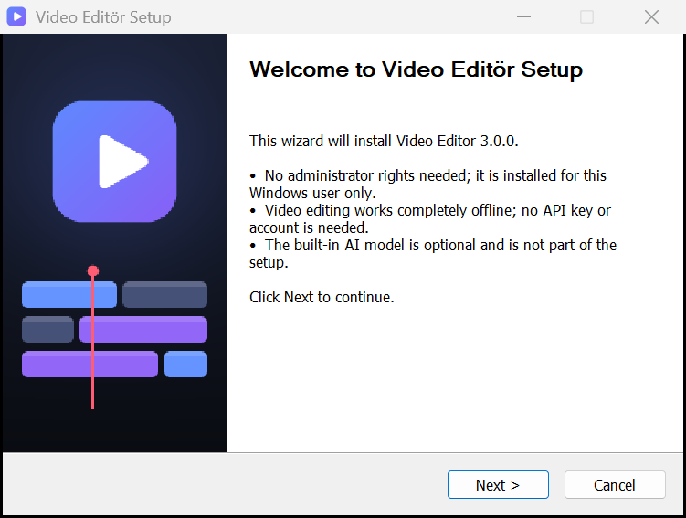
- The app opens in **Turkish** with the **dark theme**. Switch language and theme in the top bar; your choice is remembered.
- Your original videos are **never modified**. You are building an edit list; the result is written to a new MP4 file when you export.
- The app is not code-signed. If Windows says "Windows protected your PC" on first launch, choose **More info → Run anyway**. If a corporate security tool blocks it, ask your IT department for an exception.

### 2. Screen layout

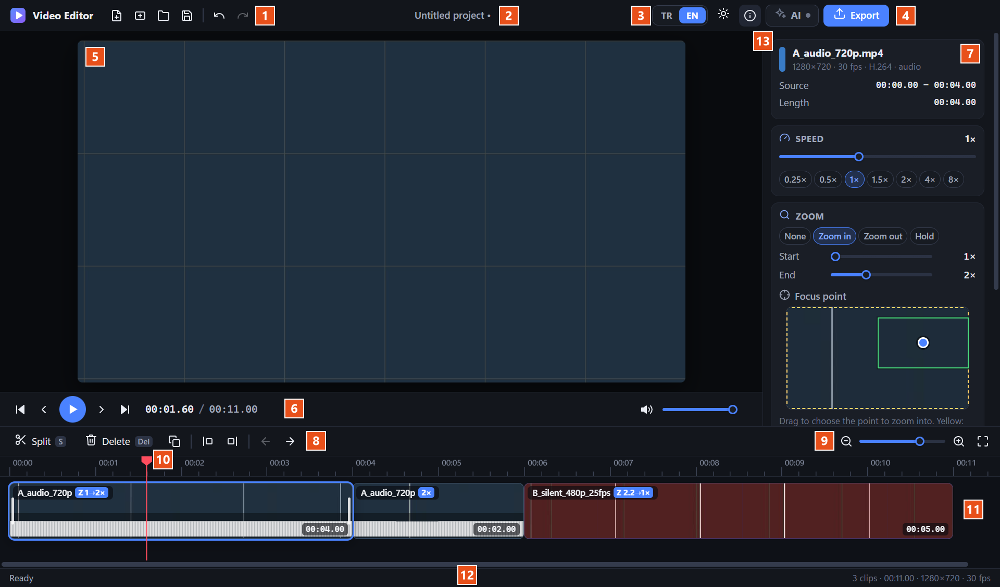

| # | Area | What it does |
|---|---|---|
| 1 | File and edit buttons | New project · Add videos · Open project · Save · Undo · Redo |
| 2 | Project name | A `•` next to the name means unsaved changes |
| 3 | Language, theme, about | `TR` / `EN` · sun/moon (dark ↔ light theme) · ⓘ About |
| 4 | Export | Saves the result as an MP4 (`Ctrl+E`) |
| 5 | Preview | Zoom, speed and frame geometry are calculated exactly like the export. When empty, drop videos here |
| 6 | Transport bar | Go to start · Previous frame · Play/Pause · Next frame · Go to end · timecode · preview volume |
| 7 | Right panel (clip properties) | **Speed**, **Zoom**, **Audio** and **Fade** settings of the selected clip. Scrolls in small windows |
| 8 | Timeline tools | Split · Delete · Duplicate · Trim start / end to playhead · Move left / right |
| 9 | Timeline zoom | Changes only the **view** of the timeline, not the video · Fit |
| 10 | Ruler and playhead | The red line is the current moment. Click and drag on the ruler to navigate |
| 11 | Clips | Thumbnails and audio waveform · speed/zoom badges (`2×`, `Z 1→2×`) · trim grips on the edges · drag to reorder. Clips from the same video share a colour |
| 12 | Status bar | Status message · clip count · total length · output size · frame rate |
| 13 | AI button | Opens/closes the optional AI assistant pane (`Ctrl+K`). Dot: green = ready, grey = off (see [AI assistant](#en-ai)) |

### 3. First video in 5 steps

1. **Add videos:** drag files onto the window, or press `Ctrl+O` / **Add videos** (you can select several files). They are placed on the timeline one after another.
2. **Navigate:** press `Space` to play; click and drag on the ruler to move the playhead. Use `←` `→` for single frames.
3. **Edit:** split with `S`, select a clip and press `Del` to remove it, trim by dragging the clip edges, and set speed/zoom/audio in the right panel.
4. **Export:** `Ctrl+E` → choose a location with **Browse…** → **Export**.
5. When it finishes, click **Play** to watch the result or **Show in folder**.

### 4. How do I…?

#### 4.1 Cut / trim (from the start and the end)
Click a clip to select it (blue outline), then:
- **With the grips:** drag the white grip on the left or right edge of the clip. The status bar shows the new in–out points and length. `Esc` cancels the drag.
- **With the playhead:** move the playhead to the frame you want; `Q` trims the clip **start**, `W` trims the clip **end** to the playhead.
- Step frame by frame with `←` `→`, jump one second with `Shift+←` `Shift+→`.
- Trimming is reversible: drag the grip back to bring the trimmed part back.

#### 4.2 Split
Place the playhead inside a clip → `S` or **Split**. The clip is divided in two and the right part is selected. Picture, sound and zoom stay continuous at the cut.

#### 4.3 Remove a section from the middle
1. Split at the start of the unwanted section (`S`) and again at its end (`S`).
2. Select the middle piece and press `Del`. The clips on the right slide left automatically, leaving no gap.
3. Made a mistake? `Ctrl+Z`.

#### 4.4 Merge
- Add several videos; they are lined up in order.
- To change the order, **drag** a clip to its new position (a drop line appears) or select it and use `Alt+←` / `Alt+→`.
- Videos with different resolutions, aspect ratios or frame rates are **conformed automatically**: the picture is never distorted and is centred with black bars when needed. By default the output size follows the **first clip**; change it in the **Export** window.
- To reuse part of a video, duplicate the clip with `Ctrl+D`.
- Videos without sound can be merged too; those parts are silent.

#### 4.5 Speed up / slow down
- Select a clip → **Speed** in the right panel: drag the slider or use the presets: `0.25×` · `0.5×` · `1×` · `1.5×` · `2×` · `4×` · `8×`.
- The range is **0.25×–8×**. The clip gets shorter/longer on the timeline and the **audio pitch is preserved**.
- To change the speed of only part of a video, first isolate that part with `S`, then change just that clip.
- Slow motion does not invent in-between frames; frames are repeated. For the smoothest slow motion use a high frame-rate source (60 fps).

#### 4.6 Zoom in / zoom out
Select a clip → **Zoom** in the right panel:

| Button | Effect |
|---|---|
| **None** | No zoom |
| **Zoom in** | 1× → 2× over the length of the clip |
| **Zoom out** | 2× → 1× over the length of the clip |
| **Hold** | Constant 2× for the whole clip |

- If the clip already has a zoom value, the presets use it as the target; otherwise 2×.
- **Fine-tuning:** the **Start** and **End** sliders (1×–4×). When they differ, the zoom moves smoothly at a constant rate over the clip.
- **Focus point:** click or drag on the small picture to choose the point to zoom into. The **yellow dashed box** is the start view, the **green box** is the end view.
- **To zoom only a specific moment,** split the clip first and apply the zoom to that piece only.
  Example "zoom in – hold – zoom out": split into three pieces → piece 1 **Zoom in**, piece 2 **Hold**, piece 3 **Zoom out**. Splitting copies the focus point, so all three look at the same spot.
- Zoom crops and enlarges the picture; a high-resolution source (1080p, 4K) keeps the result sharper.
- Sections with zoom take longer to export (especially 4K, see [Tips & limits](#en-tips)).

#### 4.7 Audio
**Audio** in the right panel: the slider goes from **0% to 200%**; the **Mute** box silences the clip. The preview plays at 100% at most, but **values above 100% are applied in full on export**. The speaker at the right end of the transport bar only controls the preview volume and does not affect the output. If a video has no audio, the controls are disabled.

#### 4.8 Fade
**Fade** in the right panel: **Fade in** and **Fade out** (up to 3 s). At the start/end of the clip the picture fades from/to black and the sound fades in/out too. Give the first clip a **Fade in** and the last clip a **Fade out** for a smooth opening and ending.

#### 4.9 Reset, duplicate, move
- **Reset clip:** returns speed, zoom, focus point, volume and fades to their defaults (trimming is kept).
- **Duplicate** (`Ctrl+D`): puts a copy right after the clip.
- **Move:** `Alt+←` / `Alt+→`, or drag and drop.

#### 4.10 Undo / redo
`Ctrl+Z` undoes, `Ctrl+Y` (or `Ctrl+Shift+Z`) redoes, up to 200 steps. Dragging a slider counts as one step.

### 5. AI assistant (optional)

The assistant carries out the command you type into the pane: "cut the first 10 seconds", "zoom in from 0:30 to 0:40", "slow down the last 5 seconds", "speed up 1:00–1:30 to 2×" — and, **new in v3, by looking at the video**: "zoom in on the dog", "cut the parts with the car on the left". All the timeline changes it makes are **undone in one step** (`Ctrl+Z`); export settings are not part of the undo history, they are shown in and changed from the **Export** window. The assistant's brain is either the **built-in local model** (no key, no account, nothing leaves the computer; see 5.3), **Foundry Local** (**new in v3.3:** Microsoft's free tool that runs models on your computer; see 5.7) or your own cloud / local provider. **New in v3.1:** with the optional **video analysis** of Foundry (Azure Content Understanding) switched on, the assistant can also read *what is shown and what is said* in the video ("cut the part where he says 'thank you'"; see 5.9). **If the model is not installed (or no other provider is set up) the pane stays disabled; editing videos never needs it.**

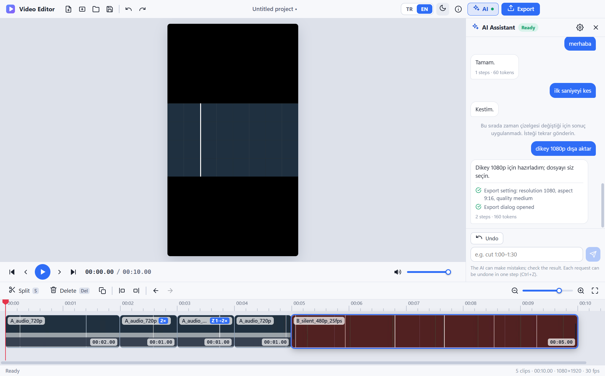

#### 5.1 Opening it and giving commands
- The **AI** button in the top bar or `Ctrl+K`. The pane opens on the right; close it with `Esc`, `Ctrl+K` or ✕. If the model is not installed (or the provider you chose has no key) the pane says "AI assistant is off" and shows a **Download and install** / **Open AI settings** button.
- Type the command into the box and press `Enter` (new line: `Shift+Enter`). You can also start from the example chips.
- Give times as `1:30`, `90`, "first 10 seconds", "last 5 seconds". **Times refer to the timeline as it was when you sent the command:** if one command both cuts a part and speeds up another part, write both times as they were originally.
- While it works a **Stop** button is shown. If you stop it or something fails, **nothing changes** and the pane says why. If you change the timeline while the assistant is working, the result is **not applied** (for safety); send the command again.
- **Check the result:** the pane lists what was done ("Removed 00:00–00:02", "Speed 2×: 00:04–00:06" …). If it is wrong use the **Undo** button or `Ctrl+Z` (with an empty box `Ctrl+Z` / `Ctrl+Y` act on the timeline). The assistant can make mistakes.
- The assistant remembers your earlier commands during the session as plain text ("now slow it down a bit").

#### 5.2 What it can and cannot do

| Can do | Cannot do |
|---|---|
| Split · cut out (delete) a range · keep only a range | **Hear** the video (barking, music) and "understand everything": only the object you name is searched for; speech is transcribed only by the optional video analysis (5.9) |
| Speed up / slow down (0.25×–8×) | Add text, subtitles, music, transitions or overlays; add new objects to the picture |
| Zoom: in · out · hold, with a focus point (e.g. "top left"); **with the built-in model** (or a Foundry Local model that sees pictures) a zoom with smooth ease-in/out aimed at the object it found | A zoom that follows a moving object frame by frame |
| Volume (0–200% / mute) · fades · clip order | Add files, choose the output file or start the export itself |
| Change the export settings and open the **Export** window | **With the built-in model** and **a Foundry Local model that sees pictures** it carries out picture-dependent commands such as "zoom in on the car" (5.4); cloud and external local servers decline honestly and ask for a time range; **with the video analysis of Foundry switched on** commands based on scene descriptions and speech work too (5.9) |

How object/scene understanding works, what it costs and its risks: [`docs/OBJE-ANLAMA-OBJECT-UNDERSTANDING.md`](docs/OBJE-ANLAMA-OBJECT-UNDERSTANDING.md).

#### 5.3 Built-in local model (recommended: no key, no account, it "looks" at the video)
The app uses its own small AI model (Qwen3.5-4B, Apache-2.0) and the `llama-server` program (llama.cpp, MIT) that runs it. **No API key, account, cloud service or extra program is needed; your command, your video and its pictures never leave the computer.** The model (≈3.4 GB) is not part of the setup; it is downloaded when you ask for it:
1. Press the **AI** button in the top bar (`Ctrl+K`). **Built-in local model** is already selected; if it is not installed the pane shows a **Download and install** button (the same button is in the **AI settings** window).
2. Click **Download and install**. The model is fetched only from `huggingface.co`, from a fixed revision, and every file is verified against its SHA-256; a file that does not verify is never used. A progress bar is shown; you can **Cancel** and **resume** later from where it stopped. **This is the only moment the built-in model uses the network, and it only happens when you press this button** (if huggingface.co is blocked on a company network see the manual way below).
3. When the installation is done the pane says **Ready**. The model is loaded into memory on first use (≈10–20 s in our trials) and is **unloaded after 10 minutes without use** (AI settings → *Unload when idle*).

- **Stopping the model / closing the app:** while the model is loaded the header of the AI pane shows a **⏻ button** (*Stop the local model*); **AI settings → Stop the model** does the same. It unloads the model at once (≈4–5 GB of memory come back); the next command starts it again by itself. While a command is running the button is disabled (press **Stop** on the command first). **When you close the app the model closes too** (closing the window or ending the app in Task Manager: Windows ends the model process that the app started together with it; anything that might be left behind is cleaned up at the next start). Tested in the real app with the real model.

- **Graphics chip / processor:** AI settings → *Run on*: **Automatic** (uses a suitable graphics chip, falls back to the processor if there is none or it does not work), **Processor (CPU)** or **Graphics chip (Vulkan)**. Speed differs roughly 2–3× between processor and graphics chip. Recommended: at least 8 GB of free memory.
- **Model folder:** by default `%APPDATA%\VideoEditor\models`; **AI settings → Choose folder** picks another local folder (e.g. a big disk). Network paths and addresses are refused.
- **If the internet / company network blocks it (manual installation):** download the two files on any computer and copy them into `<model folder>\qwen3.5-4b\`; the app verifies the SHA-256 values once on first use and refuses a wrong file:
  1. `Qwen3.5-4B-Q4_K_M.gguf` (2,740,937,888 bytes) — `https://huggingface.co/unsloth/Qwen3.5-4B-GGUF/resolve/e87f176479d0855a907a41277aca2f8ee7a09523/Qwen3.5-4B-Q4_K_M.gguf` — SHA-256 `00fe7986ff5f6b463e62455821146049db6f9313603938a70800d1fb69ef11a4`
  2. `Qwen3.5-4B-mmproj-F16.gguf` (672,423,616 bytes; the file at that address is called `mmproj-F16.gguf`, save it under this name) — `https://huggingface.co/unsloth/Qwen3.5-4B-GGUF/resolve/e87f176479d0855a907a41277aca2f8ee7a09523/mmproj-F16.gguf` — SHA-256 `cd88edcf8d031894960bb0c9c5b9b7e1fea6ebee02b9f7ce925a00d12891f864`
- **To delete it:** AI settings → **Delete model** (frees ≈3.4 GB). The uninstaller asks as well.

#### 5.4 Commands that look at the video: "zoom in on the dog"
With the built-in model (and a Foundry Local model that sees pictures, 5.7) you can say (in Turkish or English):
- "**Zoom in on the dog**" · "**Cut** the parts with the car on the left" · "**Speed up 2×** the parts where you see the red car" · "**Keep only** the parts where the person is visible" · "Köpeği yakınlaştır".
- **How it works:** the assistant first **looks** at the video: it takes about 100 pictures (one every 2–12 seconds), asks the model "is there a dog in this picture?", narrows the start and end of every part it found to ≈0.5 s and works out where the object is in the picture (the zoom aims there). Then it applies what you asked **only to those parts**; the zoom eases in and out. The parts found are listed in the pane with their times.
- **How long it takes:** in our trials (a laptop with a graphics chip) ≈1.5–2.5 minutes for a 1-minute video; ≈1 s per picture. On the processor it can take 2–3× longer. A progress bar is shown and **Stop** works at any moment (nothing changes).
- **How accurate:** on a 60-second test film made of dog photos all 5 dog parts were found (start/end within ≈0.3 s), the zoom point landed on the object (box overlap 0.89–0.98) and an object that is not in the video raised no false alarm. **Still, always check the result** (`Ctrl+Z` undoes everything).
- **Limits:** it only looks at the **picture**, it **cannot hear** (if you say "when the dog barks" it finds where the dog is *visible* and tells you so) · small or very short objects (shorter than the sampling interval) can be missed; for "far away, small car" try other words or narrow the time range · the object is searched by its English name (shown in the pane as e.g. "dog") · at most 4 objects per command · only the built-in model and Foundry Local models that see pictures can look; cloud and external local-server providers do not see the video (except the optional video analysis of Foundry: 5.9).

#### 5.5 Choosing a provider and setting it up (cloud and external servers)
If you would rather use your own provider instead of the built-in model, click the gear at the top right of the pane (**AI settings**), choose the provider, fill in the fields and press **Save and test**. When the connection and the model work, the pane says "Ready".

| Provider | What to enter | Note |
|---|---|---|
| Built-in local model (default) | Nothing; just **Download and install** | No key, no account, nothing leaves the computer; it can look at the video (5.3, 5.4) |
| Foundry Local (v3.3) | Nothing; pick a model (**Download** it if it is not on the computer yet) | Microsoft's tool for local models (installed separately); no key, no account, nothing leaves the computer; a model that sees pictures can look at the video (5.7) |
| OpenAI / compatible | Endpoint (`https://api.openai.com/v1`), model (`gpt-4o-mini`), API key | Also works with OpenAI-compatible services such as OpenRouter or Groq |
| Azure OpenAI (classic) | Resource address (`https://RESOURCE.openai.azure.com`), **deployment name**, key | You can paste the **Target URI** from the Azure portal as it is; the deployment name and API version are taken from it |
| Microsoft Foundry | Project address (`https://RESOURCE.services.ai.azure.com/api/projects/PROJECT`) or resource address, **deployment name**, key or Entra ID | The new OpenAI-compatible (v1) route; non-OpenAI models (DeepSeek, Llama, Grok…) work too |
| Anthropic (Claude) | API key, model | console.anthropic.com |
| Google Gemini | API key, model | aistudio.google.com |
| Local model | Endpoint (`http://127.0.0.1:PORT/v1`), model; no key needed | Ollama, LM Studio, llama.cpp (Foundry Local has its own option above); nothing leaves the computer |

**Azure OpenAI or Foundry?** Both connect to the same kind of resources in Azure. *Azure OpenAI (classic)* uses the older, deployment-based route (`/openai/deployments/…?api-version=…`); *Microsoft Foundry* uses the new OpenAI-compatible `/openai/v1` route and also supports project addresses and non-OpenAI models. If unsure, try **Microsoft Foundry** first; if it does not work, choose Azure OpenAI (classic).

**Address confirmation (providers with an API key):** if the address is not the provider's own (`api.openai.com`, `api.anthropic.com`, `generativelanguage.googleapis.com`) or this computer (`localhost`) (for example an Azure OpenAI / Foundry resource or your company's gateway), a confirmation window appears when you press **Save**: "What you type in the AI assistant, a summary of your timeline and your API key will be sent to this address: …". If the address is yours (or your organisation's) choose **Allow this address**. It is asked once per address and only you can confirm this window (no script in the page can), so a script that got in cannot redirect the assistant to a server of its own. An Azure/company address saved with an earlier version shows "This address has not been confirmed yet" on first use: press **Save** and confirm.

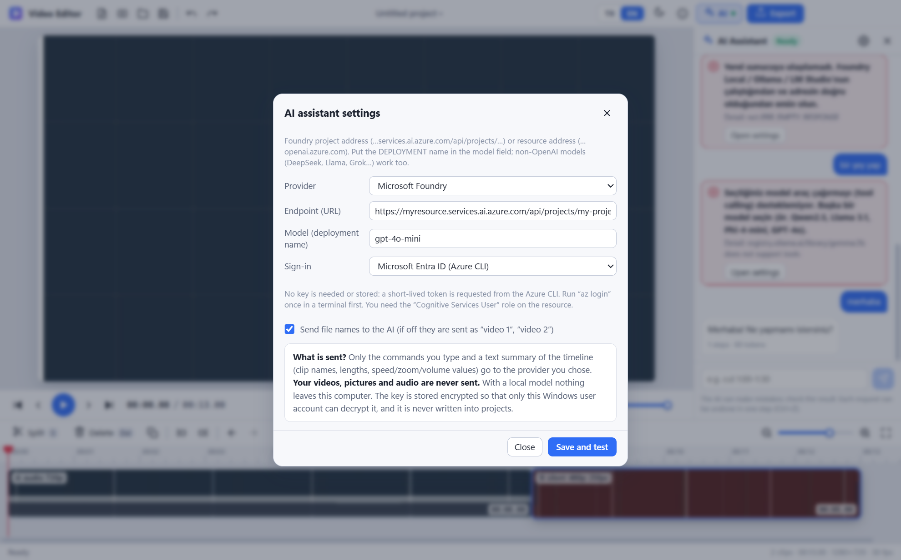

#### 5.6 Signing in with your company account (no key): Microsoft Entra ID
Many companies switch API keys off on Azure resources. For Azure OpenAI or Foundry choose **Sign-in → Microsoft Entra ID (Azure CLI)**:
1. Install the [Azure CLI](https://aka.ms/installazurecli) (Microsoft's standard installation: `C:\Program Files\Microsoft SDKs\Azure\CLI2`) and run `az login` once in a terminal. For security only this standard installation folder is searched; an `az.cmd` in other folders of the PATH is not used.
2. In the settings enter the address and the deployment name, set **Sign-in** to **Microsoft Entra ID (Azure CLI)** and press **Save and test**. **A confirmation window appears the first time:** "A short-lived token from your Azure CLI sign-in will be sent to this address: …" — if the address is an Azure OpenAI / Foundry resource of yours (or your organisation's) choose **Allow this address**. It is asked once per address, and only you can confirm this window (no script in the page can).
3. Your account needs the **Cognitive Services User** role (**Cognitive Services OpenAI User** for Azure OpenAI) on the resource; a role assignment can take a few minutes to take effect.

No key is needed or stored: the app asks the Azure CLI for a short-lived access token, keeps it **in memory only** for at most 10 minutes and sends it only to the address you confirmed. If the Azure CLI is missing or not signed in, the pane shows a clear message.

#### 5.7 Foundry Local and external local servers (Ollama, LM Studio, llama.cpp; no key, nothing leaves the computer)
**Foundry Local (v3.3)** is Microsoft's free tool that runs AI models on your computer. The app **finds it, starts it when needed and loads the model by itself**: no zip, script or `.bat` is needed. Foundry Local is not part of this app; you install it separately:
1. **Install Foundry Local from Microsoft's official source:** in a terminal `winget install Microsoft.FoundryLocal`, or <https://aka.ms/foundry-local-installer> (your organisation's policy may require administrator approval).
2. In the app choose **AI settings → Provider → Foundry Local**. The panel tells you the state (installed? running?); if it is not installed the official links and the winget command are shown there; press **Refresh** after installing.
3. Pick a **model** from the list. At first the list only shows the models already **downloaded** on your computer; press **Show all models** to see what can be downloaded (Foundry Local then asks Microsoft's list over the internet and, the first time, may also fetch hardware components from Microsoft and the chip makers). ★ marks the recommended ones (`qwen3.5-4b`); models marked **sees pictures** can also look at the frames of the video (choose one for commands such as "zoom in on the dog"). If the chosen model is not downloaded a **Download (…)** button appears: Foundry Local does the download (≈3–4 GB; with a progress bar and **Cancel**).
4. **Save and test:** if needed the Foundry Local server is started, the model is loaded into memory (up to half a minute the first time; a few minutes if Foundry Local still has to fetch components on its first run) and a short question is asked. The panel turns **Ready**; now you can give commands.

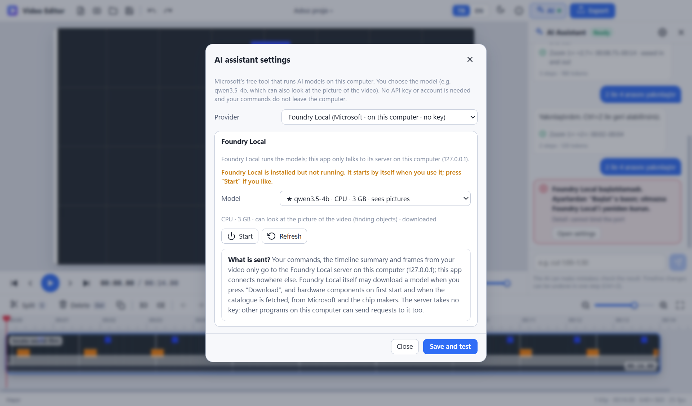

- **What is sent:** your command, the timeline summary and (when looking for an object) frames taken from the video go **only** to the Foundry Local server on this computer (`127.0.0.1`); this app connects nowhere else. The server's address is read from Foundry Local's own file every time and **verified with its process id** (details: [SECURITY.md](SECURITY.md)).
- **In a real trial** (Foundry Local 0.14, `qwen3.5-4b`, a Ryzen AI 9 laptop): the requested object was found in 12 of 12 photographs (box overlap 0.90 on average) with no false alarm for an object that was not there; with the processor variant 8 of 8 editing commands were carried out correctly (e.g. "zoom in from 10 to 15 s, zoom out from 15 to 20 s"); on a 22-second film "zoom in on the dog" found both parts where the dog is visible to within ≈1 s and aimed the zoom at the dog; for "zoom in on the giraffe" it said it could not find it and changed nothing. These numbers belong to this computer; yours will differ. **Speed:** a picture question ≈6 s, a command ≈40–75 s on the processor.
- **Processor (CPU) or graphics chip (GPU)?** Foundry Local offers two variants of the same model. With little free memory the server of the GPU variant can shut down (it did once in this trial); the app restarts the server and repeats the request (at most twice). The CPU variant is slower but was stable. At least 8 GB of free memory is recommended; the panel warns you when you have less.
- **Tool calling:** Foundry Local's server does not support native tool calling for `qwen3.5` models at the moment (HTTP 500). The app notices this by itself and writes the tools into the prompt (**tools in the prompt**): a little slower, and the model may now and then answer in English to a Turkish request. With models that support tool calling (e.g. `qwen2.5-1.5b`) it is used directly.
- **When the server stops:** a Foundry Local server that the app started stops by itself after 30 minutes without a request (the memory comes back); one you started yourself is left alone. To stop it by hand: `foundry server stop`.
- **Shared computer:** Foundry Local's server takes no key; other programs on the same computer (other users too, on a shared Windows) can send requests to it. On such a computer prefer the **built-in model**, which is protected by a key.

**Foundry Local in the web edition (v4.3, with a browser extension).** Foundry Local's server does not send the CORS headers that browsers require, so a web page cannot connect to it directly; a small **Edge / Chrome extension** is the bridge. Installing takes about a minute, once; choose **Foundry Local** in the AI settings and you see four steps that each turn green by themselves (no page reload, an unsaved project is safe):
1. **Browser extension:** press **Download the extension (.zip)** in the panel, extract the zip into a folder you keep (do not delete it), type `edge://extensions` (`chrome://extensions` in Chrome) into the address bar, switch on **Developer mode**, press **Load unpacked** and choose the folder. To be sure the zip is the right one, run the PowerShell command shown in the panel (`Get-FileHash …`) and compare the result with the SHA-256 in the **release notes** on GitHub. *On a company computer your IT may have switched Developer mode off; ask them to approve the extension, or use the Windows app.*
2. **Permission for this site:** press **Allow…**; the extension opens its own window that shows which site you are allowing (the **Allow** button becomes active a second and a half after the window opens). You can withdraw the permission at any time with **Remove** under the extension icon.
3. **Foundry Local:** in a command prompt type `winget install Microsoft.FoundryLocal` (once) and `foundry server start`; the page finds it. Foundry Local may pick a different port every time it starts: press **Find automatically** (it tries ports 49152–65535 on this computer only when you press it) or fix the port once: `foundry config set port 5272`. If you use another port, type it not into the page but into the window that opens when you click the **extension icon** in the browser toolbar.
4. **Model:** download the model once with `foundry model download qwen3.5-4b` (≈3–4 GB). Type `qwen3.5-4b` in the panel (an alias: Foundry Local picks the variant that suits your computer; with little memory type a full id such as `qwen3.5-4b-generic-cpu:3`) and press **Load and use**. The page loads the model, asks it a short question and shows it a small test picture to find out whether it **can look at pictures**: if it can, commands such as "zoom in on the dog" work; if not, the assistant works with time ranges only.

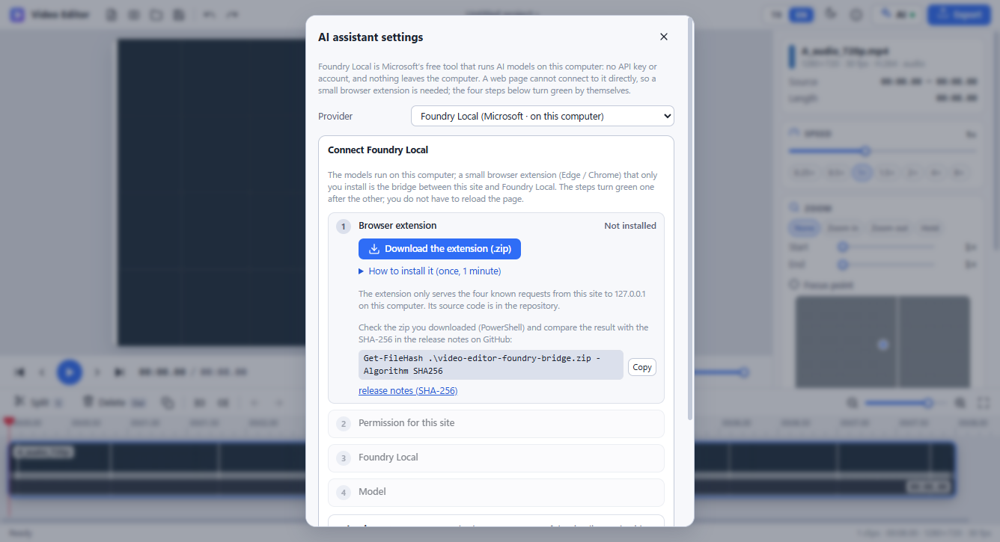

Security in short: the extension only passes **four known requests** (`models`, `loaded`, `load`, `chat`) from this site to `127.0.0.1`; the page cannot choose an address, a port, a method or headers; it only talks to a server that describes itself as Foundry Local (and looks again after 30 seconds of no use); prompts, pictures and answers are not stored. Limits: Foundry Local takes no key (other programs on this computer can use it too) and the extension cannot see which program listens on a port — fixing the port is recommended; do not use this path on a shared Windows. Details: [SECURITY.md](SECURITY.md), [web/extension/README.md](web/extension/README.md).

**Other local servers (Ollama, LM Studio, llama.cpp):** if you already run a model server:
1. Start it: **Ollama**, **LM Studio** or **llama.cpp** (`llama-server --jinja`). If the model supports tool calling it is used directly; if not, the tools are written into the prompt (a little slower and less reliable).
2. In the settings choose **Local model** → **Find local servers** → pick the server in the list (address and model are filled in) → **Save and test**.
3. The address may only point to this computer (`localhost`, `127.0.0.1`); any other address is refused.

**What to expect:** small local models (1–4 billion parameters) are fine for simple single-range commands but can get things wrong when arithmetic is needed ("the last N seconds") or with multi-step commands. In our trials (Qwen2.5-3B, CPU only, llama.cpp) 5–7 of 8 test commands gave exactly the expected edit (it varied from run to run); the mistakes were "slow down the last 5 seconds" and a three-part command, and in the real app it also cut the wrong range in a two-part command. **Check the list of actions in the pane**; for more reliable results use a larger local model (7B and up; not tried here) or a cloud model. The first answer can take a few tens of seconds while the model loads into memory.

#### 5.8 Privacy, network and key security
- **With the built-in model** your command, your video and its pictures never leave the computer: the model runs in a separate process that listens only on `127.0.0.1` with a random key that changes at every start, and it is stopped when the app quits. The only way out to the network is downloading the model files from `huggingface.co` when you press **Download and install**.
- **With Foundry Local** your command, the timeline summary and (when looking for an object) frames from the video go only to the Foundry Local server on this computer (`127.0.0.1`); because that server takes no key, its address is verified with its process id every time (5.7, [SECURITY.md](SECURITY.md)). Foundry Local's own internet traffic (model download, hardware components) is Foundry Local's, not this app's.
- **What cloud providers receive:** only the command you type and a **text summary** of the timeline (clip names, lengths, speed/zoom/volume values). In the settings you can have file names sent as "video 1". **Videos, pictures and audio are never sent by default** (only the built-in model and Foundry Local look at pictures, and they do so on your computer); the one exception is the video analysis of Foundry, **if you switch it on** and confirm each time: a reduced copy of the video is uploaded to your Foundry resource (5.9). While it is on, if a zoom has to know where an object is, **with a separate permission each time** a few small pictures from the video are also shown to your chat model (5.9). With a local model nothing leaves the computer.
- **The key:** stored encrypted so that only this Windows user account can decrypt it (Windows DPAPI); never written to the settings file, a project or a log; the screen only gets the masked form (`••••1234`). If encryption is unavailable it is kept in memory only. **Delete key** removes it. The key is bound to the address it was entered for: if the address changes the key is deleted, never sent elsewhere.
- **Network:** while the AI is off the app does not connect to anything. When on, it connects only during a request (or test) and only to the address you entered; redirects are not followed. With the built-in model that address is only this computer. If the video analysis (5.9) is on the same rule applies: it connects only to the Content Understanding address you confirmed, and only during an upload you confirmed. The pictures for finding a position only go to the address of your chat model.
- Billing is between you and your provider; the app does not measure usage and does not charge anything.

#### 5.9 Video analysis: reading the content of the video (Azure Content Understanding · Foundry · optional)
The built-in model *looks at objects* in the video; if you have a Microsoft **Foundry** resource the assistant can also have the **content** of the video (what is shown and what is said) read by the Azure **Content Understanding** service: "**cut the part where he says 'thank you'**", "speed up the scene with the dog 2×", "remove the scenes with nobody in them", "cut everything before the talking starts". This feature is **off by default**; even when on, **nothing is sent unless you confirm it each time**.

**Setting up (once):**
1. In the AI settings set up the **Microsoft Foundry** provider (5.5). Tick the **Video analysis (Azure Content Understanding)** box that appears below.
2. The address is derived from the chat model address (e.g. `https://RESOURCE.services.ai.azure.com`; it is shown below the box); type it if needed. The analyzer is `prebuilt-videoSearch` by default and the **Processing location** is "Same geography" by default (change it if your resource does not support it).
3. Press **Save**; if the address has not been confirmed before, the confirmation window appears (5.5). Then press **Test the video analysis connection**: it sends only two read requests and uploads nothing.
4. The resource needs **default model deployments** for Content Understanding (e.g. `gpt-4.1` + an embedding model): they are added once in Content Understanding Studio → Settings; the test checks this. An API key must belong to the **same resource** as the chat model (the key only goes to that address); with Entra ID (5.6) your account needs the **Cognitive Services User** role.

**Using it:** give a command that depends on the content ("cut the part where 'thank you' is said"). If the assistant sees that it has to read the video:
- **It asks first:** a native window (no script on the page can click it) says which video, how many minutes and about how many MB of the reduced copy will be uploaded and to which address. If you choose **Cancel** nothing is sent and the assistant asks you for a time range. If the result for the same video is already stored on this computer nothing is asked and nothing is uploaded.
- **It sends a reduced copy:** ≤480p, 10 fps, mono speech audio, no metadata (location etc.); parts of 10 minutes (≈10–25 MB). **The original file is not sent**; the temporary copy is deleted after the upload.
- **It waits:** progress is shown in the pane; **Stop** works at any moment (nothing changes; the service copy is asked to be deleted). A 10-minute video can take a few minutes.
- **It reads and edits:** a **Video analysis** card opens in the pane (scenes: time, description, speech); clicking a scene moves the timeline there. The assistant chooses the range itself and cuts / speeds up / zooms; everything is again **undone in one step** (`Ctrl+Z`).
- **It finds where (zooming onto an object):** the analysis answers *when*, not *where*. For a command such as "zoom in on the orange car" the assistant picks a few frames inside the scenes the analysis found, shows them to **your chat model** (your model in Foundry; it has to accept pictures, e.g. `gpt-4.1`), asks for the box of the object, and the zoom of every part locks onto the object's own place. **A separate native window asks every time:** it says the most small pictures (at most ≈MB in total), the object, the model and the length to be looked at; the pictures are reduced to at most 640 pixels on the long side and at most 120 KB each, and are sent only for this job; this app does not keep them (the data policy of the model's service applies there). If you choose **Cancel** nothing is sent and the zoom aims at the center of the picture. The pane shows "Looking through the video / Locating it in the picture" progress; **Stop** works at any moment here too. The assistant also says which scenes the pictures did not confirm.

**Data:** the result (scene descriptions and speech text) is kept in `%APPDATA%\VideoEditor\cu-cache\` for up to 30 days / 100 MB; **AI settings → Delete the analysis results** removes it. This text is also sent to your chat model (your model in Foundry) so that the assistant can carry out the command. The service keeps results on its side for up to 24 hours; after every analysis the app asks it to delete its copy right away.
**Cost:** it is billed to your Azure subscription, the app charges nothing. According to the Azure pricing page (November 2026) roughly: content extraction $1 per hour of video + contextualization $1 per hour + the tokens of the model deployed in your resource; **1 hour of video ≈ $3** (check the current price on the Azure pricing page).
**Limits:** the analysis **does not know positions in the picture by itself**: for a zoom that locks onto an object you need the *It finds where* step above (your chat model has to accept pictures; the accuracy of the box depends on the model) or the built-in model; otherwise the zoom goes to the centre or to where you say, e.g. "top left" · it looks at about one picture per second so it can miss very short events · it transcribes **speech** only (no music or noise) · the source is reduced to 1920×1080; at most 2 hours of new video per request · regional support is limited · only with the Foundry provider.
**Important:** the feature was written from the official REST documentation (GA `2025-11-01`) and tested end to end with a mock server that imitates the documented response formats; it has **not been tried against a real Azure resource**. On your own resource first press **Test the video analysis connection**, then try one command with a short video. The *It finds where* step was tested end to end with a stand-in vision model that really decodes every picture and with a real local model (Qwen3.5-4B); the box accuracy of a real GPT / Foundry deployment has not been tried - check it on your own model with a short video and a command such as "zoom in on the orange car".

#### 5.10 "AI in the browser" in the web edition (nothing to install)
The default assistant of the web edition (<https://ahmetcanalaca.github.io/videoeditor/>) runs an AI model **inside the page, on your computer's graphics card** (WebGPU). No program, no `.bat` file, no browser extension, no API key or account is needed; the only thing downloaded is the model file (**data**, not an executable program). You need: a current Edge / Chrome, a graphics card with WebGPU and 16-bit shaders (`shader-f16`), about 5 GB of free memory while it runs, and access to `huggingface.co` once.

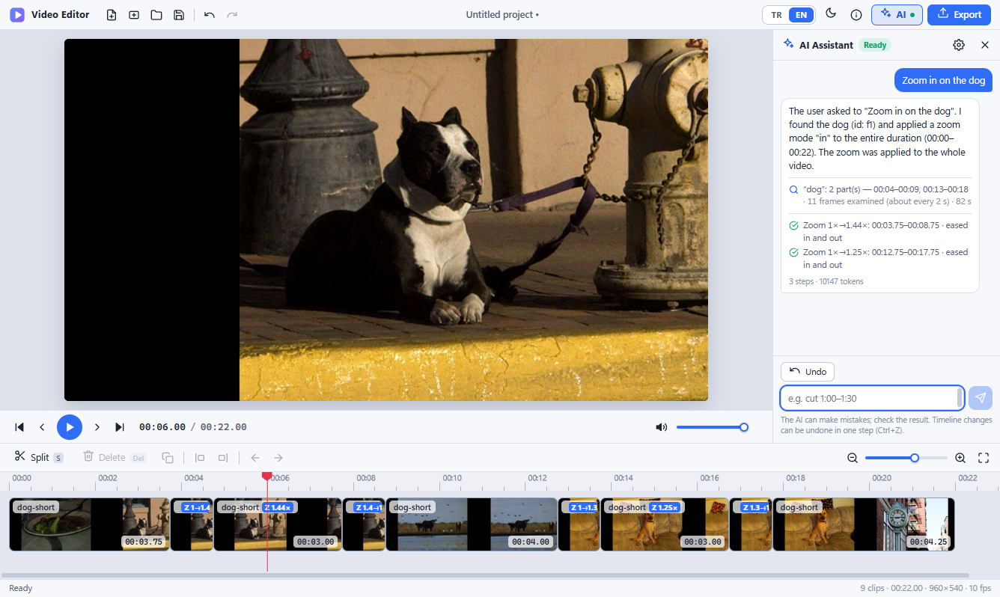

1. **AI** button → ⚙ (**AI settings**). **AI in the browser** is already the selected provider. Step 1, **Computer**, should be green ("Ready (WebGPU)"); if not, it says why (the browser or graphics card has no WebGPU, no 16-bit shaders, the browser cannot run the site's service worker — which happens in the private window of some browsers without service workers, or when site data is blocked).
2. Pick a **model**: **Balanced** (Qwen3.5 2B, 1.5 GB, recommended; about 5 GB of memory while it runs) or **Best** (Qwen3.5 4B, 2.8 GB; about 10 GB). Both look at pictures: *"zoom in on the dog"* works.
3. Press **Download and use**. A question comes first: which model, how many GB, from where (Hugging Face, which revision) and what is stored; nothing starts until you say **Download**. While it downloads you see progress and **Cancel**; a broken or silent connection (no byte for 60 s) is resumed where it stopped. Every file is checked block by block against SHA-256 values pinned in the site; nothing that does not match is stored.
4. The model is loaded onto the graphics card (about 1 minute at the start of a session: reading into memory, making the card's programs once, and a test question). When you see **"Ready. The assistant answered: …"** you can give commands; each one can be undone in one step (`Ctrl+Z`) as with the other providers.

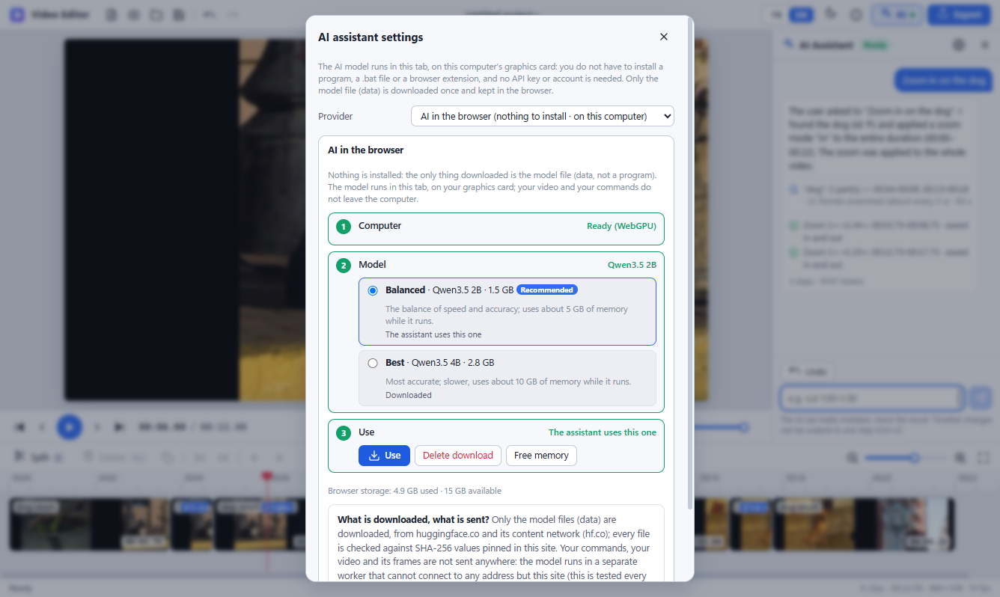

**Real trials** (a laptop with AMD integrated graphics, 31 GB of memory, Edge; the model ran on the real graphics card and the files were really downloaded from Hugging Face; yours will differ):

| | Balanced (2B) | Best (4B) |
|---|---|---|
| Download (30–50 MB/s) | ≈ 50 s | ≈ 90–100 s |
| Ready (at the start of every session) | ≈ 45–60 s | ≈ 45–60 s |
| *"Cut the first 5 seconds"*, *"speed up the video 2×"*, *"cut the last 3 seconds"* | ≈ 5–20 s | ≈ 10–25 s |
| *"Zoom in on the dog"* (22-second film) | ≈ 1–1.5 min | ≈ 1.5 min |
| Memory while it runs (the graphics card shares the computer's memory) | ≈ 5 GB | ≈ 10 GB |

- **How it works:** your command, the text summary of the timeline and — only when you ask for something that needs it — small pictures of the video go to the model in the tab; nothing is sent anywhere. In the *"zoom in on the dog"* trial the dog was found in both places where it appears in the 22-second film (4–9 s and 13–18 s) and the zoom was aimed at it (1.44× and 1.25×). A longer film takes longer (at most 40 pictures are looked at).
- **Memory:** a loaded model holds memory; **Free memory** gives it back at once (in the trial free memory went from 4.1 GB back to 8.4 GB) and it is released by itself after 10 minutes without use. Use it if the computer feels slow. Two tabs load two copies.
- **Deleting:** **Delete download** removes the files from the browser's storage (1.5 / 2.8 GB). The storage in use is shown in the settings.
- **It can be wrong:** it is a small model. In the trials the *Balanced* model carried out cutting, speed and *"zoom in on the dog"* correctly; the *Best* model once sped up only the first tenth of a second of the film for *"speed up the video 2×"*. **Check the result**; `Ctrl+Z` undoes everything. The model sometimes answers a Turkish command in English (the edit is still made). A model that says "done" without having edited anything is reminded once; if it still does not edit, the assistant says so honestly ("I could not do that…").
- **An option that is not offered:** a smaller model (0.8B, 0.6 GB) was tried as well; it answered questions but could not carry out a single editing command, so it is **not offered**.
- **Company network:** if `huggingface.co` and `hf.co` are blocked the download fails; ask IT to allow these addresses or pick another provider.
- **Security (short):** the downloaded files are data (ONNX weights); the libraries that run the model come with the site (no CDN) and are checked against pinned SHA-256 values; the model runs in a separate worker that can connect to this site only, and that is tested every time it starts; your commands, video and frames are not sent anywhere. Details and limits: [SECURITY.md](SECURITY.md).

### 6. Exporting

`Ctrl+E` or **Export** at the top right. If the timeline is empty you get a hint instead.

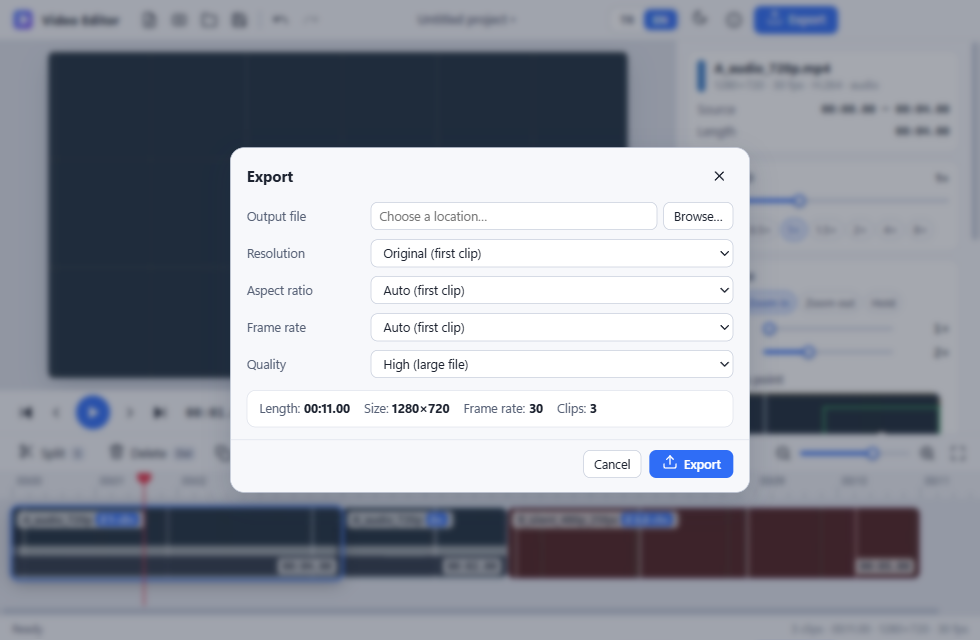

| Setting | Options | Notes |
|---|---|---|
| **Output file** | **Browse…** | Default name: first clip's name + `_edited.mp4`. A source video used in the project is **never overwritten**; choosing the same file is refused |
| **Resolution** | Original (first clip) · 1080p · 720p · 480p | The number is the **shorter side** (1080p on 16:9 = 1920×1080, in portrait 1080×1920). Choosing more than the source upscales the picture without adding detail |
| **Aspect ratio** | Auto (first clip) · 16:9 · 9:16 (portrait) · 1:1 (square) · 4:3 | Non-matching footage is centred with black bars; it is never cropped or squashed. Use 9:16 for phone/Reels/Shorts |
| **Frame rate** | Auto (first clip) · 24 · 25 · 30 · 50 · 60 | All clips are conformed to this rate |
| **Quality** | High (large file) · Balanced · Small file | High gives the best picture; Small file takes the least space |

- The summary line shows the output length, size, frame rate and clip count. Your choices are remembered.
- The output is **MP4 (H.264 + AAC)**, compatible with most players, phones and video sites.
- **While running:** a progress bar, elapsed time, remaining time (`~`) and speed (`×`) are shown. **Cancel** stops it and removes the partial file. The file only appears under its final name once it is complete.
- **When done:** the file path and size are shown, with **Show in folder** and **Play** buttons.
- **If something goes wrong:** you get a readable message (disk full, access denied, file open in another program, source video missing, out of memory…). Click **Technical details** for more.
- If you try to close the window during an export, the app asks first; quitting cancels the export.

### 7. Projects

- **Save** `Ctrl+S`, **Save as** `Ctrl+Shift+S` → a `.vedproj` file. A project stores the edit list, the export settings and the **paths** of the source videos. It **does not contain copies of the videos**, so do not move or delete the source files.
- **Open** `Ctrl+Shift+O`, or drag a `.vedproj` file onto the window. Videos that cannot be found are removed from the project with a warning.
- **New project** `Ctrl+N`. If there are unsaved changes (a `•` in the title) it asks first.

### 8. Language and theme

The **TR | EN** buttons at the top right switch the language, the sun/moon button switches dark ↔ light theme, both instantly, and both choices are kept for next time. Default: Turkish + dark theme. **ⓘ** shows the version, the components used and the fact that the app works offline.

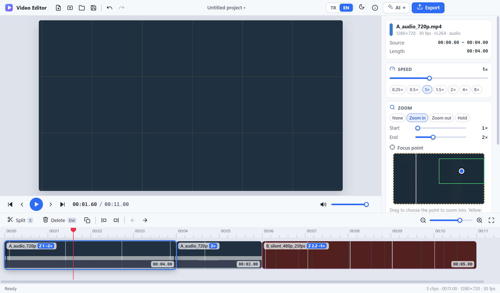

### 9. Shortcuts

| Key | Action |
|---|---|
| `Space` | Play / pause |
| `←` `→` | One frame back / forward (`Shift` = 1 second) |
| `Home` `End` | Go to start / end |
| `Ctrl+←` `Ctrl+→` | Previous / next cut point |
| `S` | Split at the playhead |
| `Del` or `Backspace` | Delete the selected clip |
| `Q` / `W` | Trim the clip start / end to the playhead |
| `Ctrl+D` | Duplicate the clip |
| `Alt+←` `Alt+→` | Move the clip left / right |
| `Ctrl+Z` · `Ctrl+Y` | Undo · Redo |
| `Ctrl+O` | Add videos |
| `Ctrl+Shift+O` | Open project |
| `Ctrl+S` · `Ctrl+Shift+S` | Save · Save as |
| `Ctrl+N` | New project |
| `Ctrl+E` | Export |
| `Ctrl+K` | Open / close the AI assistant |
| `+` `-` · `F` | Timeline zoom in / out · fit everything |
| `Esc` | Deselect, close a dialog, cancel a drag |

**Mouse:** wheel = scrolls the timeline · `Ctrl`+wheel = zooms the timeline · click and drag on the ruler or on empty space = navigate · click a clip = selects it and moves the playhead there · drag a clip = reorder · edge grips = trim.

> While a slider has focus, the `←` `→` `Home` `End` keys move that slider (the sliders in the right panel release the focus by themselves when you let go). If a shortcut does not react, click once on the preview or on an empty area of the timeline.

### 10. Tips and limits

- **Workflow:** rough cut first (split/delete), then speed, zoom, audio and fades, and finally export.
- **There are two different "zooms":** **Zoom** in the right panel enlarges the video (and shows up in the output); the magnifier below the timeline only changes how much of the timeline you see on screen.
- **Preview preparation:** for formats the browser cannot play (AVI, WMV…) and some 10-bit/HEVC videos, a "Preparing preview… %" badge appears over the preview while a low-resolution preview file is built in the background. **Exports always use the original quality.**
- **Phone videos** (portrait, with rotation metadata) are handled correctly.
- **4K / 60 fps is supported.** Exporting sections with zoom is slow (an animated 4K60 zoom can take roughly 4–8 times the clip length). For a fast result choose **1080p** and/or **30** fps when exporting. At least 16 GB of RAM is recommended for 4K. Detailed measurements: [Developer guide](docs/GELISTIRICI-REHBERI-DEVELOPER-GUIDE.md). At 4K60 the preview can drop frames at 2× speed and above; the output is correct.
- **Limits:** single video track (no overlays, titles, transitions or multiple audio tracks) · only the first video and first audio stream of each file is used · MP4 output only · encoding runs on the CPU · HDR videos are converted to SDR without tone mapping (a warning is shown) · projects with very many clips (hundreds) can hit memory or command-line limits; the app then asks you to export in two parts.

### 11. Troubleshooting

| Problem | Solution |
|---|---|
| The window opens blank or flickers | Start the app with `VideoEditor.exe --disable-gpu` |
| Windows says "Windows protected your PC" | **More info → Run anyway**. If a corporate policy blocks it, ask IT for an exception (the app is not code-signed) |
| "This file has no video stream" / "The file could not be read or is not supported" | The file may be damaged, only partly downloaded or audio-only. Check that another player can open it |
| The preview is low resolution | Expected (preview file). The output uses the original quality |
| The preview stutters at 2× or faster on 4K60 | Affects the preview only; the output has the correct speed and is smooth |
| "The output file is open in another program" | Close it in that program or choose a different name |
| "The output file is the same as a source video used in the project" | Choose a different name so the original is not overwritten |
| "There is not enough free disk space" | Free some space or pick another drive |
| "Not enough memory" | Choose a lower resolution, use fewer clips, close other programs |
| "The project has too many clips" | Export the project in two parts |
| A message "network paths ... are not opened automatically" when opening a project | For security, `\\server\share` paths and web addresses inside a project file are not opened. Add the files you trust yourself with **Add videos** (or drag and drop); files on a network share that you pick yourself open normally |
| The first import is slow | Antivirus software may be scanning FFmpeg on first use; later imports are faster |
| I want to reset language/theme | Delete `%APPDATA%\VideoEditor\settings.json` |
| The AI pane says "Off" | With the **built-in local model** selected, press **Download and install** (the pane is off on purpose until the model is installed). To use another provider enter its provider, endpoint, model and API key in the gear (**AI settings**) and press **Save and test** (or choose Entra ID / an external local server) |
| AI: "The download server refused access" / "The model repository could not be reached" | A company network or firewall may block `huggingface.co`: ask IT for permission or copy the two model files into the folder by hand (see 5.3) |
| AI: "The local model could not be started" / "did not finish loading in time" | Set AI settings → *Run on* to **Processor (CPU)**; close other programs to free memory (at least 8 GB free is recommended). If that does not help delete the model and install it again |
| AI: an object is "not found" although it is in the video | Narrow the time range ("zoom in on the dog between 0:30 and 1:00") or say the object in other words; very small objects or ones visible for only a few seconds can be missed (see 5.4) |
| The installer says "Video Editor is running" | Close the app (make sure no `VideoEditor.exe` is left in Task Manager) and click **Retry** |
| AI: "The API key is invalid or not authorised" | Check the key and the endpoint; on Azure make sure the model field holds the **deployment name**. A key entered for another address is deleted for safety; enter it again |
| AI: "The Azure CLI was not found" / "not signed in" | Install the Azure CLI with Microsoft's standard installer and run `az login` in a terminal; your account needs the **Cognitive Services User** role. Otherwise use the API key option |
| AI: "This address has not been confirmed for Microsoft Entra ID sign-in yet" | Open the AI settings, press **Save** and allow the address in the window that appears (5.6) |
| AI: "This address has not been confirmed yet (your prompts and API key only go to an address you confirmed)" | Open the AI settings, press **Save** and allow the address in the window that appears (5.5) |
| AI: "The model server was reached but did not accept the request" (with an HTTP code in brackets, e.g. 400) | The server refused the request: try again in a little while. If it keeps happening a company proxy/firewall may be altering the request: give IT the HTTP code or copy the model files by hand (5.3) |
| AI: "the model does not support tool calling" | Pick a model that supports tool calling (Qwen2.5, Llama 3.1, Phi-4-mini, GPT-4o …) |
| AI: "The local server could not be reached" | Make sure Ollama / LM Studio is running; use **Find local servers** to find the address. If answers are very slow choose a smaller model. For Foundry Local use its own option (5.7): the app finds it by itself |
| AI: "The Foundry resource has no default model deployments for Content Understanding" | In Content Understanding Studio (contentunderstanding.ai.azure.com → Settings) add the resource once and choose the default model deployments (e.g. gpt-4.1 + an embedding model); then press **Test the video analysis connection** (5.9) |
| AI: "Your resource does not support the chosen processing location" / "The Content Understanding address must be on the same resource as your chat model" | Change the **Processing location** in the AI settings (e.g. "Worldwide") or make the Content Understanding address the same resource as your chat model; you can also use Entra ID instead of an API key (5.9) |
| AI: "The chat model does not accept pictures, so the position could not be found" | To find the position your chat model has to accept pictures (image input; e.g. gpt-4.1, gpt-4o). With a model that does not, the zoom aims at the center of the picture; you can also tell the assistant a place such as "zoom into the center" or "top left" (5.9) |

Temporary files live in `%TEMP%\VideoEditor-cache` and are deleted when the app closes.

### 12. FAQ

- **Does it need internet, an API key or an account?** **No.** For editing videos the app works completely offline, there is no telemetry and no auto-update; your videos never leave your computer (the one exception: the video analysis of Foundry, if you switch it on and confirm each time, see 5.9). The **built-in AI model** needs no key or account either; internet is needed only once to install the model (≈3.4 GB from `huggingface.co`; or copy the files by hand, see 5.3). **Foundry Local** (5.7) needs no key or account either; you get Foundry Local and its models from Microsoft yourself. If you want to use your own cloud provider (OpenAI, Azure OpenAI, Foundry, Anthropic, Gemini) you need your own API key (or an Entra ID sign-in); then only your command and a text summary of the timeline go to the provider you chose, never the video (see [AI assistant](#en-ai)).
- **Will my original videos change?** No. The output is always a new file.
- **Which formats can I open?** MP4, M4V, MOV, MKV, WebM, AVI, WMV, FLV, MPG/MPEG, TS, M2TS, MTS, 3GP, OGV, VOB, MXF. The output is always MP4.
- **Can I open files from the command line / "Open with"?** Yes: `VideoEditor.exe video1.mp4 video2.mp4 project.vedproj`. If the app is already running, the files are added to the open window.
- **Is 4K 60 fps supported?** Yes; see the table in the [Developer guide](docs/GELISTIRICI-REHBERI-DEVELOPER-GUIDE.md) for details.
- **Can the AI assistant recognise objects (a dog, a car, a person…) in the video?** **Yes, with the built-in model** (and a Foundry Local model that sees pictures, 5.7): it takes pictures from the video, searches for the object and applies the command only to the parts it found (see 5.4). It cannot hear; cloud and external local-server providers do not see the video. The optional **video analysis** of Foundry (5.9) reads the content of the video (scene descriptions and speech); it has no positions in the picture. Background and cost: [`docs/OBJE-ANLAMA-OBJECT-UNDERSTANDING.md`](docs/OBJE-ANLAMA-OBJECT-UNDERSTANDING.md).
- **How much disk space does the built-in model take and where is it?** ≈3.4 GB; by default `%APPDATA%\VideoEditor\models` (another local folder can be chosen in the AI settings). **Delete model** or the uninstaller removes it.
- **Installer or portable folder?** They are the same application. The installer adds a Start menu shortcut, an "Installed apps" entry and easy removal; the portable folder runs without writing anything (like on a USB stick). Neither needs administrator rights.
- **What is the difference between Azure OpenAI and Foundry?** See [5.5](#en-ai): Azure OpenAI (classic) uses the older deployment-based route, Foundry the new OpenAI-compatible route; Foundry also supports project addresses and non-OpenAI models.
- **Multiple audio tracks/subtitles?** For now only the first video and first audio stream of each file is used.

For technical details, measurements and publishing notes see the [Developer guide](docs/GELISTIRICI-REHBERI-DEVELOPER-GUIDE.md).
