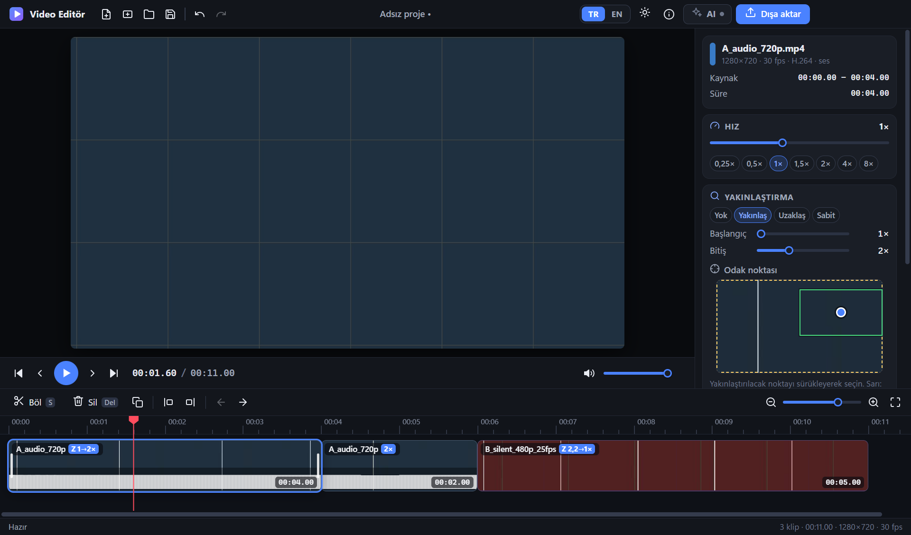
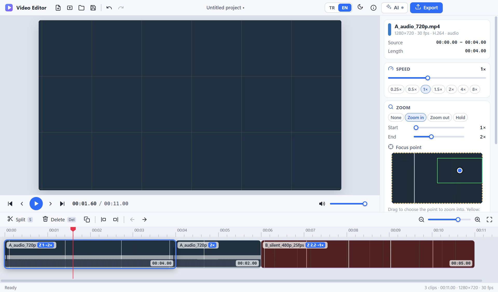

# 🎬 Video Editör · Video Editor

**Kompakt, çevrimdışı çalışan Windows video editörü.** Kesin, bölün, birleştirin, hızlandırın, yavaşlatın, yakınlaştırın; sonucu MP4 olarak kaydedin. Türkçe (varsayılan) ve İngilizce, koyu (varsayılan) ve açık tema.
*A compact Windows video editor that works offline. Cut, split, merge, speed up, slow down, zoom, and save the result as MP4. Turkish (default) and English, dark (default) and light theme.*

<p align="center">
  
  
</p>

- 🌐 **Web sürümü · Web edition** (kurulum yok · no installation): <https://ahmetcanalaca.github.io/videoeditor/>
- 💻 **Windows kurulumu · Windows installer:** [Releases → son sürüm · latest release](https://github.com/ahmetcanalaca/videoeditor/releases/latest)
- 📖 **Kılavuz · User guide:** [KULLANIM-KILAVUZU-USER-GUIDE.md](KULLANIM-KILAVUZU-USER-GUIDE.md)

Sürüm · Version: Windows uygulaması · app **3.3.0** — web sürümü · web edition **4.2.0** — Lisans · Licence: [MIT](LICENSE)

**Diller · Languages:** [🇹🇷 Türkçe](#tr) · [🇬🇧 English](#en)

---

<a id="tr"></a>
## 🇹🇷 Türkçe

### Neler yapabilir?

- ✂️ **Kesme, bölme, silme, birleştirme**; klipleri sürükleyerek sıralama; geri al / yinele
- ⏩ **Hızlandırma / yavaşlatma** (0,25×–8×; ses perdesi korunur)
- 🔍 **Zoom in / zoom out** (1×–4×); odak noktası seçilebilir
- 🔊 Ses düzeyi, sessize alma, giriş / çıkış solması
- 📤 **MP4 dışa aktarma** (H.264 + AAC): ilerleme, kalan süre, iptal; 4K / 60 kare/sn desteği
- 🤖 İsteğe bağlı **yapay zeka asistanı** (`Ctrl+K`): *"ilk 10 saniyeyi kes"*, *"köpeği yakınlaştır"*

Orijinal videolarınız **asla değiştirilmez**; sonuç yeni bir dosyaya yazılır.

### Başlamak için

1. **Web sürümü:** [ahmetcanalaca.github.io/videoeditor](https://ahmetcanalaca.github.io/videoeditor/) adresini Chrome veya Edge'de açın. Kurulum yok; videolarınız tarayıcıda işlenir ve yüklenmez (isteğe bağlı Foundry video analizi hariç: onayınızla küçültülmüş bir kopya kendi Azure kaynağınıza gider).
2. **Windows uygulaması:** [Releases](https://github.com/ahmetcanalaca/videoeditor/releases/latest) sayfasından `VideoEditor-3.3.0-Setup-x64.exe` dosyasını indirip çift tıklayın. **Yönetici yetkisi gerekmez** (yalnızca sizin kullanıcınıza kurulur).

> ⚠️ Kurulum dosyası kod imzalı değildir. Windows "bilgisayarınızı korudu" derse **Ek bilgi → Yine de çalıştır** deyin; şirket bilgisayarında BT politikası engelleyebilir. Dosyanın SHA-256 değeri Releases sayfasındaki `.sha256` dosyasındadır.

Adım adım anlatım: **[Kullanım kılavuzu](KULLANIM-KILAVUZU-USER-GUIDE.md)**.

### API anahtarı / hesap gerekir mi? **Hayır.**

Düzenleme tamamen yerel ve çevrimdışıdır. Uygulamada **hiçbir API anahtarı, hesap, bulut hizmeti, telemetri veya otomatik güncelleme yoktur.** Yapay zekâyı da anahtarsız kullanabilirsiniz (yerleşik model veya Foundry Local). Yalnızca isteğe bağlı bulut sağlayıcılarında *kendi* anahtarınızı girersiniz.

### Yapay zeka asistanı (isteğe bağlı)

Komutu yazarsınız, asistan zaman çizelgesini düzenler. Yaptığı her şey **tek adımda geri alınır** (`Ctrl+Z`).

| Seçenek | Anahtar | Videoya bakar mı? | Veriler nereye gider? |
|---|---|---|---|
| **Yerleşik yerel model** (Qwen3.5-4B), önerilen | gerekmez | **Evet** (kareleri tarar) | Hiçbir yere. Model ≈ 3,4 GB'tır, tek tıkla indirilir ve bilgisayarınızda çalışır |
| **Foundry Local** (Microsoft) · *yeni, yalnızca Windows uygulamasında* | gerekmez | **Evet** (görüntüye bakan modelle, örn. `qwen3.5-4b`) | Yalnızca bu bilgisayar. Foundry Local'i Microsoft'tan siz kurarsınız (aşağıda) |
| Diğer yerel sunucular (Ollama, LM Studio, llama.cpp) | gerekmez | modele bağlı | Yalnızca bu bilgisayar |
| OpenAI · Azure OpenAI · Microsoft Foundry · Anthropic · Gemini | kendi anahtarınız (Foundry'de Entra ID de olur) | hayır (yalnızca metin) | Komutunuz ve zaman çizelgesinin metin özeti → seçtiğiniz sağlayıcı |
| Foundry + **Content Understanding** (isteğe bağlı) | kendi Foundry kaynağınız | içeriğini okur: sahneler ve konuşma | **Her seferinde onayınızla** videonun küçültülmüş kopyası → kendi Azure kaynağınız |

**Foundry Local ile yerel yapay zekâ** (Windows uygulaması; zip, betik veya `.bat` yok):

1. **Foundry Local'i Microsoft'un resmî yolundan kurun** (bu projenin parçası değildir): [resmî yükleyici](https://aka.ms/foundry-local-installer) ya da terminalde `winget install Microsoft.FoundryLocal` ([kurulum kılavuzu](https://learn.microsoft.com/azure/foundry-local/get-started)).
2. Video Editör'de **AI** düğmesi → ⚙ **ayarlar** → Sağlayıcı: **Foundry Local**. Uygulama onu kendisi bulur; kurulu değilse resmî bağlantıları orada görürsünüz.
3. Bir **model** seçin (önerilen: `qwen3.5-4b`, videoya da bakar). Bilgisayarınızda yoksa **İndir**'e basın; liste başta yalnızca indirilmişleri gösterir, **Tüm modelleri göster** ile Microsoft'un listesi açılır.
4. **Kaydet ve sına**. Hazır: komut yazın, örn. *"köpeği yakınlaştır"*.

Sunucuyu uygulama gerektiğinde başlatır (30 dakika kullanılmazsa kapanır). Ayrıntı, sınırlar ve gerçek deneme sonuçları: [kılavuz 5.7](KULLANIM-KILAVUZU-USER-GUIDE.md). ⚠️ Foundry Local'in sunucusu anahtar istemez: paylaşılan bir Windows'ta anahtarla korunan yerleşik modeli tercih edin.

- **Web sürümünde** Foundry Local kullanılamaz (sunucusu tarayıcıların istediği CORS başlıklarını göndermiyor); asistan orada bulut sağlayıcılarıyla ve tarayıcılara izin veren yerel sunucularla (Ollama, LM Studio) çalışır. Foundry Local için Windows uygulamasını kullanın.
- Foundry + Content Understanding, resmî belgelere göre yazıldı ve sahte sunucuyla sınandı; **gerçek bir Azure kaynağıyla henüz doğrulanmadı.** Yeni: zoom nesnenin *yerine* kilitlenebilir; bunun için birkaç küçük resim yalnızca ayrıca onayladığınızda sohbet modelinize gösterilir.
- Asistan hata yapabilir; sonucu kontrol edin.

### Gizlilik ve güvenlik

- Uygulama ağa **varsayılan olarak kapalıdır**; ağ yalnızca sizin başlattığınız işlerde açılır (model indirme, seçtiğiniz sağlayıcıya istek). Foundry Local'in kendi internet işleri (model indirme, donanım bileşenleri) Foundry Local'indir, bu uygulamanın değil.
- Anahtarlar Windows DPAPI ile şifrelenir ve proje dosyalarına yazılmaz. Web sürümünde anahtar yalnızca açık sekmenin oturumunda tutulur (tarayıcılar çökme kurtarma için bir kopya saklayabilir).
- Güvenlik açığı bildirimi ve tasarım ayrıntıları: [SECURITY.md](SECURITY.md).

### Bilmeniz gerekenler

- Windows 10 / 11 (x64). Yerleşik yapay zekâ için ≥ 8 GB RAM, 4K için ≥ 16 GB önerilir.
- Tek video şeridi: bindirme, yazı ve geçiş efekti yoktur. Çıktı MP4'tür; zoomlu 4K bölümlerin dışa aktarması yavaştır.
- Web sürümü yalnızca tarayıcının çözebildiği biçimleri açar (MP4, MOV, MKV, WebM, TS; AVI / WMV yok).

### Geliştiriciler için

```powershell
npm install
npm run ffmpeg:fetch      # FFmpeg (sabitlenmiş sürüm)
npm run llama:fetch       # llama.cpp (sabitlenmiş sürüm)
npm start                 # kaynaktan çalıştır
npm test                  # testler
npm run release           # kurulum dosyası + zip (dist\ klasörü)
```

Mimari, tüm komutlar, testler, sertleştirme, lisanslar ve sürüm geçmişi: **[Geliştirici rehberi](docs/GELISTIRICI-REHBERI-DEVELOPER-GUIDE.md)**. Web sürümü: [web/README.md](web/README.md).

### Lisans

Kaynak kod **MIT** ([LICENSE](LICENSE)). Kurulum paketi FFmpeg (GPL v3) ve llama.cpp (MIT) içerir; bunlar ve diğer bileşenler kendi lisanslarıyla gelir: **[THIRD-PARTY-NOTICES.txt](THIRD-PARTY-NOTICES.txt)**.

---

<a id="en"></a>
## 🇬🇧 English

### What can it do?

- ✂️ **Cut, split, delete, merge**; reorder clips by dragging; undo / redo
- ⏩ **Speed up / slow down** (0.25×–8×; the pitch of the sound is kept)
- 🔍 **Zoom in / zoom out** (1×–4×); the focus point can be chosen
- 🔊 Volume, mute, fade in / out
- 📤 **MP4 export** (H.264 + AAC): progress, time left, cancel; 4K / 60 fps supported
- 🤖 Optional **AI assistant** (`Ctrl+K`): *"cut the first 10 seconds"*, *"zoom in on the dog"*

Your original videos are **never changed**; the result is written to a new file.

### Getting started

1. **Web edition:** open [ahmetcanalaca.github.io/videoeditor](https://ahmetcanalaca.github.io/videoeditor/) in Chrome or Edge. Nothing to install; your videos are processed in the browser and not uploaded (except for the optional Foundry video analysis: with your confirmation a reduced copy goes to your own Azure resource).
2. **Windows app:** download `VideoEditor-3.3.0-Setup-x64.exe` from [Releases](https://github.com/ahmetcanalaca/videoeditor/releases/latest) and double-click it. **No administrator rights needed** (it installs for your user only).

> ⚠️ The installer is not code-signed. If Windows says "protected your PC", choose **More info → Run anyway**; on a company computer an IT policy may block it. The SHA-256 of the file is in the `.sha256` file on the Releases page.

Step by step: **[User guide](KULLANIM-KILAVUZU-USER-GUIDE.md)**.

### Does it need an API key / account? **No.**

Editing is fully local and offline. The app contains **no API key, account, cloud service, telemetry or automatic update.** You can use the AI without a key too (the built-in model or Foundry Local). You only type *your own* key if you choose an optional cloud provider.

### AI assistant (optional)

You type a command and the assistant edits the timeline. Everything it did is **one undo step** (`Ctrl+Z`).

| Option | Key | Looks at the video? | Where does the data go? |
|---|---|---|---|
| **Built-in local model** (Qwen3.5-4B), recommended | not needed | **Yes** (scans frames) | Nowhere. The model is ≈ 3.4 GB, downloaded with one click, and runs on your computer |
| **Foundry Local** (Microsoft) · *new, Windows app only* | not needed | **Yes** (with a model that sees pictures, e.g. `qwen3.5-4b`) | This computer only. You install Foundry Local from Microsoft (below) |
| Other local servers (Ollama, LM Studio, llama.cpp) | not needed | depends on the model | This computer only |
| OpenAI · Azure OpenAI · Microsoft Foundry · Anthropic · Gemini | your own key (Entra ID also works with Foundry) | no (text only) | Your command and a text summary of the timeline → the provider you chose |
| Foundry + **Content Understanding** (optional) | your own Foundry resource | reads the content: scenes and speech | **Each time with your permission**, a reduced copy of the video → your own Azure resource |

**Local AI with Foundry Local** (Windows app; no zip, script or `.bat`):

1. **Install Foundry Local from Microsoft's official source** (it is not part of this project): the [official installer](https://aka.ms/foundry-local-installer), or in a terminal `winget install Microsoft.FoundryLocal` ([installation guide](https://learn.microsoft.com/azure/foundry-local/get-started)).
2. In Video Editor press the **AI** button → ⚙ **settings** → Provider: **Foundry Local**. The app finds it by itself; if it is not installed you see the official links right there.
3. Pick a **model** (recommended: `qwen3.5-4b`, which also looks at the video). If it is not on your computer press **Download**; the list first shows only what is downloaded, **Show all models** opens Microsoft's list.
4. **Save and test**. Ready: type a command, e.g. *"zoom in on the dog"*.

The app starts the server when needed (it stops after 30 minutes without use). Details, limits and the real-trial results: [guide 5.7](KULLANIM-KILAVUZU-USER-GUIDE.md). ⚠️ Foundry Local's server takes no key: on a shared Windows prefer the built-in model, which is protected by a key.

- **In the web edition** Foundry Local cannot be used (its server does not send the CORS headers browsers require); there the assistant works with cloud providers and with local servers that allow browsers (Ollama, LM Studio). Use the Windows app for Foundry Local.
- Foundry + Content Understanding was written from the official documentation and tested against a mock server; it has **not yet been verified against a real Azure resource.** New: the zoom can lock onto the *position* of an object; for that a few small pictures are shown to your chat model only when you confirm it separately.
- The assistant can make mistakes; check the result.

### Privacy and security

- The app is **offline by default**; the network is opened only for things you start (downloading the model, a request to the provider you chose). Foundry Local's own internet jobs (model downloads, hardware components) are Foundry Local's, not this app's.
- Keys are encrypted with Windows DPAPI and are never written into project files. In the web edition the key stays in the open tab's session (a browser may keep a copy for crash recovery).
- Reporting a vulnerability and the design details: [SECURITY.md](SECURITY.md).

### Good to know

- Windows 10 / 11 (x64). ≥ 8 GB of RAM is recommended for the built-in AI, ≥ 16 GB for 4K.
- One video track: no overlays, titles or transition effects. The output is MP4; exporting 4K sections with zoom is slow.
- The web edition opens only what the browser can decode (MP4, MOV, MKV, WebM, TS; no AVI / WMV).

### For developers

```powershell
npm install
npm run ffmpeg:fetch      # FFmpeg (pinned version)
npm run llama:fetch       # llama.cpp (pinned version)
npm start                 # run from source
npm test                  # tests
npm run release           # installer + zip (dist\ folder)
```

Architecture, every command, tests, hardening, licences and release history: **[Developer guide](docs/GELISTIRICI-REHBERI-DEVELOPER-GUIDE.md)**. Web edition: [web/README.md](web/README.md).

### Licence

The source code is **MIT** ([LICENSE](LICENSE)). The installer contains FFmpeg (GPL v3) and llama.cpp (MIT); these and the other components come with their own licences: **[THIRD-PARTY-NOTICES.txt](THIRD-PARTY-NOTICES.txt)**.
