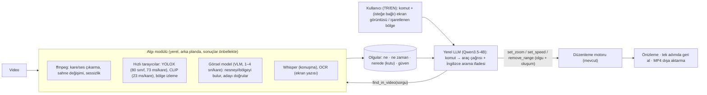
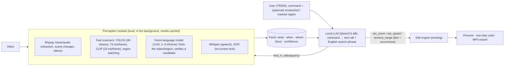

# V3 çözüm önerileri — yerel yapay zekâ, nesne anlama, ekran olayları, ses ve güvenlik · V3 solution proposals — local AI, object understanding, screen events, audio and security

[Türkçe](#tr) · [English](#en) — 9 Kasım 2026 (durum güncellemesi: 10 Kasım 2026) · Durum: **Faz 0, 1 ve 2, 3.0.0 olarak uygulandı** (bölüm 9'daki "Durum 3.0.0" kutusu); Faz 3–6 öneri olarak duruyor · Ölçüm makinesi: AMD Ryzen AI 9 HX PRO 375 (12 çekirdek / 24 iş parçacığı), 31 GB RAM, Radeon 890M iGPU, Windows 11 Enterprise. Önceki belge: [`../OBJE-ANLAMA-OBJECT-UNDERSTANDING.md`](../OBJE-ANLAMA-OBJECT-UNDERSTANDING.md)

> **Status (10 November 2026) / Durum:** Phases 0, 1 and 2 of section 9 are **implemented in 3.0.0** (see the "Status 3.0.0" box in section 9 / bölüm 9'daki kutu). Phases 3–6 (screen events, tracking/OCR, audio, cloud/generative) remain proposals. This document keeps the analysis and the measurements that led to the design.

---

## 🇹🇷 Türkçe

### 1. Kısa cevaplar

| Sorunuz | Cevap |
|---------|-------|
| **Videodaki herhangi bir nesne ya da bölümden söz edince** ("köpeği yakınlaştır", "kırmızı arabanın olduğu yeri kes", "soldaki kişiye zoom yap") yerel model bunu anlayıp işlem yapabilir mi? | **Evet, ama tek model değil, küçük bir hatla:** LLM sözü komuta + İngilizce sorguya çevirir → yerel görsel model (VLM) *ne/nerede*'yi bulur → hızlı tarayıcılar *ne zaman*'ı bulur → mevcut motor uygular; önizleme + geri alma. **Ölçüm (doğal fotoğraf, yalnızca bu PC, bulut yok):** "var mı?" 31–32/32, kutuyla bulma 11–12/12, "soldaki/sağdaki" 23–26/26, olmayan nesneyi uydurmama 7/8; fotoğraf başına 1,2–4,3 sn. **Sınırlar:** bütün videoyu VLM ile taramak yavaş (10 dk ≈ 12–43 dk) → hızlı tarayıcı aday seçer; takip, eylem/olay ve gerçek video doğruluğu **ölçülmedi**. Bölüm 4. |
| "AI'ya prompt girdikten sonra, cevap gelene kadar olan kısmı hızlandır / zoom yap" yerelde olur mu? | **Evet; bulut ve büyük model gerekmeden.** Gerçek bir yapay zekâ sohbet arayüzünün iki ekran kaydında, kullanıcının gösterdiği "Stop" düğmesi bölgesini izleyerek bekleme aralığını **en fazla 0,2 sn hatayla (IoU 0,98–1,00)** buldum; düşünen (reasoning) modelde 39 sn'lik beklemede de. Bölüm 3. |
| "Anlaması için ekran görüntüsü de atabiliriz" | **İşe yarıyor.** Farklı ölçekte (%75–%200) ve JPEG sıkıştırmalı bir ekran görüntüsü kırpımını, videoda yapay zekâ kullanmadan 1–3 piksel hassasiyetle buldum. Görüntüyü okuyup "şu düğme" diyebilen yerel görsel model (VLM) ise yedek yol: tarif edilen küçük düğmeyi buldu (merkez 5/5) ama durumu ("çalışıyor mu?") tam ekran karede bilemedi (rastgele düzey); bölüm 4.2. |
| Foundry/bulut "mecburuz gibi, pahalı" | **Mecbur değilsiniz.** Anlamı ikiye bölüyoruz: *ne* (bir kez, ucuz) ve *ne zaman* (binlerce kare; klasik, yerel, ücretsiz). Bulut isteğe bağlı kalır ve kare başına değil, **görüntü başına ≈ $0,001** tutar (bölüm 7). |
| Yerel küçük model olur mu? İngilizce prompt sorun değil | **Olur.** Qwen3.5-4B (Apache-2.0, ≈2,6 GB) yalnızca CPU'da komut başına ≈10 sn; temel komutlarda İngilizce 15/16, Türkçe 14/16. Ekran olayı komutları daha zor (≈ %60–75): önizleme + geri alma şart (bölüm 5). |
| "Şurada sesi çıkar vs. eklemek istiyorum" | Ses işlemlerinin çoğu ffmpeg'de hazır; yalnızca "müzik/ses dosyası ekleme" için modelde ses katmanı gerekir. Türkçe seslendirme ve OCR için bu bilgisayarda Windows yerleşik desteği **yok** (yalnızca İngilizce) → motor paketlemek gerekir. Bölüm 6. |
| Güvenlik taraması | **Kritik/yüksek bulgu yok.** 2 orta, 2 düşük + sertleştirme maddeleri; hepsi için doğrulanmış düzeltme var (bölüm 8). Bağımsız çalışma sırasında Electron'un 45.2.3 sürümü çıkmış, uygulama 45.1.0'da. |

### 2. Önerilen mimari

Her şey yerelde çalışır; bulut yalnızca isteğe bağlıdır. **Tek model dosyası hem "beyin" hem "göz" olabilir:** Qwen3.5-4B + görsel eklenti (toplam ≈ 3,3 GB) komutları araç çağrısına çevirir *ve* kareye bakıp nesneyi bulur (aynı `llama-server`).

Beş ilke (hepsi ölçümle desteklendi; ölçülmeyenler ilgili bölümde açıkça belirtilir):

1. **LLM'e kare/ses göndermiyoruz, metin olgular gönderiyoruz.** Algı modülü videodan zaman damgalı *olgular* üretir ("köpek: 12,0–31,5 sn, kutu …", "AI çalışıyor: 12,5–51,0 sn").
2. **Sayı aritmetiğini mümkün olduğunca motor yapar.** Küçük modelin zayıf noktası zaman hesabı ve olay eşleştirme; modele süreleri düz saniye olarak veririz, ona "durum + oluşum" seçtiririz (bölüm 5).
3. **"Ne/nerede"yi bir kez bul, "ne zaman"ı ucuz tarayıcıyla izle.** VLM kare başına 1–4 sn sürer (CPU/iGPU); hızlı tarayıcılar (YOLOX, CLIP, bölge karşılaştırma) kare başına 0,02–0,07 sn. Hat: hızlı tarayıcı aday seçer → VLM doğrular/konumlandırır (bölüm 4.4).
4. **Sorgu İngilizce'ye çevrilir.** CLIP'in Türkçe sorgulardaki isabeti %6–15, İngilizce'de %61 (önceki ölçüm); LLM kullanıcının sözünü ("sağdaki kırmızı araba") kısa bir İngilizce arama ifadesine çevirir (bölüm 4.3).
5. **Her sonuç önizlenir ve tek adımda geri alınır**; model/analiz indirilmediyse uygulama v2 gibi çalışmaya devam eder.

### 3. Örnek 1: ekran göstergesine bağlı aralık ("prompt'tan cevap bitene kadar")

*Bu bölüm tek bir örnektir: herhangi bir uygulamadaki "çalışıyor / bitti" göstergesi. Videodaki herhangi bir nesne ya da bölüm için genel durum bölüm 4'tedir.*

**3.1 Deney düzeneği.** Gerçek bir yapay zekâ sohbet arayüzünü (llama.cpp web arayüzü) yerel modellerle kullandım ve ekran kaydı gibi kaydettim (1280×720, 30 fps, H.264). **Referans (ground truth) arayüzün kendisinden geliyor**: "Stop generation" düğmesi DOM'da olduğu sürece yapay zekâ çalışıyor sayıldı; Enter, yazma ve kaydırma anları betikten bilindi. Senaryo: boşta → prompt yaz → Enter → AI çalışır → boşta → kullanıcı cevabı kaydırır → ikinci prompt → AI çalışır → boşta.

| Kayıt | Model | Süre | AI çalışma aralıkları (referans) |
|-------|-------|------|----------------------------------|
| 1 | Qwen3.5-2B, düşünme kapalı | 52,8 sn | 12,43–26,07 (13,6 sn) · 41,41–48,65 (7,2 sn) |
| 2 | Qwen3.5-4B, **düşünen** (uzun "thinking" önce) | 99,5 sn | 12,45–51,03 (38,6 sn) · 66,19–95,22 (29,0 sn) |

**3.2 Yöntemler ve sonuçlar** (başlangıç/bitiş hatası saniye; IoU = aralık örtüşmesi, 1,00 = tam):

| Yöntem | Kayıt 1 (a / b aralığı) | Kayıt 2 (a / b aralığı) |
|--------|-------------------------|-------------------------|
| **A. Genel ekran etkinliği** (ekranın ne kadarı değişiyor; kimse neyi izleyeceğini bilmeden) | a: −0,03 / **−2,37** (IoU 0,82) · b: −0,01 / +0,05 (IoU 0,99) | a: +2,25 / **−8,93** (IoU 0,71) · b: +3,01 / **−13,12** (IoU 0,44) |
| **B. Bölge izleme** (kullanıcı "Stop" düğmesini içeren dikdörtgeni gösterir; iki örnek: düğme var / yok; eşik = iki örnek arası mesafenin yarısı) | a: +0,17 / −0,07 (IoU **0,98**) · b: −0,01 / −0,05 (IoU **0,99**) | a: +0,15 / −0,03 (IoU **1,00**) · b: +0,01 / −0,02 (IoU **1,00**) |

Çıkarımlar:

- **Genel etkinlik tek başına yetmez.** Ekran, model "düşünürken" ya da akış beklerken donuk kalıyor; sonuçta aralık parçalanıyor (kayıt 2'de bitiş hatası −9 ve −13 sn) ve kullanıcı kaydırması "AI çalışıyor" gibi görünüyor. Ama kesin sınırları (kare düzeyinde) ve *aday* bölümleri bulmak için ucuz ve yararlı.
- **Gösterge izleme çok güvenilir.** Düğme bölgesi bekleme boyunca sabit görünüyor; Enter'dan düğmenin belirmesine 0,02–0,10 sn, bölge karşılaştırması ≈0,15 sn gecikmeli yakalıyor.
- **Eşik elle ayarlanmamalı.** Tek örnek + yüzdelik tabanlı "kör" eşik kayıt 1'de başarısız oldu (IoU 0,43 / 0,62). **İki örnek** (olumlu: düğme var; olumsuz: aynı bölgenin boşta hali) ve "olumluya mesafe < örnekler arası mesafenin yarısı" kuralı her iki kayıtta da ayarsız çalıştı. "En yakın örnek kazanır" kuralı tek başına yetmedi (ilk mesaj öncesi farklı yerleşim: IoU 0,52 / 0,76).
- **Ekran görüntüsünden bulma.** 40×40 piksellik düğme kırpımını %75, %100, %150, %200 ölçekte ve JPEG sıkıştırmalı olarak videodaki kareye gerçek konumundan en çok 3 piksel sapmayla ve 0,95–0,998 korelasyonla buldum; çok ölçekli, kaba-ince arama, saf JavaScript, kare başına 0,1–0,6 sn. (Yani dışarıdan alınan ekran görüntüsü, farklı DPI'da olsa bile, bölge olarak kullanılabilir.)
- **Hız.** 100 sn'lik 720p kayıt: bölge izleme 1,2 sn, etkinlik analizi 1,5 sn (≈70–80× gerçek zaman). 1080p ≈ 13×, 4K60 ≈ 4–8× gerçek zaman (önceki ölçüm). 10 dakikalık 1080p kayıt ≈ 1 dk altında taranır; arka planda ilerleme çubuğuyla çalışır.

**3.3 Kullanıcı akışı (önerilen arayüz).**

1. Kullanıcı önizlemede AI'nin çalıştığı bir kareye gelir → **"İzleme bölgesi ekle"** → düğmenin çevresine dikdörtgen çizer, ad verir ("AI çalışıyor") → (isteğe bağlı) aynı bölgeyi AI'nin boşta olduğu bir karede "bu durumda değil" diye işaretler. Alternatif: bir **ekran görüntüsü** ekler (yapıştır/sürükle), üzerinde bölgeyi çizer; uygulama videoda bulur (bölüm 4).
2. Uygulama bütün videoyu tarar → zaman çizelgesinde ince **durum şeritleri** çıkar ("AI çalışıyor" ×2, "yazıyor" ×2, "boşta"). Kullanıcı sınırları sürükleyerek ayarlayabilir.
3. Kullanıcı AI paneline yazar: *"AI çalışıyor kısımlarını 6 kat hızlandır, kalanı normal hızda kalsın"* veya *"ilk cevap sırasında yakınlaştır"* → ajan `set_speed(state="ai_working", occurrence="all", speed=6)` çağırır; motor süreleri çözer (bölüm 5).
4. Önizleme, tek adımda geri alma, dışa aktarma — mevcut davranış.

**3.4 Zor durumlar ve çareleri.**

| Durum | Çare |
|-------|------|
| Gösterge sabit konumda değil (pencere taşınıyor/yeniden boyutlanıyor) | Çok ölçekli bulma her N saniyede yeniden çalışır; ya da bölge yerine "bölge **etkinliği**" (spinner dönüyor mu?) |
| Uygulamada tek bir gösterge yok (ör. terminal) | Çıktı alanını göstermek + "değişmeyen süre ≥ N sn = bitti" (N ayarlanır); OCR ile "metin akıyor"; gerekirse VLM tek kare doğrulama |
| İmleç / fare üzerine gelme düğmeyi kısmen örter | Çok örnekli eşleme (hover dahil), eşik kuralı küçük örtmelere dayanıklı; **gerçek kayıtlarla sınanmalı** (ölçülmedi) |
| Aydınlık/karanlık tema, farklı ölçek | Her tema için ayrı örnek; ölçek için çok ölçekli bulma |
| Yüksek sıkıştırmalı (ör. indirilmiş) video | Eşik "örnekler arası mesafe"ye göre oransal olduğu için dayanıklı; yine de gerçek kayıtla sınanmalı |

**Sınır (dürüstçe):** İki kısa kayıt, tek arayüz (llama.cpp web arayüzü), 720p. Sizin gerçek uygulamanızın göstergesi (VS Code, tarayıcı sohbeti, terminal…) farklı davranabilir. Kabul testi için **2–3 gerçek kaydınızı** (veri paylaşmadan, yalnızca bu araçla yerelde) kullanmayı öneriyorum.

### 4. Genel durum: videoda adı geçen herhangi bir nesne ya da bölüm

Bölüm 3 yalnızca bir örnekti (ekranda "çalışıyor" gösterge­sine bağlı aralık). Asıl soru genel: kullanıcı videodaki **herhangi bir nesneden ya da bölümden** söz edince — "köpeği yakınlaştır", "kırmızı arabanın olduğu yeri kes", "soldaki kişiye zoom yap", "kuşların uçtuğu kısmı yavaşlat" — yerel model bunu anlayıp videoda işlem yapabilir mi?

**4.1 Kısa cevap.** **Evet, ama tek bir model değil; dört adımlı küçük bir hat ile.** Metin LLM'i videoyu *görmez* (v2 bu yüzden "köpeği yakınlaştır" isteğini reddedip aralık ister); görmek için bir görsel model (VLM) gerekir ve onu pahalı bulut yerine yerelde, aynı model dosyasıyla çalıştırmak mümkün:

1. **Sözü sorguya çevir** — LLM (Türkçe/İngilizce) komutu işleme (zoom / hız / kes …) ve İngilizce bir arama ifadesine (nesne, renk, konum) ayırır. Ölçüm: 4.3.
2. **Ne ve nerede** — VLM bir kareye bakıp nesnenin kutusunu verir. Ölçüm: 4.2.
3. **Ne zaman** — hızlı tarayıcılar (YOLOX, CLIP, bölge izleme) bütün videoyu tarayıp nesnenin göründüğü aralıkları bulur; VLM adayı doğrular. Zaman bütçesi: 4.4.
4. **Uygula** — mevcut motor: `set_zoom` (odak noktası = kutunun merkezi), `set_speed`, `remove_range`; sonuç önizlenir ve tek adımda geri alınır.

**4.2 Ölçüm: doğal fotoğraflarda küçük yerel görsel model.** COCO val2017'den 52 fotoğraf (var/yok, kutu bulma, olmayan nesne) + 13 fotoğraflık "soldaki/sağdaki" seti; her istem tek fotoğraf; sıcaklık 0. **Yalnızca bu bilgisayar (12 çekirdekli CPU veya Radeon iGPU/Vulkan); bulut yok.** Kutu biçimi modele özgü ve veriden belirlendi (Qwen3.5: `[x1,y1,x2,y2]`, 0–1000; Gemma 4: `[y1,x1,y2,x2]`, 0–1000).

| Test | Qwen3.5-4B (Q4_K_M, 3,3 GB) | Gemma-4-E4B (Q4_K_M, 5,7 GB) |
|------|-----------------------------|------------------------------|
| "Şu nesne var mı?" evet/hayır (köpek, araba; 16 var + 16 yok) | **32/32** | 31/32 |
| Nesneyi kutuyla bulma, IoU ≥ 0,5 (köpek, araba, kedi, kişi, otobüs, pizza; 12 fotoğraf) | 11/12 (merkez nesnenin içinde 11–12/12) | **12/12** (merkez 12/12) |
| "**Soldaki / sağdaki** X" (13 fotoğraf, 26 soru), IoU ≥ 0,5 | **26/26** (merkez 26/26) | 23/26 (merkez 26/26) |
| Olmayan nesneyi uydurmama (8 fotoğraf, "köpek" yok) | 7/8 | 7/8 |
| Fotoğraf başına süre: CPU → **iGPU (Vulkan)** | 4,3 sn → **2,3 sn** (301 belirteç/fotoğraf) | 2,5 sn → **1,2 sn** (155 belirteç/fotoğraf) |
| Komut → İngilizce sorgu (24 komut, katı puan: nesne + renk + konum doğru, uydurma yok) | 21/24 (Türkçe 17/20) | 22/24 (Türkçe 18/20) |

Okuma:

- **Sınıf düzeyinde ve konum ifadeleriyle sonuçlar iyi:** İngilizce sorguda var/yok %97–100, kutu bulma %92–100, "soldaki/sağdaki" %88–100. iGPU CPU'dan ≈ 2× hızlı ve doğruluk değişmedi; sürücü çeşitliliği yüzünden CPU yedek kalır.
- **Bu fotoğraflar kolay** (nesne alanı ≥ %3–5, net, tek ana özne). Gerçek videoda hareket bulanıklığı, küçük/kısmen kapalı nesne, sıkıştırma ve düşük ışık oranları düşürür. **Örnek sayısı küçük** (12–32): sonuçlar "yöntem çalışıyor" kanıtıdır, kesin yüzde değil (ör. 26/26'nın %95 güven aralığı alt sınırı ≈ %87; 11/12 için ≈ %65).
- **Tek model hem beyin hem göz olabilir:** Qwen3.5-4B hem komut aracı (bölüm 5: 15/16 EN, 14/16 TR) hem de görsel model olarak çalıştı; tek 3,3 GB indirme (ajan kıyaslaması görsel eklenti yüklenmeden alındı: ağırlıklar aynı, ama eklentiyle yeniden doğrulanmalı). Gemma-4-E4B daha hızlı ve kutuda biraz iyi ama 5,7 GB ve bu çalışmada metin-komut doğruluğu ölçülmedi → isteğe bağlı "daha hızlı göz".
- **Kutu biçimi modele göre değişiyor** (x-önce / y-önce): her model için ayrıştırıcı + birim test gerekir; yanlış biçim sessizce yanlış yeri yakınlaştırır.
- **Küçük arayüz öğeleri için VLM uygun değil.** Ekran kaydının 1280×720 karesinde VLM "AI şu an çalışıyor mu?" sorusuna neredeyse her karede "hayır" dedi (13 karede 7–8 doğru = rastgele düzey); tarif edilen küçük Stop düğmesini Qwen3.5-4B buldu (merkez 5/5, IoU ≥ 0,5: 3/5), Gemma bulamadı (0/5). Sonuç: durum göstergelerini bölüm 3'teki **bölge izlemeyle** izleyin; VLM yalnızca "bölgeyi öner" için yardımcıdır.

**4.3 Sözden sorguya (beyin → göz).** LLM'e yapılandırılmış sorgu doldurtuldu (`object`, `color`, `position`; 20 Türkçe + 4 İngilizce komut). Katı puanda (her alan doğru, uydurma yok) 21–22/24. Hatalar anlamlı: **sol/sağ karışıklığı** ("Soldaki arabayı" → `right`, Qwen), **nitelik kaybı** ("şapkalı kadın" → `woman`; şemada nitelik alanı yoktu), **uydurma ek** (kullanıcının söylemediği renk/konum), "adam" sözcüğünün özel ad sanılması (Gemma, serbest metin denemesinde). Serbest metin çevirisi ilk bakışta 22–23/24 görünse de çoğunda "left side", "center", "blue" gibi uydurma eklentiler var → yapılandırılmış şema şart. Çareler (v3):

- Şema: `object`, `color`, **`attributes`** (serbest betimleme: "wearing a hat"), `position`, `event` (isteğe bağlı).
- **Konum ve renk sözcüklerini kural tabanlı ön geçişle çöz** (sağ/sol/üst/alt/orta, renk adları; Türkçe ve İngilizce); LLM bunları uydurmasın.
- Arayüzde **"Aranan: *red car · left*"** satırı: kullanıcı taramadan önce görür ve düzeltir.

**4.4 "Ne zaman": videoyu taramak.** VLM kare başına 1,2–4,3 sn → 10 dakikalık videoda 1 kare/sn = 600 kare ≈ **12–43 dk**. Bütün videoyu VLM ile taramak pratik değil; hız dengesi:

| Adım | Süre (10 dk, 1080p, 1 kare/sn) |
|------|--------------------------------|
| ffmpeg kare çıkarma (≈ 13× gerçek zaman) | ≈ 45 sn |
| Hızlı tarayıcı: YOLOX-s (80 sınıf) 600 × 73 ms · veya CLIP (serbest metin) 600 × 23 ms | ≈ 44 sn · ≈ 14 sn |
| VLM yalnızca aday aralıklarda (30–60 kare × 1,2–4,3 sn) | ≈ 0,6–4 dk |
| **Toplam** (arka planda, ilerleme çubuğu, sonuç dosyada önbellekte) | **≈ 2–6 dk** |

COCO'nun 80 sınıfı dışındaki nesneler ("kırmızı sırt çantası", "bisiklet kaskı") için YOLOX yetmez: CLIP (İngilizce, kare–metin isabeti %61 @5) aday seçer, VLM doğrular. **Alternatif: sahne dizini.** Sahne değişimlerini ffmpeg `scdet` ile bul → her sahneden 1–2 kareyi VLM ile etiketle ("köpek, park, adam") → etiketleri metin olarak sakla → sonraki sorgular LLM ile **anında** yanıtlanır (video başına tek VLM geçişi). Etiket geri çağırma oranı ölçülmedi; Faz 4'te ölçülecek.

**4.5 Yetenek matrisi: ne diyorsunuz → ne oluyor?**

| Kullanıcı ne diyor? | Örnek | Yöntem | Kanıt (bu çalışma) | Durum |
|---------------------|-------|--------|--------------------|-------|
| Zaman aralığı | "0:20–0:30'u 2× hızlandır", "son 5 sn" | LLM → araç çağrısı | 15/16 EN · 14/16 TR (4B) | **v2'de var** |
| Karenin bir bölgesi | "sol üst köşeyi yakınlaştır" | LLM → `set_zoom` odak noktası | temel komut C14: EN ✓ TR ✓ | **v2'de var** |
| Nesne var mı / ne zaman görünüyor | "köpek görünen yerleri hızlandır" | YOLOX/CLIP aday → VLM doğrula | VLM var/yok 31–32/32; YOLOX büyük nesne %88–92, kişi ≈ %97 | tasarım; birleşik hat ölçülmedi |
| Nesneyi göster / yakınlaştır (durağan) | "köpeği yakınlaştır" | VLM kutusu → odak = kutu merkezi | kutu 11–12/12 | v2 motoru yeter; hat v3 |
| Konum ifadesi | "soldaki kişi" | VLM | 23–26/26 | v3 |
| Serbest metin / nitelik | "kırmızı sırt çantası", "şapkalı kadın" | CLIP + VLM | CLIP EN %61 @5; VLM nitelik **ölçülmedi** | kısmen |
| Hareketli nesneyi takip | "köpeği takip et" | sık kutular + yumuşatma → **odak kaydırma (pan)** anahtar kareleri | **ölçülmedi**; motor bugün segment başına tek odak noktası tutuyor (kısa alt segmentlerle yaklaşık; gerçek takip için küçük motor değişikliği) | v3 Faz 4 |
| Ekran göstergesi / durum | "AI çalışırken hızlandır" | bölge izleme | IoU 0,98–1,00 (bölüm 3) | pilot |
| Konuşma | "'teşekkürler' dediğim yerde bitir" | Whisper | Türkçe hata oranı %18–29 | ölçüldü (WER) |
| Ekrandaki yazı | "hata mesajı çıkınca yakınlaştır" | OCR (Türkçe için paketlenen motor) / VLM | **ölçülmedi** | Faz 4 |
| Eylem / olay | "köpek zıpladığında", "gol olduğu an" | art arda kareler / video girişli VLM | **ölçülmedi**; kare başına VLM yetmez | zayıf |
| Kimlik | "Ahmet çıkınca" | yüz tanıma | — | **önermiyorum** (gizlilik / KVKK) |
| Üretken | "köpek ekle" | bulut | bölüm 7 | isteğe bağlı |

**4.6 Dürüst sınırlar.** (1) Ölçümler **fotoğraf**; video değil. Hareket bulanıklığı, sıkıştırma, küçük/kısmi nesne ve düşük ışık için kabul testi sizin gerçek videolarınızla yapılmalı (Faz 2). (2) Örnek sayısı küçük, iki model, tek nicemleme (Q4_K_M). (3) Eylem/olay anlama ve takip ölçülmedi. (4) CPU'da VLM yavaş; iş dizüstünde 2–4× daha yavaş olabilir → tarama arka planda, adayla sınırlı, ilerleme çubuklu ve önbellekli olmalı. (5) Küçük model hata yapar (sol/sağ, nitelik) → önizleme + geri alma + "Aranan:" satırı şart.

**Not:** bu bölümdeki hat belirli bir uygulamaya ya da nesneye özgü değildir; herhangi bir videodaki herhangi bir nesne ya da bölge için aynıdır. Bölüm 3'teki ekran kaydı yalnızca "gösterge/durum" sınıfının bir örneğidir.

### 5. Yerel beyin: model seçimi ve doğruluk

**5.1 Düzenek.** `tests\local-llm-bench.js` v2'nin **gerçek** ajan kodunu (yerel sağlayıcı bağdaştırıcısı + ajan döngüsü + düzenleme motoru) çalıştırır; aynı komutlar İngilizce ve Türkçe; 16 temel komut (kesme, hızlandırma, yavaşlatma, zoom, ses, solma, birden çok işlem, soru, "köpeği yakınlaştır" gibi görsel istekler, "müzik ekle" gibi desteklenmeyen istekler) + 6 olay komutu. llama.cpp b12212 (CPU, 12 iş parçacığı), Q4_K_M, düşünme kapalı, kısa (compact) yerel istem, yalnızca CPU.

| Model (Q4_K_M) | Boyut | Temel komut EN | Temel komut TR | Olay komutları EN · TR | Süre / komut (CPU) | Yorum |
|----------------|-------|----------------|----------------|------------------------|--------------------|-------|
| **Qwen3.5-4B** | 2,6 GB (+ 0,64 GB görsel eklenti) | **15/16** (%94) | **14/16** (%88) | 4/6 · 3/6 | ≈ 10 sn (ilk komut ≈ 28 sn) | **Önerilen.** Aynı sonuç 3 ayrı çalıştırmada |
| Qwen3.5-2B | 1,2 GB | 11/16 (%69) | 8/16 (%50) | 1/4 · 0/4 (çalıştırma yarıda kesildi) | ≈ 5–7 sn | Türkçe'de ve çok işlemli komutlarda zayıf ("12 adımda bitiremedi" hataları, yanlış aralık); yalnızca basit İngilizce komutlar için |
| Qwen3.5-9B, Gemma-4-E4B (metin), Phi-4-mini, Qwen2.5-3B | — | **bu harness'te ölçülmedi** | | | | Görsel testlere öncelik verildi. (v2'nin eski, daha küçük setinde Qwen2.5-3B 5–7/8 almıştı; karşılaştırılamaz.) |

"Temel komut" = 16 komutlu set; "olay komutu" = ekran kaydı olgularıyla 6 komut (durum + oluşum seçtirme). Süreler 12 iş parçacıklı CPU'da; tam komut listesi `tests\local-llm-bench.js` içinde.

**5.2 Hata örnekleri ve çareleri (Qwen3.5-4B).**

| Hata | Neden | Çare (v3) |
|------|-------|-----------|
| "Sonda 3 saniyelik bir **solma** ekle" → yakınlaştırma yaptı | İstemde "solma/kararma = fade" eşlemesi yok | Kısa istem ve araç açıklamasına TR/EN eş anlamlılar ve örnek |
| "Köpeği yakınlaştır" → bütün videoyu yakınlaştırdı (EN ve TR) | Küçük model "göremiyorum, aralık ver" kuralına uymak yerine bir şey yapma eğiliminde | Reddetmek yerine **`find_in_video` aracı** (analiz modülünü çağırır; sonuç yoksa "bulunamadı"); araçsız görsel istekte düzenleme **motor tarafından engellenir** |
| Olay komutlarında yanlış olayı/oluşumu seçmek, ondalık dönüştürme (0:58.4 → 0,584) | Sayı kopyalama ve eşleştirme | Süreleri düz saniye ver, durum + oluşum seçtir, makro araç, önizleme + geri alma (bkz. 5.3) |

**5.3 Olguların modele veriliş biçimi (Qwen3.5-4B, 6 olay komutu × 2 dil; tamamı CPU).** Olay komutları ("ilk prompt'tan cevap bitene kadar 6× hızlandır", "yazma kısımlarını kes" …) temel komutlardan belirgin biçimde zor.

| Olgular nasıl verildi? | İngilizce | Türkçe | Toplam |
|------------------------|-----------|--------|--------|
| Olay listesi, süreler **"m:ss"** ("0:58.4") | 2/6 | 0/6 | 2/12 |
| Aralık listesi ("AI çalışıyor: 21,6–58,4 ve 85,3–101,7 sn") | 3/6 | 0/6 | 3/12 |
| Olay listesi, süreler **düz saniye** ("58,4 sn: cevap bitti") | 5/6 | 2/6 | 7/12 |
| Durum + oluşum seçtirme (`state="ai_working", occurrence="1"`), açıklama v1 (tek çalıştırma) | 5/6 | 4/6 | 9/12 |
| Durum + oluşum seçtirme, açıklama v2 (2 çalıştırma, aynı sonuç) | 4/6 | 3/6 | 7/12 |

Sonuç (dürüstçe): **iki şey kesin** — (1) süreleri **düz saniye** verin (model "0:58.4"ü 0,584 diye okuyor), (2) **aralık listesinden kaçının** (3/12). Durum + oluşum seçtirme ile düz-saniye olay listesi arasında **anlamlı fark yok** (7–9/12 ve 7/12; altışar örnek, çalıştırmalar arası oynama ±2). Durum + oluşum yine de tercih edilir: süre aritmetiğini motora taşır ve "ilk cevap / ikinci prompt / hepsi" ifadelerini doğrudan karşılar. Ama **4B model bu tür komutlarda ≈ %60–75**: tek başına yetmez. Bu yüzden: kullanıcının adlandırdığı, birbirinden belirgin durum adları (v2 açıklamasındaki "bekleme/boşluk" gibi belirsiz eş anlamlılar Türkçe'de karıştırdı), kural tabanlı hızlı yol, **"spotlight" gibi makro araçlar** (tek çağrıda "bu durumu hızlandır, kalanı normal yap"), her zaman önizleme + geri alma; daha büyük model / düşünme modu denenmedi.

**5.4 Hız.** Komut başına ≈ 8–10 sn (tek işlemli), 14–17 sn (2–3 işlemli); her komut 2 model çağrısı ve ≈ 3,9 bin belirteçlik istem (sistem + araç şeması) içerir. **İlk komut ≈ 28 sn** (istem önbelleği soğuk); AI paneli açılırken ısıtma isteği göndermek ve araç şemasını küçültmek bunu kısaltır. **iGPU (Vulkan) belirgin hızlandırır** — `llama-bench`, Qwen3.5-4B Q4_K_M: istem işleme CPU 168 → iGPU **475 belirteç/sn (2,8×)**, üretim 16,5 → **19,9 belirteç/sn (1,2×)**. Hesapla: soğuk ilk komut ≈ 28 sn → ≈ 12 sn; komut başına ≈ 10 sn → ≈ 8 sn (uçtan uca ölçülmedi). Görsel istemlerde iGPU ≈ 2× (bölüm 4.2).

**5.5 Öneri.**

- Varsayılan yerel model: **Qwen3.5-4B (Q4_K_M)**; RAM'i ≤ 8 GB olan makineler için **Qwen3.5-2B**; güçlü makineler için isteğe bağlı 9B. Hepsi Apache-2.0; model uygulamaya gömülmez, **isteğe bağlı indirilir** (onay, devam ettirilebilir indirme, SHA-256 doğrulama, ağ yöneticisinin önceden yerleştirebileceği klasör).
- Çalışma zamanı: `llama-server` (MIT). Paket CPU (24 MB) + Vulkan (36 MB) sürümlerini taşır (≈ +60 MB); cihaz seçimi otomatik (`--list-devices`), kullanıcı değiştirebilir. Sunucu yalnızca `127.0.0.1`'e bağlanır ve **rastgele oturum anahtarı** ister (başka yerel süreçlerin/tarayıcıların kullanmasını önlemek için).
- "Hızlı yol": açık sayı içeren sık komutlar ("ilk 10 sn'yi kes", "0:20–0:30'u 2× hızlandır") için kural tabanlı çözümleyici (LLM'siz, 0 sn, %100 tekrarlanabilir); LLM yalnızca kalanlar için. Gelecekte: kendi araç şemamız için ince ayarlı ~0,5–1B model (isteğe bağlı, daha ileri faz).
- Bulut (kullanıcının kendi anahtarı) v2'deki gibi kalır; yerel model yetersiz kaldığında seçilebilir.

### 6. Ses özellikleri

"Şurada sesi çıkar" ifadesini üç şekilde ele aldım: (a) o aralıkta sesi **kaldır/sustur**, (b) sesi ayrı dosya olarak **çıkar**, (c) **ses/müzik ekle**. Paketlenen ffmpeg 9.0.2'de (2.0.1'den itibaren; aranan 59 filtrenin ilk ölçümü 6.1.1'deydi, burada adı geçen 43'ünün 9.0.2'de de hepsi mevcut olduğu yeniden doğrulandı) (afftdn, arnndn, loudnorm, silenceremove, amix, sidechaincompress, subtitles/ass, drawtext, overlay, find_rect, xfade …); MP3/Opus/Vorbis/FLAC kodlayıcıları ve AMD/NVIDIA/Intel donanım H.264/HEVC kodlayıcıları da yerleşik.

| İstek | Yöntem | Yerel mi | Durum / efor (tahminim) |
|-------|--------|----------|-------------------------|
| Aralıkta sesi kapat / kıs | `set_volume` (mute) | Evet | **Bugün var**; yerel modelde 4B ile 2/2 doğru |
| Sesi ayrı dosya olarak çıkar (MP3/WAV/M4A) | ffmpeg `-vn` + mevcut ses zinciri (atempo, volume, fade, birleştirme) | Evet | 1–2 gün: "Yalnızca ses" dışa aktarma seçeneği |
| Müzik / ses efekti / ses dosyası ekle | 2. ses katmanı (başlangıç, kırpma, ses, solma), `adelay` + `amix`; konuşmada müziği kısmak için `sidechaincompress` | Evet | 1–2 hafta: modelde ses katmanı + önizlemede karıştırma + dışa aktarma + AI aracı |
| Gürültü azalt, ses seviyesini eşitle | `afftdn`, `arnndn` (RNNoise modeli ayrı küçük dosya), `loudnorm`, `acompressor` | Evet | 2–3 gün (hazır ön ayarlar) |
| Sessiz kısımları at / "ııı"ları kes | `silencedetect` / `silenceremove` (hazır); dolgu sözcükleri için Whisper | Evet | 2 gün / 1 hafta. Whisper Türkçe hata oranı (30 gerçek yayın klibi, 920 kelime): base %28,7 · small %22,4 · large-v3-turbo-q5 %18,0 |
| Altyazı ekle | Whisper → SRT/ASS → `subtitles` (libass yerleşik) | Evet | 1–2 hafta (düzenleme arayüzüyle birlikte) |
| Metinden seslendirme | Bu bilgisayarda Windows sesleri **yalnızca İngilizce** (David, Zira, Mark); Türkçe için ya Windows'a Türkçe ses eklenmeli ya motor paketlenmeli (Piper vb.; lisans/ses koşulları doğrulanmalı) ya da bulut TTS (Azure nöral ≈ $16 / 1M karakter; 1 dk anlatım ≈ $0,015; F0 katmanında ayda 0,5 M karakter ücretsiz) | Kısmen | 1 hafta + lisans/politika kararı |
| Müziği çıkar, yalnızca konuşma kalsın | Kaynak ayırma (Demucs tipi ONNX modeller): ağır (≥ 300 MB model, gerçek zaman civarı) | Evet (ağır) | İsteğe bağlı; önce `highpass` + `afftdn` ön ayarını deneyin |

**OCR için de aynı uyarı:** bu bilgisayarda Windows OCR yalnızca İngilizce (en-US) kurulu. Türkçe ekran yazısı okumak için Windows'un yerleşik özelliğine **güvenilemez**; Tesseract (Apache-2.0, tur+eng verisi ≈ 8 MB) gibi paketlenen bir motor ya da VLM gerekir.

### 7. Maliyet

| Senaryo | Maliyet |
|---------|---------|
| **Yerel (önerilen)**: analiz + yerel LLM (+ isteğe bağlı VLM) | **$0**; disk ≈ 3,3 GB (4B + görsel eklenti) veya ≈ 1,9 GB (2B); zip +60 MB (çalışma zamanı) |
| Bulut VLM ile "bölgeyi bul" (tek ekran görüntüsü) | Gemini 3.8 Flash giriş $0,75 / 1M belirteç (31 Aralık 2026'ya kadar; sonra $1,50): 1280×720 görüntü = 2 kutucuk × 258 = **≈ 516 belirteç** + ≈ 100 çıktı belirteci ⇒ **≈ $0,001**; 20 görüntü ≈ $0,02 |
| Bulut ile **tüm videoyu** tarama (10 dk) | 60–180 bin belirteç ⇒ $0,05–0,14 (Flash). Ucuz; ama kareler dışarı çıkar, 1 kare/sn örnekleme (±1 sn hata), gecikme ve gizlilik onayı gerekir |
| Asistan komutu (yalnızca metin) | ≈ 8–12 bin belirteç ⇒ ≈ $0,006–0,01 (Flash) |

**Yorum:** Sorun "bulut pahalı" değil; **gizlilik, kullanıcı başına anahtar/hesap yönetimi, hız sınırları ve kurumsal onay**. Yerel tasarım bunların hiçbirini gerektirmez; bulut, yerel model yetersiz kaldığında kullanıcının kendi tercihi olarak kalır. Üretken ekleme/uzatma (köpek ekle) bulut gerektirir ve ayrı fiyatlanır: bkz. [`OBJE-ANLAMA-OBJECT-UNDERSTANDING.md`](../OBJE-ANLAMA-OBJECT-UNDERSTANDING.md) bölüm 8 (Gemini Omni ≈ $0,07/sn).

### 8. Güvenlik taraması ve sertleştirme planı

**Yöntem.** (1) Bağımsız bir güvenlik inceleme ajanı bütün kaynağı, paketleme betiklerini ve **paketli exe'yi** (fuse'lar, `app.asar`, PE bayrakları, gömülü ffmpeg/ffprobe) salt okunur inceledi; bulguları gerçek denemelerle (adlandırılmış kanal, `data:` URI, ffprobe çağrıları) doğruladı. (2) Bağımlılık taraması: `npm audit --omit=dev` → **0 açık** (çalışma zamanında npm bağımlılığı yok; hepsi derleme bağımlılığı); tam `npm audit` kurumsal vekil sunucu yüzünden çalışmadı, bunun yerine kilit dosyasındaki 69 paket OSV veritabanında tarandı. (3) Electron güvenlik duyuruları (GitHub) tarandı. (4) Paketli exe'nin fuse'ları okundu.

**Sonuç: kritik veya yüksek bulgu yok.** Uygulamanın temel sertleştirmesi sağlam bulundu: `contextIsolation` + `sandbox` açık, `nodeIntegration` kapalı, CSP `connect-src 'none'`, yönlendirme/pencere açma/izinler reddediliyor, IPC'de gönderici denetimi var, ffmpeg bağımsız değişkenleri dizi olarak (kabuk yok) ve filtre grafiği yalnızca sayısallaştırılmış değerlerle kuruluyor, ağ yalnızca kullanıcının yapılandırdığı tek origin'e, anahtar DPAPI ile uç noktaya bağlı saklanıyor, telemetri yok, test kancaları yalnızca `VE_TEST_MODE=1` ile açılıyor.

| # | Önem | Dosya | Satırlar | Zafiyet | Güven |
|---|------|-------|----------|---------|-------|
| 1 | 🟡 ORTA | `src\main\main.js`, `probe.js`, `media-tools.js`, `exporter.js` | main.js:195-199, 571-575; probe.js:94-98, 108; media-tools.js:46, 74, 119; exporter.js:198-203 | Hazırlanmış `.vedproj` ya da herhangi bir ada sahip medya dosyası **UNC/SMB yolu açtırıyor** (NTLM özeti sızıntısı): yollar yerel sürücüyle sınırlı değil; ffprobe/ffmpeg tüm demuxer'larla çalışıyor (DASH/HLS içeriği dosya adına bakmadan algılanıp `//sunucu/paylaşım/...` açıyor) | 8/10 |
| 2 | 🟡 ORTA | `src\main\probe.js`, `package.json`, `scripts\package.js` | probe.js:108; package.json (ffprobe-static ^3.1.0); package.js:52, 57 | Paketli **ffprobe 4.0.2 (2018) ömrünü doldurmuş**; indirilen/güvenilmeyen her dosyayı ayrıcalıksız ama korumasız ayrıştırıyor (ör. CVE-2019-17542, `vqavideo` yığın taşması, kapsam 4.0–4.0.5). ASLR/DEP açık olduğu için ORTA. ffmpeg 6.1.1 (Ocak 2024) de eski | 8/10 |
| 3 | ⚪ DÜŞÜK | `scripts\package.js` (fuse adımı yok), paketli `VideoEditor.exe` | package.js:131-160 | **Electron fuse'ları varsayılan:** RunAsNode, NODE_OPTIONS, `--inspect`, GrantFileProtocolExtraPrivileges açık; asar bütünlüğü ve OnlyLoadAppFromAsar kapalı. `ELECTRON_RUN_AS_NODE=1 VideoEditor.exe -e ...` JavaScript çalıştırdı → exe genel bir Node çalıştırıcısına dönüşüyor (uygulama allow-list'ini aşar). Yetki sınırı aşılmıyor; derinlemesine savunma | 9/10 |
| 4 | ⚪ DÜŞÜK | `node_modules\ffmpeg-static\install.js`, `scripts\package.js`, `package-lock.json` | install.js:163-187; package.js:50-57 | ffmpeg.exe kurulumda **bütünlük doğrulamasız** indiriliyor (ortam değişkeniyle yönlendirilebilir); kilit dosyasında 69 girişin 60'ı yalnızca `sha1`. Mevcut ikili temiz (SHA-256 yukarı akışla bire bir aynı doğrulandı) → süreç açığı, aktif ihlal değil | 9/10 |

**Eşik altı (sertleştirme) maddeleri.** Hepsi renderer'ın ele geçirilmesi ya da yazma erişimi gerektiriyor; pratik sömürü bulunmadı:

- IPC yol güveni: `project:save` renderer'ın verdiği yola **herhangi bir uzantıyla** yazar; `export:start` herhangi bir mutlak `.mp4` yolunu kabul eder; `settings:set` `ai.*` alanlarını `ai:save` denetimleri olmadan kabul eder; **Entra belirteçleri her https adresine** gidebilir (anahtardaki gibi bir uç nokta bağlaması yok). Çare: yol yetkisini diyalogdan alıp ana süreçte tutmak, uzantıyı `.vedproj`/`.mp4`'e sabitlemek, `settings:set`'ten `ai`'yi çıkarmak, Entra için ana bilgisayar izin listesi (`*.openai.azure.com`, `*.services.ai.azure.com`, `*.cognitiveservices.azure.com`).
- `Masaustu-Kisayolu-Olustur.cmd`: kurulum klasörü adındaki `'` PowerShell dizgisinden çıkıyor (saldırgan klasör adını seçerse). Çare: yolu ortam değişkeniyle geçirmek ya da tırnağı ikilemek.
- `az.cmd` ve `foundry.exe` PATH'teki mutlak girdilerden çözülüyor (yerleştirilmiş dosya, kullanıcı Entra/yerel sunucu bulmayı kullanınca çalışır; kabukla aynı güven düzeyi).
- Zaman çizelgesi özet JSON'u `<` karakterini kaçışlamıyor: dosya adı `</timeline_summary>` içerebilir (etkisi geri alınabilir zaman çizelgesi düzenlemeleriyle sınırlı).
- DLL yan yükleme / `resources\app` gölgelemesi uygulama klasörüne yazma erişimi gerektirir (uygulamayla aynı güven düzeyi).

**Bağımlılıklar.** OSV: kilit dosyasındaki 69 paketten 2'sinde **yalnızca derleme zamanı** uyarı (ikisi de ORTA, pakete girmez): `glob@13.0.6` (GHSA-3g3m-2fjr-6pw4, ≥ 14.0.2'de düzelir) ve `minimatch@10.2.6` (GHSA-g3hv-75wg-m249, ≥ 11.0.1). **Electron:** yayımlanmış hiçbir duyuru 45.1.0'ı etkilemiyor (hepsi 45.0.0 öncesi yamalı), ama 45 hattında **45.2.3** (4 Kasım) çıkmış; Chromium düzeltmeleri için güncellenmeli. FFmpeg: gyan.dev'in güncel kararlı sürümü **9.0.2** (20 Eylül 2026); bu sıçrama dışa aktarma hattında (zoom/atempo/concat) regresyon riski taşıdığı için mevcut 27 + 23 dışa aktarma testiyle doğrulanarak yapılmalı.

**Durum — 2.0.1 (9 Kasım 2026): iki ORTA bulgu düzeltildi, doğrulandı ve paketlendi.**

| # | Durum | Ne yapıldı / kanıt |
|---|-------|--------------------|
| 1 | ✔ Düzeltildi | `src\main\media-guard.js`: URL ve cihaz yolları her zaman reddedilir; **proje dosyasından gelen UNC yolu açılmaz** (kullanıcıya "ağ yolları otomatik açılmaz" iletisiyle listelenir), **kullanıcının kendi seçtiği UNC dosyası açılır** (iş yerinde ağ paylaşımı normaldir — ajanın "hepsini reddet" önerisini bu yönde inceltim); her ffprobe/ffmpeg girişi `-format_whitelist` (uygulamanın sunduğu 10 kapsayıcı) + `-protocol_whitelist file,pipe` ile açılır. Testler: `tests\media-guard.test.js` (17 denetim: 17 uzantının hepsi hâlâ açılıyor; DASH/concat/SDP taklitleri reddediliyor; `http://` reddediliyor; dışa aktarma URL girişini reddediyor) + `tests\ui-misc.js` M12 (gerçek uygulamada UNC içeren proje). **Not:** FFmpeg 9.0.2 zaten HLS'i (standart dışı uzantıda), güvensiz concat yollarını ve RTP'yi varsayılan olarak reddediyor; **DASH tek açık kapıydı** (kontrol deneyi: korumasız ffprobe taklitteki adresten içerik yüklemeye çalışıyor) — beyaz liste sınıfın tamamını kapatıyor. |
| 2 | ✔ Düzeltildi | `ffmpeg-static` + `ffprobe-static` kaldırıldı; **ffmpeg ve ffprobe tek pakette** (gyan.dev "essentials" **9.0.2**), `vendor\ffmpeg\ffmpeg-pin.json` ile SHA-256 sabit (paket hash'i gyan.dev ve GitHub'ın yayımladığıyla aynı; `scripts\fetch-ffmpeg.js` indirir/doğrular, `scripts\package.js` uyuşmazlıkta durur). Regresyon: dışa aktarma **27/27**, AI **142/142**, UI paketleri (geliştirme ve paketli exe'de) ve 4K60 **12/12 + 6/6** yeşil. Gereken tek kod değişikliği: FFmpeg 8'de kaldırılan `-filter_complex_script` → `-/filter_complex`; ayrıca FFmpeg 7+ başlangıç ilerleme bloğunu yazmadığı için dışa aktarma `%0` olayını kendisi bildiriyor. `probe()` çıktısı 27 örnek dosyada 4.0.2 ile **aynı** (yalnızca 2 stream-copy klipte süre 4,134 → 4,067 sn). Bedel: zip 190,6 → **215,9 MB**. |
| 4 | ◐ Kısmen | ffmpeg.exe artık kurulumda doğrulamasız inmiyor (npm paketi yok, SHA-256 sabit). **Açık:** kilit dosyasında 51 girişin çoğu yalnızca `sha1` — herkese açık kayıt defterine erişilen bir ortamda `npm install --package-lock-only` ile `sha512` yenilenmeli. |
| 3 | ☐ Açık | Electron fuse'ları (RunAsNode vb.) henüz değişmedi. |
| — | ☐ Açık | Eşik-altı sertleştirme maddeleri ve Electron 45.2.3 güncellemesi. |

**Düzeltme planı (Faz 0, 2–3 gün).** Aşağıdaki iki düzeltme ajan tarafından gömülü ikililerle **doğrulandı**; 1–3. maddeler 2.0.1'de uygulandı:

1. **UNC reddi:** `importOne()` ve `probe()` içinde `path.resolve` sonrası `/^[\\/]{2}/` (UNC, `\\?\UNC`, `\\.\`) olan yolları reddet.
2. **Biçim beyaz listesi:** ffprobe/ffmpeg çağrılarında girişten önce `-format_whitelist mov,matroska,webm,avi,asf,flv,mpeg,mpegts,ogg,mxf` (uygulamanın açtığı uzantılara göre genişletilir). Doğrulama: DASH/HLS taklidi "Format not on whitelist" ile reddediliyor, gerçek MP4 normal inceleniyor.
3. **ffprobe/ffmpeg:** `ffprobe-static`'i bırak; ffprobe'u ffmpeg ile **aynı gyan.dev paketinden** al, ikisini güncelle (önce 6.1.x'in son yaması, sonra 9.x denemesi), `package.js`'te SHA-256 sabitle ve uyuşmazlıkta derlemeyi durdur; dönüştürücüleri düşük bütünlükte/Job Object içinde çalıştırmak isteğe bağlı.
4. **Fuse'lar:** `@electron/fuses` adımı: RunAsNode, EnableNodeOptionsEnvironmentVariable, EnableNodeCliInspectArguments = false; EnableEmbeddedAsarIntegrityValidation, OnlyLoadAppFromAsar = true; GrantFileProtocolExtraPrivileges = false (önce `ui-*` testleriyle sınanır; paketli exe ile UI testleri `--remote-debugging-port` kullanıyor, bu bir fuse değil Chromium anahtarıdır).
5. **Tedarik zinciri:** `npm ci --ignore-scripts`, kilit dosyasını registry.npmjs.org ile yeniden üretip `sha512` bütünlüğü almak, `glob`/`minimatch` güncellemesi (`@electron/packager` güncellemesi ya da `overrides`).
6. **Electron 45.2.3'e güncelleme** (sürüm sabit).
7. **Sertleştirme:** yukarıdaki IPC/`.cmd`/`<` kaçışı maddeleri.

Yeni testler: UNC içeren `.vedproj`, `.mp4` adıyla DASH/HLS içeriği, fuse durumunu okuyan test, `'` içeren klasör adıyla kısayol betiği, `settings:set` ile `ai` yazma denemesi.

### 9. Yol haritası (v3)

Eforlar **tahminimdir** (1 geliştirici, mevcut kod tabanı); her faz sonunda çalışan, test edilmiş bir sürüm çıkar.

> **Durum 3.0.0 (10 Kasım 2026):** **Faz 0, 1 ve 2 uygulandı ve doğrulandı.** *Faz 0:* UNC/URL koruması + biçim beyaz listesi, FFmpeg/ffprobe 9.0.2 SHA-256 ile sabit (2.0.1); Electron 45.2.1, Electron fuse'ları (RunAsNode/NODE_OPTIONS/inspect kapalı, asar bütünlüğü + yalnızca-asar açık), IPC gönderen-çerçeve denetimi, `package-lock.json` tümü sha512 + `overrides` ile `npm audit` 0. *Faz 1:* `llama-server` yöneticisi (CPU/Vulkan, otomatik geri düşme, rastgele anahtar, boşta kapanma, çökme sonrası temizlik), katalog + sürdürülebilir indirme + SHA-256, **Qwen3.5-4B**; 12 görsel + çekirdek komut kıyası. *Faz 2:* algı modülü (`src\main\perception`), `find_in_video` + `found`/`occurrence` ile tüm aralık araçlarında bulunan bölümler, yumuşak zoom (odak = kutu merkezi), arayüzde ilerleme/durdur. **Plandan farklar:** YOLOX/CLIP aday adımı **kullanılmadı** (VLM'in kendi evet/hayır + kutu cevapları, ≈1 sn/kare, yeterli doğruluk verdi ve ek model dosyası gerektirmedi); bulunan aralık şeritleri zaman çizelgesinde değil panelde listelenir. **Ölçülen (Qwen3.5-4B Q4_K_M, Vulkan iGPU):** sunucu hazır ≈11–14 sn; kare başına ≈1,0 sn; 60 sn'lik COCO-fotoğraf filmleri: köpek 5/5 bölüm (uç ≈0,25–0,3 sn, kutu IoU 0,89/0,98), araba 5/5, olmayan nesne 0 yanlış alarm; sorgu başına ≈105–150 sn; gerçek uygulama + gerçek model: "Köpeği yakınlaştır" 5/5, "Cut the parts with the dog" −26 sn (doğru). **Son komut kıyası (gerçek model, istem düzeltmelerinden sonra):** çekirdek komutlar İngilizce **16/16**, Türkçe **16/16**; görsel komutlar (14 komut) İngilizce **14/14**, Türkçe **14/14**; komut başına ≈ 8,6 sn (tarama süresi hariç). İlk turda iki Türkçe komutta ("Tek boynuzlu atı yakınlaştır", "Atın olduğu yerleri kes") isim yanlış çevrilmişti → istemlere Türkçe→İngilizce isim sözlüğü ve "eki at" kuralı eklendi; 4B model olduğundan çalıştırmadan çalıştırmaya küçük farklar olabilir. Sonuç dosyaları: `tests\out\bench-*.json`. **Güvenlik incelemesi:** 13 bulgunun hepsi düzeltildi ve testlerle doğrulandı; düzeltmelerin bağımsız ikinci incelemesi hiçbirini aşamadı, çıkan 3 düşük bulgu ve deneyle doğrulanan WebRTC çıkış yolu da kapatıldı — bkz. [`SECURITY-REVIEW-3.0.0.md`](SECURITY-REVIEW-3.0.0.md). **Hâlâ yok:** Faz 3 (ekran olayları), 4 (takip, OCR), 5 (ses), 6 (bulut/üretken); ses duyma yok.
>
> **Status 3.0.0 (10 November 2026):** **Phases 0, 1 and 2 are implemented and verified.** *Phase 0:* UNC/URL guard + format whitelist, FFmpeg/ffprobe 9.0.2 pinned by SHA-256 (2.0.1); Electron 45.2.1, Electron fuses (RunAsNode/NODE_OPTIONS/inspect off, asar integrity + only-from-asar on), IPC sender-frame check, every `package-lock.json` entry sha512 + `overrides` so that `npm audit` reports 0. *Phase 1:* `llama-server` manager (CPU/Vulkan, automatic fallback, random key, idle stop, clean-up after a crash), catalogue + resumable download + SHA-256, **Qwen3.5-4B**; 12-case vision + core command benchmarks. *Phase 2:* perception module (`src\main\perception`), `find_in_video` + `found`/`occurrence` on every range tool, eased zoom (focus = box centre), progress/stop in the UI. **Differences from the plan:** the YOLOX/CLIP candidate step was **not used** (the VLM's own yes/no and box answers, ≈1 s per picture, were accurate enough and need no extra model file); the found ranges are listed in the pane, not drawn as strips on the timeline. **Measured (Qwen3.5-4B Q4_K_M, Vulkan iGPU):** server ready ≈11–14 s; ≈1.0 s per picture; 60-second COCO-photo films: dog 5/5 parts (edges ≈0.25–0.3 s, box IoU 0.89/0.98), car 5/5, absent object 0 false alarms; ≈105–150 s per query; real app + real model: "Köpeği yakınlaştır" 5/5, "Cut the parts with the dog" −26 s (correct). **Final command benchmark (real model, after the prompt fixes):** core commands English **16/16**, Turkish **16/16**; vision commands (14 cases) English **14/14**, Turkish **14/14**; ≈ 8.6 s per command (scan time excluded). In the first round two Turkish commands ("Tek boynuzlu atı yakınlaştır", "Atın olduğu yerleri kes") had the noun translated wrongly → a Turkish→English noun glossary and a "drop the suffix" rule were added to the prompts; a 4B model can vary slightly from run to run. Result files: `tests\out\bench-*.json`. **Security review:** all 13 findings are fixed and covered by tests; an independent second review of the fixes could not bypass any of them, and its 3 low findings plus the WebRTC exit route confirmed by experiment are closed too — see [`SECURITY-REVIEW-3.0.0.md`](SECURITY-REVIEW-3.0.0.md). **Still missing:** phase 3 (screen events), 4 (tracking, OCR), 5 (audio), 6 (cloud/generative); no hearing.

| Faz | İçerik | Efor | Kabul ölçütü |
|-----|--------|------|--------------|
| **0. Güvenlik yaması (2.0.1)** | Bölüm 8'deki düzeltmeler — **yapıldı (2.0.1):** UNC/URL koruması + `-format_whitelist`, ffprobe/ffmpeg 9.0.2 + SHA-256 sabitleme; **kalan:** Electron fuse'ları, Electron 45.2.x, IPC sıkılaştırma, kilit dosyası `sha512` | 2–3 gün (yarısı bitti) | Tüm mevcut testler + yeni güvenlik testleri (UNC proje, DASH/HLS taklidi, fuse okuma) geçer |
| **1. Yerel beyin** | `llama-server` yöneticisi (CPU/Vulkan seçimi, rastgele anahtar, boşta kapanma), model kataloğu + onaylı indirme + SHA-256 (Qwen3.5-4B + görsel eklenti), istem iyileştirmeleri (solma, görsel isteği motorun engellemesi), ısıtma, kural tabanlı hızlı yol, kıyaslama betiği eşikleri | 1,5 hafta | `local-llm-bench` ≥ %90 temel komut (EN ve TR); ilk komut ≤ 15 sn (iGPU) |
| **2. Göz: nesne ve bölüm** | Algı modülü (analiz işçisi, ffmpeg kareleri, önbellek, ilerleme çubuğu), **`find_in_video`** (yapılandırılmış sorgu: nesne / renk / nitelik / konum; konum-renk için kural tabanlı ön geçiş; "Aranan: …" satırı), YOLOX/CLIP aday + VLM doğrulama ve kutu (model başına kutu ayrıştırıcı + birim test), zaman çizelgesinde bulunan aralık şeritleri, kutu merkezi → `set_zoom` odak noktası | 2–2,5 hafta | Doğal fotoğrafta var/yok ≥ %95 ve kutu ≥ %85 (bölüm 4.2'nin yeniden çalıştırılması) **+ sizin 2–3 gerçek videonuzda** el etiketli 20–30 örnekle kabul; 10 dk video ≤ 6 dk taranır |
| **3. Ekran olayları** | Bölge izleme (2 örnek kuralı), etkinlik adayları, durum şeritleri, "İzleme bölgesi" arayüzü, ekran görüntüsü ekleme + çok ölçekli bulma, `list_states` + durum/oluşum parametreleri, sentetik kayıt üreticisi (bu belgedeki düzenek) test varlığı olarak | 1,5–2 hafta | İki kayıtta IoU ≥ 0,95 ve sınır hatası ≤ 0,3 sn (otomatik test); sizin 2–3 gerçek kaydınızda aynı ölçüt; ekran görüntüsünden bulma ≥ %95 (farklı DPI) |
| **4. Takip, sahne dizini, OCR** | Odak kaydırma (segment başına başlangıç→bitiş odağı), hareketli nesne takibi (sık kutu + yumuşatma), sahne dizini (`scdet` + VLM etiketleri), OCR (Tesseract tur+eng) ile "yazı belirdi" olayları | 2 hafta | Takip: kutu merkezi hatası ≤ kare genişliğinin %10'u (el etiketli klip); dizin: etiket geri çağırma ölçülür (hedef ≥ %80) |
| **5. Ses** | Yalnızca ses dışa aktarma, ses katmanı (müzik), gürültü/seviye ön ayarları, sessizlik atma; sonra Whisper altyazı, TTS | 2 hafta (+ TTS 1 hafta) | Katmanlı çıktıda ses/süre doğrulaması (ffprobe), önizleme = çıktı |
| **6. İsteğe bağlı bulut/üretken** | Gemini Omni ile "ekle / uzat" (ücret tahmini + üst sınır + onay) | 1 hafta | Her çalıştırmada tahmini ücret ve iptal; sonuç tek adımda geri alınır |

Önerilen başlangıç: **Faz 0 → Faz 1 → Faz 2** (videodaki nesne/bölüm istekleri bu üçüyle çalışır); "AI çalışırken hızlandır" gibi ekran-durum örneği Faz 3 ile; Faz 4–6 sıra ve kapsam sizin önceliğinize göre.

### 10. Riskler, sınırlar ve sizden istenenler

- **Gerçek videolar ve kayıtlar:** Nesne ölçümleri **fotoğraflarla**, ekran ölçümleri iki kısa kayıtla yapıldı. Gerçek videoda hareket bulanıklığı, küçük/kısmi nesne, sıkıştırma; sizin uygulamanızda göstergenin yapısı (animasyon, hover, tema, ölçek, imleç) farklı olabilir → Faz 2 ve 3'te gerçek videolarla ayar/kabul gerekir.
- **Donanım:** Süreler 12 çekirdekli bir makineye aittir; iş dizüstünde CPU 2–4× yavaş olabilir. iGPU (Vulkan) farkı bölüm 4.2 ve 5.4'te (≈ 2×); sürücü çeşitliliği nedeniyle CPU her zaman yedek kalır.
- **Model boyutu/indirme:** ≈ 3,3 GB (Qwen3.5-4B + görsel eklenti); şirket ağı/vekil sunucu ve antivirüs davranışı sınanmalı; IT'nin modeli önceden yerleştirebilmesi için klasör yapılandırması şart.
- **Doğruluk:** Küçük model komutların bir kısmında yanılabilir (temel komutlarda ≈ %88–94; ekran olayı komutlarında ≈ %60–75; sorgu çevirisinde sol/sağ ve nitelik hataları). Çare: sonuç önizleme + tek adımda geri alma, "Aranan:" satırı, hızlı yol, kural tabanlı ön geçiş, isteğe bağlı bulut.
- **Türkçe:** Yerel Türkçe OCR/TTS paketlenen motor gerektirir (bölüm 6); Whisper Türkçe hata oranı %18–29; nesne sorguları LLM ile İngilizce'ye çevrilir.
- **Lisans:** Qwen3.5 ve Gemma 4 Apache-2.0; llama.cpp MIT; Tesseract Apache-2.0. Piper/ses modelleri ve model *ağırlıklarının* lisansı ayrıca doğrulanmalı.

**Sizden istenenler (karar):** (1) Hangi videoları düzenliyorsunuz (ekran kaydı, saha/telefon videosu, sunum)? 2–3 örnek video/kayıt (yalnızca bu araçla yerelde sınanır). (2) Hedef dizüstülerin RAM/GPU durumu. (3) 3 GB'lık model indirmesi şirket ağından uygun mu, yoksa IT önceden mi yerleştirecek? (4) Öncelik sırası (Faz 0 → 1 → 2 önerilir). (5) Türkçe seslendirme gerekli mi? (6) Üretken bulut düzenlemeye (Faz 6) kurum politikası izin veriyor mu?

### 11. Yeniden üretme (ölçüm araçları)

`tests\pilot\` altında (paketlenmez): `rec-main.js` (gerçek sohbet arayüzünü kaydeder + referans verir), `build-video.js`, `truth.js`, `screen-events.js` (etkinlik ve bölge izleme), `locate.js` (ekran görüntüsünden bölge bulma), `llm-srv.js` (llama-server başlatıcı), `fetch_coco_vlm.py` + `fetch_coco_refer.py` (doğal fotoğraf test setleri), `vlm-coco.js` / `vlm-refer.js` / `vlm-test.js` (görsel model testleri), `translate-test.js` / `translate-test2.js` (sözden sorguya), `vlm-all.js` / `vlm-extra.js` / `bench-all.js` (toplu çalıştırıcılar); ayrıca `tests\local-llm-bench.js`. Gereken indirmeler (llama.cpp b12212 CPU/Vulkan, GGUF modeller) ve çalıştırma sırası `tests\pilot\README.md` içinde.

<!--TR-END-->

---

## 🇬🇧 English

### 1. Short answers

| Your question | Answer |
|---------------|--------|
| When the user mentions **any object or part of a video** ("zoom in on the dog", "cut the part with the red car", "zoom on the person on the left"), can the local model understand it and act on it? | **Yes, but with a small pipeline, not a single model:** the LLM turns the words into a command + an English query → a local vision-language model (VLM) finds the *what/where* → fast scanners find the *when* → the existing engine applies it; preview + undo. **Measured (natural photos, this PC only, no cloud):** "is it there?" 31–32/32, finding with a box 11–12/12, "left/right" 23–26/26, not inventing an absent object 7/8; 1.2–4.3 s per photo. **Limits:** scanning a whole video with the VLM is slow (10 min ≈ 12–43 min) → a fast scanner proposes candidates; tracking, action/event understanding and accuracy on real video were **not measured**. Section 4. |
| Can "speed up / zoom the part from entering a prompt until the AI answers" be done locally? | **Yes, with no cloud and no large model.** On two screen recordings of a real AI chat UI, watching the "Stop" button region that the user points at found the waiting interval with **at most 0.2 s error (IoU 0.98–1.00)**, also for a 39 s wait of a reasoning model. Section 3. |
| "We can also send a screenshot so it understands" | **It works.** A screenshot crop at another scale (75–200 %) and saved as JPEG was located in the video with 1–3 px accuracy without any AI model. A local vision-language model (VLM) that reads an image and says "that button" is the fallback: it found the described small button (centre 5/5) but could not tell the state ("is it working?") on a full-screen frame (chance level); section 4.2. |
| Foundry / cloud "seems forced and expensive" | **It is not forced.** We split understanding in two: *what* (once, cheap) and *when* (thousands of frames; classic, local, free). The cloud stays optional and costs **about $0.001 per image**, not per frame (section 7). |
| Is a small local model possible? English prompts are fine | **Yes.** Qwen3.5-4B (Apache-2.0, ≈ 2.6 GB) needs ≈ 10 s per command on CPU only; core commands: English 15/16, Turkish 14/16. Screen-event commands are harder (≈ 60–75 %): preview + undo are a must (section 5). |
| "Remove the sound there, etc." | Most audio operations are already in ffmpeg; only "add music / an audio file" needs an audio layer in the model. For Turkish speech synthesis and OCR this PC has **no** built-in Windows support (English only) → an engine must be bundled. Section 6. |
| Security scan | **No critical or high finding.** 2 medium, 2 low + hardening items; a verified fix exists for each (section 8). While this study ran, Electron 45.2.3 was released; the app is on 45.1.0. |

### 2. Proposed architecture

Everything runs locally; the cloud is optional only. **One model file can be both "brain" and "eyes":** Qwen3.5-4B + its vision add-on (≈ 3.3 GB in total) turns commands into tool calls *and* looks at a frame to find the object (the same `llama-server`).

Five principles (all backed by measurements; whatever was not measured is said so in the relevant section):

1. **The LLM gets text facts, not frames or sound.** The perception module turns the video into timestamped *facts* ("dog: 12.0–31.5 s, box …", "AI working: 12.5–51.0 s").
2. **The engine does the number arithmetic wherever possible.** The small model's weak spots are time arithmetic and event pairing; it gets times as plain seconds and picks a "state + occurrence" (section 5).
3. **Find the "what/where" once, watch the "when" with cheap scanners.** The VLM needs 1–4 s per frame (CPU/iGPU); the fast scanners (YOLOX, CLIP, region comparison) need 0.02–0.07 s per frame. Pipeline: a fast scanner proposes candidates → the VLM verifies / locates (section 4.4).
4. **The query is translated to English.** CLIP's hit rate on Turkish queries is 6–15 % versus 61 % in English (earlier measurement); the LLM turns the user's words ("the red car on the right") into a short English search phrase (section 4.3).
5. **Every result is previewed and undone in one step**; if no model/analysis is downloaded the app keeps working like v2.

### 3. Example 1: an interval tied to an on-screen indicator ("from the prompt until the answer is finished")

*This section is one example: the "working / finished" indicator of any application. The general case for any object or part of a video is in section 4.*

**3.1 Setup.** I used a real AI chat UI (the llama.cpp web UI) with local models and recorded it like a screen recorder (1280×720, 30 fps, H.264). **Ground truth comes from the UI itself**: as long as the "Stop generation" button exists in the DOM the AI counts as working; Enter, typing and scroll moments were known from the script. Scenario: idle → type prompt → Enter → AI works → idle → user scrolls the answer → second prompt → AI works → idle.

| Recording | Model | Length | AI working intervals (truth) |
|-----------|-------|--------|------------------------------|
| 1 | Qwen3.5-2B, thinking off | 52.8 s | 12.43–26.07 (13.6 s) · 41.41–48.65 (7.2 s) |
| 2 | Qwen3.5-4B, **reasoning** (long "thinking" first) | 99.5 s | 12.45–51.03 (38.6 s) · 66.19–95.22 (29.0 s) |

**3.2 Methods and results** (start / end error in seconds; IoU = interval overlap, 1.00 = exact):

| Method | Recording 1 (interval a / b) | Recording 2 (interval a / b) |
|--------|------------------------------|------------------------------|
| **A. Generic screen activity** (how much of the screen changes; nobody says what to watch) | a: −0.03 / **−2.37** (IoU 0.82) · b: −0.01 / +0.05 (IoU 0.99) | a: +2.25 / **−8.93** (IoU 0.71) · b: +3.01 / **−13.12** (IoU 0.44) |
| **B. Region watching** (the user points at a rectangle with the "Stop" button; two examples: button present / absent; threshold = half the distance between the examples) | a: +0.17 / −0.07 (IoU **0.98**) · b: −0.01 / −0.05 (IoU **0.99**) | a: +0.15 / −0.03 (IoU **1.00**) · b: +0.01 / −0.02 (IoU **1.00**) |

Take-aways:

- **Generic activity alone is not enough.** The screen stays still while the model "thinks" or waits for the stream, so the interval is fragmented (end error −9 and −13 s in recording 2) and the user's scrolling looks like "AI working". It is still cheap and useful for exact (frame-level) boundaries and for *candidate* segments.
- **Watching an indicator is very reliable.** The button region stays visible during the whole wait; the button appears 0.02–0.10 s after Enter and the region comparison catches it with ≈ 0.15 s delay.
- **The threshold must not be tuned by hand.** One example plus a percentile-based "blind" threshold failed on recording 1 (IoU 0.43 / 0.62). **Two examples** (positive: button present; negative: the same region when idle) and the rule "distance to the positive < half the distance between the examples" worked on both recordings without tuning. "Nearest example wins" alone was not enough (different layout before the first message: IoU 0.52 / 0.76).
- **Finding it from a screenshot.** A 40×40 px button crop at 75, 100, 150 and 200 % scale, JPEG-compressed, was found in the video frame at most 3 px from its true position with 0.95–0.998 correlation; multi-scale, coarse-to-fine, plain JavaScript, 0.1–0.6 s per frame. (So a screenshot taken elsewhere, even at another DPI, can serve as the region.)
- **Speed.** A 100 s 720p recording: region watching 1.2 s, activity analysis 1.5 s (≈ 70–80× real time). 1080p ≈ 13×, 4K60 ≈ 4–8× real time (earlier measurement). A 10-minute 1080p recording is scanned in about a minute; it runs in the background with a progress bar.

**3.3 User flow (proposed UI).**

1. The user goes to a frame where the AI is working → **"Add watch region"** → draws a rectangle around the button and names it ("AI working") → (optional) marks the same region on a frame where the AI is idle as "not this state". Alternative: attaches a **screenshot** (paste / drop), draws the region on it; the app finds it in the video (section 4).
2. The app scans the whole video → thin **state lanes** appear on the timeline ("AI working" ×2, "typing" ×2, "idle"). The user can drag the boundaries.
3. The user types in the AI pane: *"speed up the AI working parts 6x, keep the rest at normal speed"* or *"zoom in during the first answer"* → the agent calls `set_speed(state="ai_working", occurrence="all", speed=6)`; the engine resolves the times (section 5).
4. Preview, one-step undo, export — the existing behaviour.

**3.4 Hard cases and remedies.**

| Case | Remedy |
|------|--------|
| The indicator is not at a fixed position (window moves / resizes) | Multi-scale search re-runs every N seconds; or "region **activity**" (is the spinner turning?) instead of region appearance |
| The app has no single indicator (e.g. a terminal) | Point at the output area + "unchanged for ≥ N s = finished" (N adjustable); OCR for "text is streaming"; a single-frame VLM check if needed |
| The cursor / hover partly covers the button | Multi-example matching (incl. hover); the threshold rule tolerates small occlusions; **must be tried on real recordings** (not measured) |
| Light / dark theme, other scale | One example per theme; multi-scale search for scale |
| Highly compressed (e.g. downloaded) video | The threshold is proportional to the distance between examples, so it is robust; still needs a real-recording check |

**Limit (honestly):** two short recordings, one UI (llama.cpp web UI), 720p. The indicator of your real application (VS Code, browser chat, terminal …) may behave differently. For acceptance I suggest using **2–3 of your real recordings** (no data sharing, locally with this tool only).

### 4. General case: any object or part that is mentioned in a video

Section 3 was only one example (an interval tied to an on-screen "working" indicator). The real question is general: when the user mentions **any object or part of the video** — "zoom in on the dog", "cut the part with the red car", "zoom on the person on the left", "slow down where the birds fly" — can the local model understand it and act on the video?

**4.1 Short answer.** **Yes, but not with a single model; with a small four-step pipeline.** A text LLM does not *see* the video (this is why v2 refuses "zoom in on the dog" and asks for a range); seeing needs a vision-language model (VLM), and it can run locally from the same model file instead of an expensive cloud service:

1. **Words → query** — the LLM (Turkish/English) splits the command into the operation (zoom / speed / cut …) and an English search phrase (object, colour, position). Measurement: 4.3.
2. **What and where** — the VLM looks at a frame and returns the object's box. Measurement: 4.2.
3. **When** — fast scanners (YOLOX, CLIP, region watching) sweep the whole video and find the intervals where the object is visible; the VLM verifies the candidates. Time budget: 4.4.
4. **Apply** — the existing engine: `set_zoom` (focus point = box centre), `set_speed`, `remove_range`; the result is previewed and undone in one step.

**4.2 Measurement: a small local vision model on natural photos.** 52 photos from COCO val2017 (present/absent, box finding, absent object) + a 13-photo "left / right" set; one prompt per photo; temperature 0. **Only this PC (12-core CPU or Radeon iGPU/Vulkan); no cloud.** The box format is model-specific and was determined from the data (Qwen3.5: `[x1,y1,x2,y2]`, 0–1000; Gemma 4: `[y1,x1,y2,x2]`, 0–1000).

| Test | Qwen3.5-4B (Q4_K_M, 3.3 GB) | Gemma-4-E4B (Q4_K_M, 5.7 GB) |
|------|-----------------------------|------------------------------|
| "Is there an X?" yes/no (dog, car; 16 present + 16 absent) | **32/32** | 31/32 |
| Find the object with a box, IoU ≥ 0.5 (dog, car, cat, person, bus, pizza; 12 photos) | 11/12 (centre inside the object 11–12/12) | **12/12** (centre 12/12) |
| "The X on the **left / right**" (13 photos, 26 questions), IoU ≥ 0.5 | **26/26** (centre 26/26) | 23/26 (centre 26/26) |
| Do not invent an absent object (8 photos, no "dog") | 7/8 | 7/8 |
| Time per photo: CPU → **iGPU (Vulkan)** | 4.3 s → **2.3 s** (301 tokens/photo) | 2.5 s → **1.2 s** (155 tokens/photo) |
| Command → English query (24 commands, strict scoring: object + colour + position right, nothing invented) | 21/24 (Turkish 17/20) | 22/24 (Turkish 18/20) |

Reading:

- **At class level and with position words the results are good:** with an English query yes/no is 97–100 %, box finding 92–100 %, "left/right" 88–100 %. The iGPU is ≈ 2× faster than the CPU with unchanged accuracy; because of driver variety the CPU stays the fallback.
- **These photos are easy** (object area ≥ 3–5 %, sharp, one main subject). In real video, motion blur, small / partly hidden objects, compression and low light lower the rates. **The sample is small** (12–32): the results are evidence that "the method works", not exact percentages (e.g. the lower 95 % bound for 26/26 is ≈ 87 %; for 11/12 it is ≈ 65 %).
- **One model can be both brain and eyes:** Qwen3.5-4B worked as the command agent (section 5: 15/16 EN, 14/16 TR) and as the vision model; a single 3.3 GB download (the agent benchmark was taken without the vision add-on loaded: same weights, but it must be re-verified with the add-on). Gemma-4-E4B is faster and a little better on boxes but is 5.7 GB and its text-command accuracy was not measured here → an optional "faster eyes" model.
- **The box format differs per model** (x-first / y-first): each model needs its own parser + unit test; a wrong format silently zooms into the wrong place.
- **A VLM is not suitable for small UI elements.** On the 1280×720 frame of the screen recording the VLM answered "no" to "is the AI working right now?" in almost every frame (7–8 of 13 correct = chance level); asked to find the described small Stop button, Qwen3.5-4B found it (centre 5/5, IoU ≥ 0.5: 3/5), Gemma did not (0/5). Conclusion: watch state indicators with **region watching** (section 3); the VLM only helps to "propose the region".

**4.3 From words to a query (brain → eyes).** The LLM was made to fill a structured query (`object`, `color`, `position`; 20 Turkish + 4 English commands). Under strict scoring (every field right, nothing invented) 21–22/24. The errors are meaningful: **left/right confusion** ("Soldaki arabayı" → `right`, Qwen), **lost attributes** ("şapkalı kadın" → `woman`; the schema had no attribute field), **invented extras** (a colour/position the user did not say), a Turkish word taken as a proper name ("adam" = man; Gemma, in the free-text trial). Free-text translation looks like 22–23/24 at first glance, but many of those carry invented additions such as "left side", "center", "blue" → a structured schema is a must. Remedies (v3):

- Schema: `object`, `color`, **`attributes`** (free description: "wearing a hat"), `position`, `event` (optional).
- **Resolve position and colour words with a rule-based pre-pass** (right / left / top / bottom / centre, colour names; Turkish and English) so the LLM cannot invent them.
- A **"Searching for: *red car · left*"** line in the UI: the user sees and corrects it before the scan.

**4.4 "When": scanning the video.** The VLM needs 1.2–4.3 s per frame → a 10-minute video at 1 frame/s = 600 frames ≈ **12–43 min**. Scanning the whole video with the VLM is not practical; the balance is:

| Step | Time (10 min, 1080p, 1 frame/s) |
|------|---------------------------------|
| ffmpeg frame extraction (≈ 13× real time) | ≈ 45 s |
| Fast scanner: YOLOX-s (80 classes) 600 × 73 ms · or CLIP (free text) 600 × 23 ms | ≈ 44 s · ≈ 14 s |
| VLM only on candidate intervals (30–60 frames × 1.2–4.3 s) | ≈ 0.6–4 min |
| **Total** (in the background, progress bar, result cached in the file) | **≈ 2–6 min** |

For objects outside COCO's 80 classes ("red backpack", "bicycle helmet") YOLOX is not enough: CLIP (English, frame–text hit rate 61 % @5) proposes candidates and the VLM verifies. **Alternative: a scene index.** Find scene changes with ffmpeg `scdet` → label 1–2 frames per scene with the VLM ("dog, park, man") → store the labels as text → later queries are answered by the LLM **instantly** (one VLM pass per video). The label recall was not measured; it will be in Phase 4.

**4.5 Capability matrix: what you say → what happens?**

| What the user says | Example | Method | Evidence (this study) | Status |
|--------------------|---------|--------|-----------------------|--------|
| Time range | "speed up 0:20–0:30 by 2×", "last 5 s" | LLM → tool call | 15/16 EN · 14/16 TR (4B) | **exists in v2** |
| A region of the frame | "zoom into the top-left corner" | LLM → `set_zoom` focus point | core command C14: EN ✓ TR ✓ | **exists in v2** |
| Is an object there / when is it visible | "speed up where a dog is visible" | YOLOX/CLIP candidate → VLM verify | VLM yes/no 31–32/32; YOLOX large objects 88–92 %, person ≈ 97 % | design; the combined pipeline was not measured |
| Show / zoom into an object (static) | "zoom in on the dog" | VLM box → focus = box centre | box 11–12/12 | the v2 engine is enough; pipeline is v3 |
| Position expression | "the person on the left" | VLM | 23–26/26 | v3 |
| Free text / attribute | "red backpack", "woman with a hat" | CLIP + VLM | CLIP EN 61 % @5; VLM attributes **not measured** | partly |
| Follow a moving object | "follow the dog" | frequent boxes + smoothing → **focus pan** keyframes | **not measured**; today the engine keeps one focus point per segment (approximation with short sub-segments; real tracking needs a small engine change) | v3 Phase 4 |
| Screen indicator / state | "speed up while the AI is working" | region watching | IoU 0.98–1.00 (section 3) | pilot |
| Speech | "end where I say 'thank you'" | Whisper | Turkish error rate 18–29 % | measured (WER) |
| On-screen text | "zoom in when an error message appears" | OCR (bundled engine for Turkish) / VLM | **not measured** | Phase 4 |
| Action / event | "when the dog jumps", "the moment of the goal" | consecutive frames / video-input VLM | **not measured**; one VLM call per frame is not enough | weak |
| Identity | "when Ahmet appears" | face recognition | — | **not recommended** (privacy / GDPR-KVKK) |
| Generative | "add a dog" | cloud | section 7 | optional |

**4.6 Honest limits.** (1) The measurements are **photos**, not video. Motion blur, compression, small / partial objects and low light need an acceptance test on your real videos (Phase 2). (2) Small sample, two models, one quantisation (Q4_K_M). (3) Action/event understanding and tracking were not measured. (4) The VLM is slow on the CPU; on a business laptop it may be 2–4× slower → scanning must be in the background, limited to candidates, with a progress bar and cached. (5) The small model makes mistakes (left/right, attributes) → preview + undo + the "Searching for:" line are a must.

**Note:** the pipeline in this section is not specific to any application or object; it is the same for any object or region in any video. The screen recording of section 3 is only one example of the "indicator/state" class.

### 5. Local brain: model choice and measured accuracy

**5.1 Setup.** `tests\local-llm-bench.js` runs v2's **real** agent code (local provider adapter + agent loop + edit engine); the same commands in English and Turkish; 16 core commands (cut, speed up, slow down, zoom, volume, fade, multi-step, a question, visual requests such as "zoom in on the dog", unsupported requests such as "add music") + 6 event commands. llama.cpp b12212 (CPU, 12 threads), Q4_K_M, thinking off, short (compact) local prompt, CPU only.

| Model (Q4_K_M) | Size | Core EN | Core TR | Event commands EN · TR | Time / command (CPU) | Comment |
|----------------|------|---------|---------|------------------------|----------------------|---------|
| **Qwen3.5-4B** | 2.6 GB (+ 0.64 GB vision add-on) | **15/16** (94 %) | **14/16** (88 %) | 4/6 · 3/6 | ≈ 10 s (first command ≈ 28 s) | **Recommended.** Same result in 3 separate runs |
| Qwen3.5-2B | 1.2 GB | 11/16 (69 %) | 8/16 (50 %) | 1/4 · 0/4 (run cut short) | ≈ 5–7 s | Weak in Turkish and on multi-step commands ("did not finish in 12 steps" errors, wrong range); only for simple English commands |
| Qwen3.5-9B, Gemma-4-E4B (text), Phi-4-mini, Qwen2.5-3B | — | **not measured in this harness** | | | | Priority went to the vision tests. (On v2's older, smaller set Qwen2.5-3B scored 5–7/8; not comparable.) |

"Core" = the 16-command set; "event commands" = 6 commands on screen-recording facts (state + occurrence selection). Times are on the 12-thread CPU; the full command list is in `tests\local-llm-bench.js`.

**5.2 Failure examples and remedies (Qwen3.5-4B).**

| Failure | Cause | Remedy (v3) |
|---------|-------|-------------|
| "Add a 3 second **fade** at the end" in Turkish ("solma") → it zoomed | The prompt has no "solma / kararma = fade" mapping | TR/EN synonyms and an example in the short prompt and tool description |
| "Zoom in on the dog" → zoomed the whole video (EN and TR) | The small model tends to do something instead of obeying "I cannot see, give a range" | Instead of refusing, a **`find_in_video` tool** (calls the analysis module; "not found" if nothing); for a visual request without a tool the **engine blocks** the edit |
| Wrong event / occurrence, decimal conversion (0:58.4 → 0.584) in event commands | Copying numbers and pairing events | Give times as plain seconds, pick state + occurrence, macro tool, preview + undo (see 5.3) |

**5.3 How the facts are given to the model (Qwen3.5-4B, 6 event commands × 2 languages; all on CPU).** Event commands ("speed up 6× from the first prompt until the answer is finished", "cut out the typing parts" …) are clearly harder than the core commands.

| How the facts were given | English | Turkish | Total |
|--------------------------|---------|---------|-------|
| Event list, times as **"m:ss"** ("0:58.4") | 2/6 | 0/6 | 2/12 |
| Interval list ("AI working: 21.6–58.4 and 85.3–101.7 s") | 3/6 | 0/6 | 3/12 |
| Event list, times as **plain seconds** ("58.4 s: answer finished") | 5/6 | 2/6 | 7/12 |
| State + occurrence selection (`state="ai_working", occurrence="1"`), description v1 (one run) | 5/6 | 4/6 | 9/12 |
| State + occurrence selection, description v2 (2 runs, same result) | 4/6 | 3/6 | 7/12 |

Conclusion (honestly): **two things are certain** — (1) give times as **plain seconds** (the model reads "0:58.4" as 0.584), (2) **avoid interval lists** (3/12). Between state + occurrence selection and a plain-seconds event list there is **no significant difference** (7–9/12 vs 7/12; six samples each, run-to-run spread ±2). State + occurrence is still preferred: it moves the time arithmetic into the engine and directly matches "the first answer / the second prompt / all of them". But **the 4B model gets ≈ 60–75 % on such commands**: that alone is not enough. Hence: distinct state names named by the user (ambiguous synonyms such as "wait / pause" in the v2 description confused the Turkish run), a rule-based fast path, **macro tools such as "spotlight"** (one call: "speed this state up, keep the rest normal"), always preview + undo; a larger model / thinking mode was not tried.

**5.4 Speed.** ≈ 8–10 s per command (one operation), 14–17 s (2–3 operations); each command has 2 model calls and a ≈ 3.9 k-token prompt (system + tool schema). **The first command takes ≈ 28 s** (cold prompt cache); sending a warm-up request when the AI pane opens and shrinking the tool schema shorten this. **The iGPU (Vulkan) speeds it up noticeably** — `llama-bench`, Qwen3.5-4B Q4_K_M: prompt processing CPU 168 → iGPU **475 tokens/s (2.8×)**, generation 16.5 → **19.9 tokens/s (1.2×)**. By calculation: the cold first command ≈ 28 s → ≈ 12 s; per command ≈ 10 s → ≈ 8 s (not measured end to end). For vision prompts the iGPU is ≈ 2× (section 4.2).

**5.5 Recommendation.**

- Default local model: **Qwen3.5-4B (Q4_K_M)**; **Qwen3.5-2B** for machines with ≤ 8 GB RAM; optional 9B for strong machines. All Apache-2.0; the model is not embedded in the app but **downloaded on request** (consent, resumable download, SHA-256 check, a folder an administrator can pre-seed).
- Runtime: `llama-server` (MIT). The package carries the CPU (24 MB) and Vulkan (36 MB) builds (≈ +60 MB); the device is chosen automatically (`--list-devices`) and the user can change it. The server binds to `127.0.0.1` only and requires a **random per-session key** (so other local processes / browsers cannot use it).
- "Fast path": a rule-based parser for frequent commands with explicit numbers ("cut the first 10 s", "speed up 0:20–0:30 by 2×") — no LLM, 0 s, 100 % repeatable; the LLM only for the rest. Later: a fine-tuned ~0.5–1B model for our own tool schema (optional, later phase).
- The cloud (the user's own key) stays as in v2; selectable when the local model is not enough.

### 6. Audio features

I handled "remove the sound there" in three ways: (a) **remove / mute** the sound in that range, (b) **extract** the sound as a separate file, (c) **add sound / music**. The bundled ffmpeg 9.0.2 (since 2.0.1; the first measurement of the 59 filters I looked for was on 6.1.1, and it was re-verified that all 43 filters named here exist in 9.0.2 as well) (afftdn, arnndn, loudnorm, silenceremove, amix, sidechaincompress, subtitles/ass, drawtext, overlay, find_rect, xfade …); MP3/Opus/Vorbis/FLAC encoders and AMD/NVIDIA/Intel hardware H.264/HEVC encoders are built in as well.

| Request | Method | Local? | Status / effort (my estimate) |
|---------|--------|--------|-------------------------------|
| Mute / lower the sound in a range | `set_volume` (mute) | Yes | **Exists today**; the local 4B model got 2/2 right |
| Extract the sound as a file (MP3/WAV/M4A) | ffmpeg `-vn` + the existing audio chain (atempo, volume, fade, concat) | Yes | 1–2 days: an "Audio only" export option |
| Add music / sound effect / audio file | A second audio layer (start, trim, volume, fade), `adelay` + `amix`; `sidechaincompress` to duck music under speech | Yes | 1–2 weeks: audio layer in the model + mixing in the preview + export + AI tool |
| Reduce noise, even out loudness | `afftdn`, `arnndn` (RNNoise model as a small separate file), `loudnorm`, `acompressor` | Yes | 2–3 days (ready presets) |
| Drop silences / cut "umm"s | `silencedetect` / `silenceremove` (ready); Whisper for filler words | Yes | 2 days / 1 week. Whisper Turkish error rate (30 real broadcast clips, 920 words): base 28.7 % · small 22.4 % · large-v3-turbo-q5 18.0 % |
| Add subtitles | Whisper → SRT/ASS → `subtitles` (libass built in) | Yes | 1–2 weeks (with an editing UI) |
| Text-to-speech narration | On this PC the Windows voices are **English only** (David, Zira, Mark); for Turkish either a Turkish voice must be added to Windows, or an engine bundled (Piper etc.; licence / voice terms must be verified), or cloud TTS (Azure neural ≈ $16 / 1M characters; 1 min of narration ≈ $0.015; 0.5 M characters free per month on F0) | Partly | 1 week + a licence / policy decision |
| Remove music, keep only speech | Source separation (Demucs-style ONNX models): heavy (≥ 300 MB model, about real time) | Yes (heavy) | Optional; first try a `highpass` + `afftdn` preset |

**The same warning for OCR:** on this PC only English (en-US) Windows OCR is installed. For Turkish on-screen text the built-in Windows feature **cannot be relied on**; a bundled engine such as Tesseract (Apache-2.0, tur+eng data ≈ 8 MB) or a VLM is needed.

### 7. Cost

| Scenario | Cost |
|----------|------|
| **Local (recommended)**: analysis + local LLM (+ optional VLM) | **$0**; disk ≈ 3.3 GB (4B + vision add-on) or ≈ 1.9 GB (2B); zip +60 MB (runtime) |
| Cloud VLM "find the region" (one screenshot) | Gemini 3.8 Flash input $0.75 / 1M tokens (until 31 Dec 2026; then $1.50): a 1280×720 image = 2 tiles × 258 = **≈ 516 tokens** + ≈ 100 output tokens ⇒ **≈ $0.001**; 20 images ≈ $0.02 |
| Cloud scan of the **whole video** (10 min) | 60–180 k tokens ⇒ $0.05–0.14 (Flash). Cheap; but frames leave the PC, 1 frame/s sampling (±1 s error), latency and a privacy approval |
| Assistant command (text only) | ≈ 8–12 k tokens ⇒ ≈ $0.006–0.01 (Flash) |

**Reading:** the problem is not "the cloud is expensive"; it is **privacy, per-user key/account management, rate limits and corporate approval**. The local design needs none of them; the cloud remains the user's own choice when the local model is not enough. Generative adding/extending (add a dog) needs the cloud and is priced separately: see [`OBJE-ANLAMA-OBJECT-UNDERSTANDING.md`](../OBJE-ANLAMA-OBJECT-UNDERSTANDING.md) section 8 (Gemini Omni ≈ $0.07/s).

### 8. Security scan and hardening plan

**Method.** (1) An independent security-review agent examined the whole source, the packaging scripts and the **packaged exe** (fuses, `app.asar`, PE flags, bundled ffmpeg/ffprobe) read-only, and confirmed its findings with real experiments (named pipe, `data:` URI, ffprobe calls). (2) Dependency scan: `npm audit --omit=dev` → **0 open** (there are no runtime npm dependencies; everything is a build dependency); the full `npm audit` failed because of the corporate proxy, so the 69 packages of the lock file were checked against the OSV database instead. (3) Electron security advisories (GitHub) were checked. (4) The fuses of the packaged exe were read.

**Result: no critical or high finding.** The basic hardening of the app was found sound: `contextIsolation` + `sandbox` on, `nodeIntegration` off, CSP `connect-src 'none'`, navigation / window opening / permissions denied, sender checks on IPC, ffmpeg arguments passed as arrays (no shell) and the filter graph built only from sanitized numbers, network only to the single origin the user configured, the key stored with DPAPI and bound to the endpoint, no telemetry, test hooks enabled only with `VE_TEST_MODE=1`.

| # | Severity | File | Lines | Vulnerability | Confidence |
|---|----------|------|-------|---------------|------------|
| 1 | 🟡 MEDIUM | `src\main\main.js`, `probe.js`, `media-tools.js`, `exporter.js` | main.js:195-199, 571-575; probe.js:94-98, 108; media-tools.js:46, 74, 119; exporter.js:198-203 | A crafted `.vedproj`, or any media file with any name, can make the app **open a UNC/SMB path** (NTLM hash leak): paths are not limited to local drives and ffprobe/ffmpeg run with all demuxers (DASH/HLS content is detected regardless of the file name and opens `//server/share/...`) | 8/10 |
| 2 | 🟡 MEDIUM | `src\main\probe.js`, `package.json`, `scripts\package.js` | probe.js:108; package.json (ffprobe-static ^3.1.0); package.js:52, 57 | The bundled **ffprobe 4.0.2 (2018) is end-of-life**; it parses every downloaded / untrusted file unprivileged but unprotected (e.g. CVE-2019-17542, `vqavideo` heap overflow, affects 4.0–4.0.5). MEDIUM because ASLR/DEP are on. ffmpeg 6.1.1 (January 2024) is old as well | 8/10 |
| 3 | ⚪ LOW | `scripts\package.js` (no fuse step), packaged `VideoEditor.exe` | package.js:131-160 | **Electron fuses at their defaults:** RunAsNode, NODE_OPTIONS, `--inspect` and GrantFileProtocolExtraPrivileges are on; asar integrity and OnlyLoadAppFromAsar are off. `ELECTRON_RUN_AS_NODE=1 VideoEditor.exe -e ...` executed JavaScript → the exe doubles as a generic Node runner (bypasses application allow-lists). No privilege boundary is crossed; defence in depth | 9/10 |
| 4 | ⚪ LOW | `node_modules\ffmpeg-static\install.js`, `scripts\package.js`, `package-lock.json` | install.js:163-187; package.js:50-57 | ffmpeg.exe is downloaded at install time **without an integrity check** (redirectable by an environment variable); 60 of the 69 lock-file entries have only `sha1`. The current binary is clean (SHA-256 verified identical to upstream) → a process weakness, not an active compromise | 9/10 |

**Below-threshold (hardening) items.** All need a compromised renderer or write access; no practical exploit was found:

- IPC path trust: `project:save` writes to a renderer-supplied path with **any extension**; `export:start` accepts any absolute `.mp4` path; `settings:set` accepts `ai.*` fields without the `ai:save` checks; **Entra tokens can go to any https host** (unlike the key there is no endpoint binding). Remedy: take path authority from the dialog and keep it in the main process, pin the extension to `.vedproj` / `.mp4`, drop `ai` from `settings:set`, host allow-list for Entra (`*.openai.azure.com`, `*.services.ai.azure.com`, `*.cognitiveservices.azure.com`).
- `Masaustu-Kisayolu-Olustur.cmd`: a `'` in the install folder name breaks out of the PowerShell string (if an attacker chooses the folder name). Remedy: pass the path through an environment variable or double the quote.
- `az.cmd` and `foundry.exe` are resolved from absolute PATH entries (a planted file runs when the user uses Entra / local-server discovery; same trust level as the shell).
- The timeline-summary JSON does not escape `<`: a file name may contain `</timeline_summary>` (impact limited to undoable timeline edits).
- DLL side-loading / `resources\app` shadowing needs write access to the app folder (same trust level as the app).

**Dependencies.** OSV: of the 69 packages in the lock file, 2 have **build-time-only** advisories (both MEDIUM, neither is packaged): `glob@13.0.6` (GHSA-3g3m-2fjr-6pw4, fixed in ≥ 14.0.2) and `minimatch@10.2.6` (GHSA-g3hv-75wg-m249, ≥ 11.0.1). **Electron:** no published advisory affects 45.1.0 (all were patched before 45.0.0), but **45.2.3** (4 November) exists on the 45 line; update for the Chromium fixes. FFmpeg: gyan.dev's current stable is **9.0.2** (20 September 2026); because that jump carries regression risk for the export pipeline (zoom / atempo / concat) it must be done with the existing 27 + 23 export tests as the check.

**Status — 2.0.1 (9 November 2026): the two MEDIUM findings are fixed, verified and packaged.**

| # | Status | What was done / evidence |
|---|--------|--------------------------|
| 1 | ✔ Fixed | `src\main\media-guard.js`: URLs and device paths are always refused; a **UNC path coming from a project file is not opened** (listed to the user in a "network paths are not opened automatically" message), while a **UNC file the user picks themselves opens** (network shares are normal at work — I refined the agent's "reject everything" suggestion this way); every ffprobe/ffmpeg input is opened with `-format_whitelist` (the 10 containers the app offers) + `-protocol_whitelist file,pipe`. Tests: `tests\media-guard.test.js` (17 checks: all 17 extensions still open; DASH/concat/SDP lookalikes are refused; `http://` is refused; the exporter refuses a URL input) + `tests\ui-misc.js` M12 (a project containing a UNC path in the real app). **Note:** FFmpeg 9.0.2 already refuses HLS (non-standard extension), unsafe concat paths and RTP by default; **DASH was the one open door** (control experiment: an unguarded ffprobe tries to load content from the address named in the lookalike) — the whitelist closes the whole class. |
| 2 | ✔ Fixed | `ffmpeg-static` + `ffprobe-static` removed; **ffmpeg and ffprobe come from one package** (gyan.dev "essentials" **9.0.2**), pinned by SHA-256 in `vendor\ffmpeg\ffmpeg-pin.json` (the package hash equals the one published by gyan.dev and GitHub; `scripts\fetch-ffmpeg.js` downloads/verifies, `scripts\package.js` stops on a mismatch). Regression: export **27/27**, AI **142/142**, the UI suites (in development and on the packaged exe) and 4K60 **12/12 + 6/6** are green. The only code change needed: `-filter_complex_script`, removed in FFmpeg 8, → `-/filter_complex`; and since FFmpeg 7+ no longer prints an initial progress block the export reports the `0 %` event itself. `probe()` output is **identical** to 4.0.2 on 27 sample files (only the duration of 2 stream-copy clips differs: 4.134 → 4.067 s). Cost: the zip grows 190.6 → **215.9 MB**. |
| 4 | ◐ Partly | ffmpeg.exe is no longer downloaded at install time without a check (no npm package, SHA-256 pinned). **Open:** most of the 51 lock-file entries carry only `sha1` — refresh `sha512` with `npm install --package-lock-only` where the public registry is reachable. |
| 3 | ☐ Open | The Electron fuses (RunAsNode etc.) are unchanged so far. |
| — | ☐ Open | The below-threshold hardening items and the Electron 45.2.3 update. |

**Fix plan (Phase 0, 2–3 days).** The first two fixes below were **verified** by the agent against the bundled binaries; items 1–3 were applied in 2.0.1:

1. **UNC rejection:** in `importOne()` and `probe()` reject, after `path.resolve`, every path matching `/^[\\/]{2}/` (UNC, `\\?\UNC`, `\\.\`).
2. **Format whitelist:** `-format_whitelist mov,matroska,webm,avi,asf,flv,mpeg,mpegts,ogg,mxf` before the input in every ffprobe/ffmpeg call (extended to the extensions the app opens). Check: a DASH/HLS lookalike is refused with "Format not on whitelist", a real MP4 is probed normally.
3. **ffprobe/ffmpeg:** drop `ffprobe-static`; take ffprobe from the **same gyan.dev package** as ffmpeg and update both (first the last 6.1.x patch, then try 9.x), pin SHA-256 in `package.js` and stop the build on mismatch; running the converters at low integrity / in a Job Object is optional.
4. **Fuses:** an `@electron/fuses` step: RunAsNode, EnableNodeOptionsEnvironmentVariable, EnableNodeCliInspectArguments = false; EnableEmbeddedAsarIntegrityValidation, OnlyLoadAppFromAsar = true; GrantFileProtocolExtraPrivileges = false (try with the `ui-*` tests first; the UI tests of the packaged exe use `--remote-debugging-port`, which is a Chromium switch, not a fuse).
5. **Supply chain:** `npm ci --ignore-scripts`, regenerate the lock file against registry.npmjs.org to get `sha512` integrity, update `glob` / `minimatch` (`@electron/packager` update or `overrides`).
6. **Update to Electron 45.2.3** (version pinned).
7. **Hardening:** the IPC / `.cmd` / `<`-escaping items above.

New tests: a `.vedproj` containing a UNC path, DASH/HLS content under an `.mp4` name, a test that reads the fuse state, the shortcut script with a `'` in the folder name, a `settings:set` attempt to write `ai`.

### 9. Roadmap (v3)

Efforts are **my estimates** (one developer, existing code base); each phase ends with a working, tested release.

| Phase | Content | Effort | Acceptance criterion |
|-------|---------|--------|----------------------|
| **0. Security patch (2.0.1)** | The fixes of section 8 — **done (2.0.1):** UNC/URL guard + `-format_whitelist`, ffprobe/ffmpeg 9.0.2 + SHA-256 pinning; **remaining:** Electron fuses, Electron 45.2.x, IPC hardening, lock-file `sha512` | 2–3 days (half done) | All existing tests + new security tests (UNC project, DASH/HLS lookalike, fuse reading) pass |
| **1. Local brain** | `llama-server` manager (CPU/Vulkan choice, random key, idle shutdown), model catalog + consented download + SHA-256 (Qwen3.5-4B + vision add-on), prompt improvements (fade, the engine blocking a visual request), warm-up, rule-based fast path, benchmark thresholds | 1.5 weeks | `local-llm-bench` ≥ 90 % core commands (EN and TR); first command ≤ 15 s (iGPU) |
| **2. Eyes: object and part** | Perception module (analysis worker, ffmpeg frames, cache, progress bar), **`find_in_video`** (structured query: object / colour / attributes / position; rule-based pre-pass for position and colour; a "Searching for: …" line), YOLOX/CLIP candidates + VLM verification and box (a box parser + unit test per model), found-interval lanes on the timeline, box centre → `set_zoom` focus point | 2–2.5 weeks | On natural photos yes/no ≥ 95 % and box ≥ 85 % (re-run of section 4.2) **+ acceptance on 20–30 hand-labelled samples from your 2–3 real videos**; a 10 min video is scanned in ≤ 6 min |
| **3. Screen events** | Region watching (two-example rule), activity candidates, state lanes, "Watch region" UI, screenshot attach + multi-scale search, `list_states` + state/occurrence parameters, the synthetic-recording generator of this document as a test asset | 1.5–2 weeks | IoU ≥ 0.95 and boundary error ≤ 0.3 s on the two recordings (automatic test); the same criterion on your 2–3 real recordings; finding from a screenshot ≥ 95 % (different DPI) |
| **4. Tracking, scene index, OCR** | Focus pan (start→end focus per segment), moving-object tracking (frequent boxes + smoothing), scene index (`scdet` + VLM labels), OCR (Tesseract tur+eng) for "text appeared" events | 2 weeks | Tracking: box-centre error ≤ 10 % of the frame width (hand-labelled clip); index: label recall is measured (target ≥ 80 %) |
| **5. Audio** | Audio-only export, audio layer (music), noise/level presets, silence removal; then Whisper subtitles, TTS | 2 weeks (+ TTS 1 week) | Audio/duration verification of layered output (ffprobe), preview = output |
| **6. Optional cloud / generative** | "Add / extend" with Gemini Omni (price estimate + cap + consent) | 1 week | Estimated price and cancel on every run; result undone in one step |

Suggested start: **Phase 0 → 1 → 2** (requests about objects/parts of a video work with these three); the screen-state example such as "speed up while the AI is working" comes with Phase 3; phases 4–6 in the order and scope you prefer.

### 10. Risks, limits and what I need from you

- **Real videos and recordings:** the object measurements are on **photos**, the screen measurements on two short recordings. In real video there is motion blur, small / partial objects, compression; in your application the indicator's structure (animation, hover, theme, scale, cursor) may differ → phases 2 and 3 need tuning/acceptance with real videos.
- **Hardware:** the times are from a 12-core machine; on a business laptop the CPU may be 2–4× slower. The iGPU (Vulkan) difference is in sections 4.2 and 5.4 (≈ 2×); because of driver variety the CPU always remains the fallback.
- **Model size / download:** ≈ 3.3 GB (Qwen3.5-4B + vision add-on); corporate network / proxy and antivirus behaviour must be tested; a folder setting is a must so IT can pre-seed the model.
- **Accuracy:** the small model can get some commands wrong (≈ 88–94 % on core commands; ≈ 60–75 % on screen-event commands; left/right and attribute errors in query translation). Remedies: preview + one-step undo, the "Searching for:" line, fast path, rule-based pre-pass, optional cloud.
- **Turkish:** local Turkish OCR/TTS needs a bundled engine (section 6); Whisper Turkish error rate is 18–29 %; object queries are translated to English by the LLM.
- **Licences:** Qwen3.5 and Gemma 4 are Apache-2.0; llama.cpp is MIT; Tesseract is Apache-2.0. Piper / voice models and the licence of model *weights* must be verified separately.

**Decisions I need from you:** (1) Which videos do you edit (screen recordings, field/phone video, presentations)? 2–3 sample videos/recordings (tried only locally with this tool). (2) RAM/GPU of the target laptops. (3) Is a 3 GB model download acceptable over the corporate network, or will IT pre-seed it? (4) Priority order (Phase 0 → 1 → 2 is suggested). (5) Is Turkish narration needed? (6) Does corporate policy allow generative cloud editing (Phase 6)?

### 11. Reproducing the measurements

Under `tests\pilot\` (not packaged): `rec-main.js` (records the real chat UI + gives ground truth), `build-video.js`, `truth.js`, `screen-events.js` (activity and region watching), `locate.js` (find a region from a screenshot), `llm-srv.js` (llama-server launcher), `fetch_coco_vlm.py` + `fetch_coco_refer.py` (natural-photo test sets), `vlm-coco.js` / `vlm-refer.js` / `vlm-test.js` (vision-model tests), `translate-test.js` / `translate-test2.js` (words → query), `vlm-all.js` / `vlm-extra.js` / `bench-all.js` (batch runners); and `tests\local-llm-bench.js`. The required downloads (llama.cpp b12212 CPU/Vulkan, GGUF models) and the run order are in `tests\pilot\README.md`.

<!--EN-END-->

