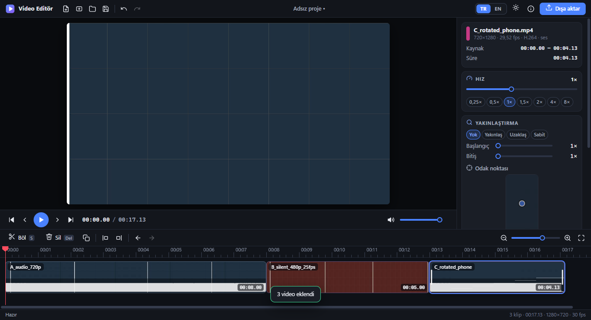
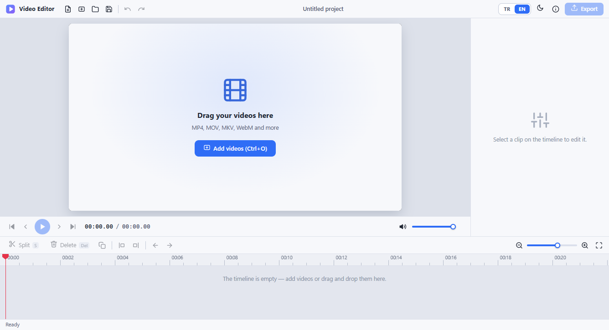
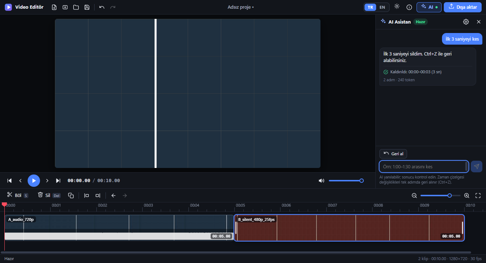
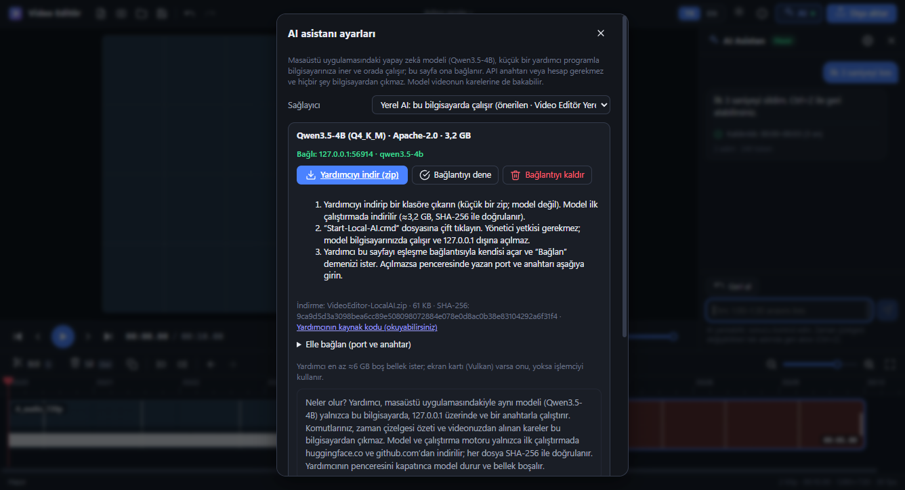
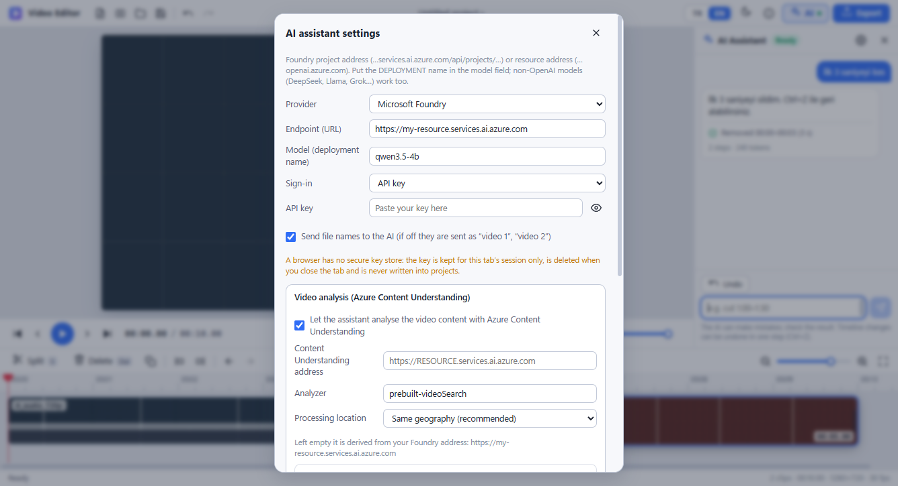

# Video Editör · Web edition (v4)

**Live site / Canlı site:** <https://ahmetcanalaca.github.io/videoeditor/>

The same compact editor as the Windows app, as a **static website**: no server code, no installation, no account, and **no API key to edit videos**.
Your videos are opened with the browser's own file picker, decoded and encoded **inside the page** (WebCodecs, through the
[Mediabunny](https://github.com/Vanilagy/mediabunny) library) and the result is written with the browser's save dialog.
**Nothing is uploaded anywhere.** After the first visit the site also works **offline** (service worker).
The optional **AI assistant** is the same as in the Windows app: it runs a model on *your* computer (the *Local AI helper*) or talks to the provider *you* choose with *your* key.

Windows uygulamasıyla aynı kompakt editör, **statik bir web sitesi** olarak: sunucu kodu, kurulum, hesap yok; **video düzenlemek için API anahtarı gerekmez**.
Videolarınız tarayıcının kendi dosya seçicisiyle açılır, **sayfanın içinde** çözülür/kodlanır (WebCodecs, Mediabunny kütüphanesi üzerinden)
ve sonuç tarayıcının kaydetme penceresiyle yazılır. **Hiçbir şey bir yere yüklenmez.** İlk ziyaretten sonra site **internetsiz** de çalışır.
İsteğe bağlı **AI asistanı** Windows uygulamasındakiyle aynıdır: *sizin* bilgisayarınızda çalışan bir modelle (*Yerel AI yardımcısı*) veya *sizin* seçtiğiniz sağlayıcıyla, *sizin* anahtarınızla çalışır.

## Use it / Kullanım

<p>
  
  
</p>
1. Open the site in **Chrome or Edge** (a current version). Türkçe is the default language, dark the default theme (switch in the title bar; the choice is remembered).
2. Add videos (button or drag & drop), cut them on the timeline (split `S`, delete `Delete`, undo `Ctrl+Z`), set speed (0.25–8×), zoom in / out / hold with a focus point, volume, fades.
3. **Export** → pick the file in the save dialog → MP4 (H.264 + AAC). The export shows progress, can be cancelled and never overwrites a source file.

| | Web edition | Windows app |
|---|---|---|
| Split, cut, delete, reorder, merge, speed, zoom, volume, fades, undo/redo, projects (`.vedproj`) | ✔ | ✔ |
| MP4 export with progress / cancel | ✔ (WebCodecs, ≈2.6× real time for 1080p on a laptop) | ✔ (FFmpeg) |
| Works offline | ✔ after the first visit | ✔ |
| Installation / administrator rights | none | per-user installer or portable folder |
| Formats it can open | what the browser decodes: MP4, MOV, M4V, MKV, WebM, MPEG-TS with H.264 / VP8 / VP9 / AV1 (HEVC only where the browser has hardware support) | everything FFmpeg reads (AVI, WMV, FLV, MPG …, with a preview proxy) |
| AI assistant (optional) | ✔ Local AI helper (same model as the app), cloud providers with your key, other local servers, Foundry video analysis | ✔ built-in local model, cloud providers, Foundry video analysis |
| Browsers | Chrome / Edge (tested, full). Other browsers are not tested: without the save picker the export is built in memory (limit ≈1.2 GB) and downloaded | – |

### AI assistant (optional) / AI asistanı (isteğe bağlı)

<p>
  
  
</p>
<p>
  
</p>

Type what you want ("cut the first 3 seconds", "speed up the quiet parts", "zoom in on the dog") and the assistant edits the timeline; everything it did is **one undo step**.
It is the desktop app's assistant, unchanged (`scripts/sync-desktop.js` bundles the desktop code instead of copying it by hand). With a model that accepts images it can also
**look at the video** ("find the dog, zoom in while it is on screen"). Open it with the **AI** button; the settings dialog offers:

| Provider | What runs where | Needs |
|---|---|---|
| **Local AI** (recommended) | The same model as the Windows app (Qwen3.5-4B with image input, llama.cpp) runs **on your computer** and listens on `127.0.0.1` only. | Download the small helper (zip) from the settings dialog, extract it, double-click `Start-Local-AI.cmd`. The first run downloads the engine (≈40 MB, github.com) and the model (≈3.4 GB, huggingface.co), checks every file against a pinned SHA-256, then opens this page with a pairing link; press *Connect*. Windows, ≈6 GB free memory. No account, no key to buy. |
| OpenAI-compatible, Azure OpenAI, **Microsoft Foundry**, Anthropic, Gemini | The page calls the provider directly from your browser. Only your command and a **text** summary of the timeline are sent. | Your own API key (kept for this tab only, never written to a project or to disk). Entra ID: paste a short-lived access token. |
| Other local server (Ollama, LM Studio, Foundry Local, llama.cpp …) | On this computer. | The server must allow this site (CORS). |
| **Foundry + Content Understanding** | Optional *video analysis*: with your confirmation each time, a small copy of your video is uploaded to **your** Azure resource; the result (scene descriptions, speech) comes back as text. | A Foundry / Azure AI resource with Content Understanding. |

Türkçe özet: *Yerel AI* modeli (masaüstündekiyle aynı) **sizin bilgisayarınıza** iner ve orada çalışır; bu site ona 127.0.0.1 üzerinden bağlanır. Yardımcı küçük bir zip'tir
(`Start-Local-AI.cmd`, okunabilir PowerShell betiği); model ve motor ilk çalıştırmada indirilir ve SHA-256 ile doğrulanır. Bulut sağlayıcıları kendi anahtarınızla çalışır.

How it is kept safe:

* **One network path.** The page itself can only talk to its own origin (`connect-src 'self'`). Every request of the assistant goes through a small worker (`js/web/ai/net-worker.js`) that has its own, stricter policy:
  `127.0.0.1` / `localhost`, the three well-known provider origins, and the https origins **you confirmed** in the settings (asked whenever you enter a key for such an address, saying what is sent there). No redirects, no cookies, no referrer.
* **Keys.** A browser has no secure key store, so a cloud key lives in `sessionStorage` (this tab only, gone when the tab closes), is bound to the origin it was typed for, is only ever sent to that origin, and is never part of a project file.
* **The helper.** `127.0.0.1` only, a random key that is made on your computer **at every start** (handed to the page in the part of the address after `#`, which is never sent to a server; worthless once the helper's window is closed), SHA-256-pinned downloads, no administrator rights, nothing else contacted. It is a readable script: [`local-ai/`](local-ai/). It is not signed: you trust this repository and GitHub; the workflow that publishes the site attests the exact zip (signed build provenance), so `gh attestation verify` on the file you downloaded tells you where it was built, see [SECURITY.md](../SECURITY.md).
* **Hosting.** Browsers isolate by origin, not by path: this site shares `*.github.io` with every other Pages site of the account. The service worker therefore verifies every cached file against the build manifest (whose hash is baked into the worker script), and you should not host untrusted content on other repositories of the same account (or give this site its own domain).
* **Pairing.** The page asks before it connects to a helper ("Connect to the Local AI on this computer, port …?") and removes the key from the address bar at once.

Measured with the real thing (`node tests/ai-real.test.js`: the helper starts the real Qwen3.5-4B, the page pairs with it, headless Chrome drives the UI; one laptop with an integrated AMD GPU): 5 of 5 typed commands (English and Turkish: cut the first 3 seconds, speed up ×2, split + half speed, delete the last 2 seconds, zoom 1.5×) edited the timeline exactly as asked and were undone by one Ctrl+Z; "zoom in on the dog" on a 60 s film made of real COCO photographs found 5 of 5 appearances (time-IoU 0.90, edges within ≈0.3 s, the zoom aimed at the dog) in ≈2.5–2.8 minutes, in both languages. Other films and other hardware will differ; a 4B model makes mistakes, which is why every change is one undo step.

Limits of the AI part: Chrome/Edge ask once for permission to "access devices on your local network" (Local Network Access, Chrome/Edge 142+) the first time the page talks to `127.0.0.1` (choose *Allow*; if you chose *Block*, the settings panel says where to change it: site settings > Local network access / Loopback network; on a company computer IT can pre-allow it with the policy `LoopbackNetworkAllowedForUrls` for this site; `tests/lna.test.js` runs the real browser check). A cloud provider has to allow browser calls (OpenAI, Anthropic, Gemini and Azure do);
the helper is a Windows script (on other systems start `llama-server` yourself, see `local-ai/README.txt`); the Foundry / Content Understanding path is tested against a mock and the services' CORS answers, not against a live resource in this release.

### Known limits

* The browser decides what it can decode: no AVI / WMV / FLV, no HEVC on machines without hardware support. HDR sources are converted to SDR without tone mapping (the editor warns about it).
* Export speed depends on your GPU/CPU and the browser's hardware encoder; very long 4K projects are far faster with the Windows app.
* Shortcuts `Ctrl+N`, `Ctrl+T`, `Ctrl+W` belong to the browser: use the toolbar button for a new project.
* A project file stores the media **names**, not paths (a web page cannot know paths): opening a project asks you to pick the media again.

## Privacy and security

* The page's Content-Security-Policy only allows its own origin (a service worker adds the same policy as an HTTP header, plus `frame-ancestors 'none'`, which GitHub Pages cannot send itself). There is no upload endpoint, no analytics, no cookies and no third-party request from the editor. The **only** requests that can leave the page are the assistant's, made on purpose through its network worker (see above): to `127.0.0.1`, or to a provider you chose and confirmed.
* No API key, token or secret exists anywhere in this site or its source. (A key you type for a cloud provider stays in your tab.)
* Libraries are vendored and pinned by SHA-256 (`vendor/vendor-lock.json`, checked by every build); nothing is loaded from a CDN.
* Details and how to report a problem: [SECURITY.md](../SECURITY.md). "No known vulnerabilities" is not "no vulnerabilities": keep your browser up to date and only open videos you trust.

## Develop / Geliştirme

```text
cd web
node scripts/serve.js                 # http://127.0.0.1:<port>/ (the site as GitHub Pages serves it; also packs the Local AI helper download on the fly)
node scripts/build.js                 # builds _site/ (what is published: service worker with the build id, precache list, local-ai/ download, .nojekyll, 404.html)
node scripts/sync-desktop.js          # regenerates what is taken from the desktop sources (add --check to only verify)
node scripts/vendor.js verify         # vendored libraries == vendor-lock.json
node tests/audio-dsp.test.js          # unit tests (no browser)
node tests/ai-core.test.js            # the desktop assistant code running in the web bundle (agent loop, providers, endpoints, find_in_video, crypto shims)
node tests/local-ai.test.js           # the Local AI helper with Windows PowerShell: downloads (mock server), pins, zip, and the REAL model when the desktop app's model is on the machine (VE_ONLY=static|download|real, VE_SKIP_REAL=1)
node tests/smoke.test.js              # real Chrome/Edge (set VE_BROWSER to its path if it is not found)
node tests/ui.test.js                 # the whole UI: languages, themes, import, editing, shortcuts, export dialog, projects
node tests/ai.test.js                 # the assistant in the browser: pairing, cutting by command, cancel, wrong key, find_in_video, cloud providers, trust dialogs
node tests/cu.test.js                 # Foundry + Content Understanding video analysis against the desktop app's mock of the service
node tests/lna.test.js                # Local Network Access as Chrome/Edge enforce it (page counts as public, helper on loopback): refusal, grant, other tab
node tests/ai-real.test.js            # MANUAL (npm run test:real): the real helper + the real Qwen3.5-4B + the page; needs the desktop app's model, ≈10 minutes
node tests/pwa.test.js                # service worker: offline, headers, network-worker policy, integrity of the cache, update flow
node tests/export.test.js             # 27 export cases checked with ffprobe/ffmpeg (set VE_FFMPEG / VE_FFPROBE, or keep the desktop vendor\ffmpeg\bin next to the repo)
```

The renderer in `js/` is the Windows app's UI; `js/web/` replaces what Electron provided (file access, settings, export engine, projects, the assistant's network and key handling) with
browser APIs. The editing model and the assistant's brain (`js/shared/`, `js/web/ai/desktop-core.js`) come from the desktop app and are regenerated, not forked.

### Publish your own copy

Fork the repository → *Settings → Pages → Source: GitHub Actions* → push to `main`. The workflow `.github/workflows/pages.yml`
verifies the vendored libraries, builds `web/_site`, attests the helper zip and deploys it (the Local AI helper tests run next to it on Windows, informational). A project site lives under `/<repository name>/`; all URLs in the site are relative.
The browser tests above are not run on every push (a hosted runner has no ffmpeg and no reliable package mirror); `.github/workflows/browser-tests.yml` starts them by hand, and `npm test` runs them on your own computer.
