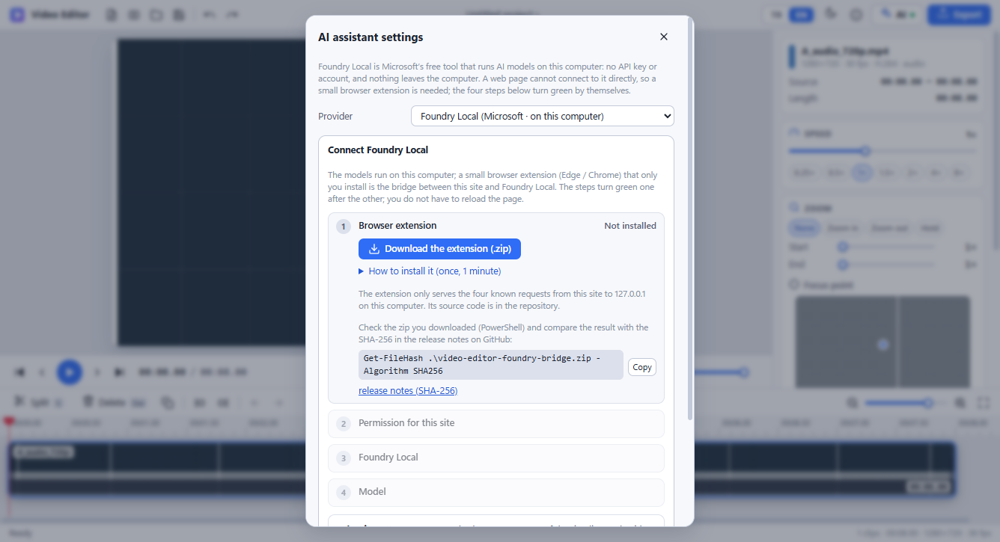
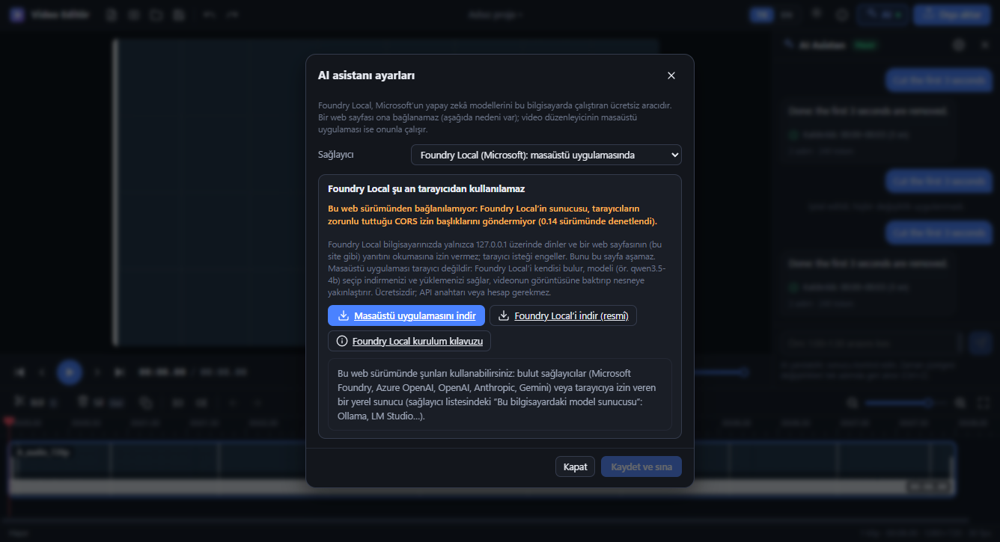
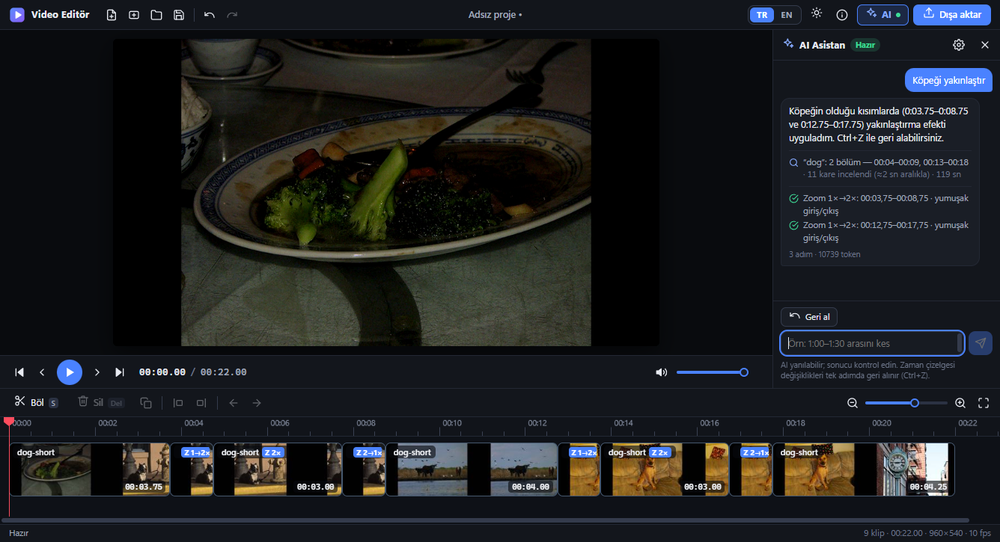
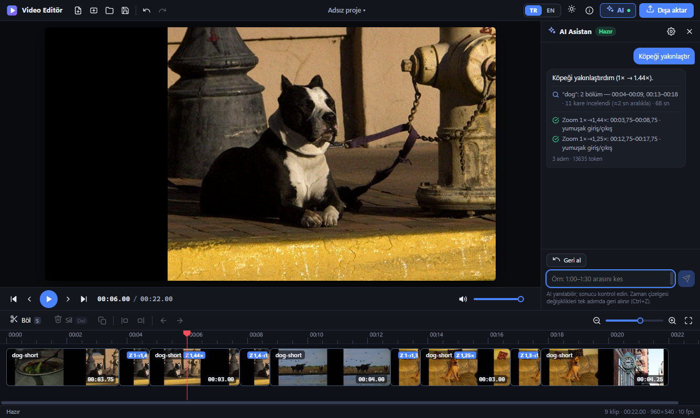

# Video Editör · Web edition (v4)

**Live site / Canlı site:** <https://ahmetcanalaca.github.io/videoeditor/>

The same compact editor as the Windows app, as a **static website**: no server code, no installation, no account, and **no API key to edit videos**.
Your videos are opened with the browser's own file picker, decoded and encoded **inside the page** (WebCodecs, through the
[Mediabunny](https://github.com/Vanilagy/mediabunny) library) and the result is written with the browser's save dialog.
**Nothing is uploaded anywhere** unless you switch on the optional Foundry video analysis (then, each time you confirm it, a reduced copy goes to *your own* Azure resource). After the first visit the site also works **offline** (service worker).
The optional **AI assistant** is the same as in the Windows app, and here it needs **nothing installed**: its model can run **inside the page**, on your graphics card (WebGPU); only the model file (data) is downloaded once and kept in the browser. It can also talk to the provider *you* choose with *your* key, to a model server on *your* computer that allows browsers (Ollama, LM Studio), or to **Foundry Local** through a small optional browser extension (all explained below).

Windows uygulamasıyla aynı kompakt editör, **statik bir web sitesi** olarak: sunucu kodu, kurulum, hesap yok; **video düzenlemek için API anahtarı gerekmez**.
Videolarınız tarayıcının kendi dosya seçicisiyle açılır, **sayfanın içinde** çözülür/kodlanır (WebCodecs, Mediabunny kütüphanesi üzerinden)
ve sonuç tarayıcının kaydetme penceresiyle yazılır. **İsteğe bağlı Foundry video analizini açmadıkça hiçbir şey bir yere yüklenmez** (açarsanız her seferinde onayınızla küçültülmüş bir kopya *kendi* Azure kaynağınıza gider). İlk ziyaretten sonra site **internetsiz** de çalışır.
İsteğe bağlı **AI asistanı** Windows uygulamasındakiyle aynıdır ve burada **hiçbir şey kurmanızı gerektirmez**: modeli **sayfanın içinde**, ekran kartınızda (WebGPU) çalışabilir; yalnızca model dosyası (veri) bir kez indirilir ve tarayıcıda saklanır. İsterseniz *sizin* seçtiğiniz sağlayıcıyla (*sizin* anahtarınızla), *sizin* bilgisayarınızdaki tarayıcılara izin veren bir model sunucusuyla (Ollama, LM Studio) ya da isteğe bağlı küçük bir tarayıcı eklentisi üzerinden **Foundry Local** ile de çalışır (aşağıda açıklanıyor).

## Use it / Kullanım

<p>
  
  
</p>
1. Open the site in **Chrome or Edge** (a current version). Türkçe is the default language, dark the default theme (switch in the title bar; the choice is remembered).
2. Add videos (button or drag & drop), cut them on the timeline (split `S`, delete `Delete`, undo `Ctrl+Z`), set speed (0.25–8×), zoom in / out / hold with a focus point, volume, fades.
3. **Export** → pick the file in the save dialog → MP4 (H.264 + AAC). The export shows progress, can be cancelled and never overwrites a source file.

| | Web edition | Windows app |
|---|---|---|
| Split, cut, delete, reorder, merge, speed, zoom, volume, fades, undo/redo, projects (`.vedproj`) | ✔ | ✔ |
| MP4 export with progress / cancel | ✔ (WebCodecs, ≈2.6× real time for 1080p on a laptop) | ✔ (FFmpeg) |
| Works offline | ✔ after the first visit | ✔ |
| Installation / administrator rights | none | per-user installer or portable folder |
| Formats it can open | what the browser decodes: MP4, MOV, M4V, MKV, WebM, MPEG-TS with H.264 / VP8 / VP9 / AV1 (HEVC only where the browser has hardware support) | everything FFmpeg reads (AVI, WMV, FLV, MPG …, with a preview proxy) |
| AI assistant (optional) | ✔ **a model that runs in the page** (WebGPU, nothing to install), cloud providers with your key, a model server on this computer that allows browsers (Ollama, LM Studio), **Foundry Local** (through an optional browser extension), Foundry video analysis | ✔ built-in local model, **Foundry Local** (found and started by the app), cloud providers, other local servers, Foundry video analysis |
| Browsers | Chrome / Edge (tested, full). Other browsers are not tested: without the save picker the export is built in memory (limit ≈1.2 GB) and downloaded | – |

### AI assistant (optional) / AI asistanı (isteğe bağlı)

<p>
  
  
  
</p>
<p>
  
  
</p>

Type what you want ("cut the first 3 seconds", "speed up the quiet parts", "zoom in on the dog") and the assistant edits the timeline; everything it did is **one undo step**.
It is the desktop app's assistant, unchanged (`scripts/sync-desktop.js` bundles the desktop code instead of copying it by hand). Open it with the **AI** button; the settings dialog offers:

| Provider | What runs where | Needs |
|---|---|---|
| **AI in the browser** (WebGPU) | **In this tab, on this computer's graphics card; nothing to install.** A Qwen3.5 model (*Balanced* 2B or *Best* 4B; both also look at pictures, so "zoom in on the dog" works) is downloaded once as **data** from Hugging Face, checked block by block against SHA-256 values pinned in this site, kept in the browser (deletable) and run by a worker that can connect to this site only. Your commands, video and frames never leave the computer. See *AI in the browser* below. | A current Edge / Chrome with WebGPU and 16-bit shaders (and the site's service worker active), 1.5 – 2.8 GB of browser storage, about 5 GB (*Best*: about 10 GB) of free memory while it runs, and `huggingface.co` reachable once. No key, no account, no program, no extension. |
| OpenAI-compatible, Azure OpenAI, **Microsoft Foundry**, Anthropic, Gemini | The page calls the provider directly from your browser. Only your command and a **text** summary of the timeline are sent. | Your own API key (kept for this tab only and never written to a project; the browser may keep a copy of an open tab's session data in its profile). Entra ID: paste a short-lived access token. |
| **Model server on this computer** (Ollama, LM Studio, llama.cpp …) | On this computer; nothing leaves it. A model without tool calling still works: the tools are written into the prompt. | The server must allow this site (CORS), e.g. `OLLAMA_ORIGINS` for Ollama, "Enable CORS" in LM Studio. |
| **Foundry Local** (Microsoft) | **On this computer, through an optional browser extension.** Foundry Local's server (checked with version 0.14) sends no CORS headers, so a page cannot read its answers; a small extension for Edge / Chrome (installed once, approved per site) carries four known requests for the page. The settings dialog walks through four steps that turn green by themselves: extension → permission → Foundry Local found → model loaded. A model that sees pictures (`qwen3.5-4b`) also does "zoom in on the dog". See *Foundry Local in the browser* below. If you do not want to install anything, use *AI in the browser* above. | Foundry Local ([official installer](https://aka.ms/foundry-local-installer) or `winget install Microsoft.FoundryLocal`), a downloaded model (`foundry model download qwen3.5-4b`), the extension (`extension/`, offered by the dialog). No key, no account. |
| **Foundry + Content Understanding** | Optional *video analysis*: with your confirmation each time, a small copy of your video is uploaded to **your** Azure resource; the result (scene descriptions, speech) comes back as text. For a zoom that has to aim at an object, a few small pictures (≤ 640 px, ≤ 120 KB each) can also be shown to your chat model, after a separate confirmation every time (the analysis says *when*, the pictures say *where*; this app does not keep them, the model service's own data policy applies). | A Foundry / Azure AI resource with Content Understanding; a chat model that accepts pictures (e.g. `gpt-4.1`) for the position. |

Türkçe özet: **hiçbir şey kurmak istemiyorsanız ilk seçeneği kullanın (Tarayıcıda yapay zekâ):** model sekmenin içinde, ekran kartınızda çalışır; yalnızca model dosyası (veri) Hugging Face'ten bir kez indirilir, bu sitede sabitlenmiş SHA-256 değerleriyle doğrulanır ve tarayıcıda saklanır; videoya da bakar ("köpeği yakınlaştır"). Bulut sağlayıcıları kendi anahtarınızla çalışır; bu bilgisayardaki bir model sunucusu (Ollama, LM Studio) tarayıcılara izin verirse (CORS) kullanılabilir. **Foundry Local** için isteğe bağlı küçük bir tarayıcı eklentisi gerekir (Edge / Chrome); AI ayarlarında dört adım (eklenti → izin → Foundry Local → model) kendiliğinden yeşile döner. Ayrıntı: aşağıdaki *AI in the browser* ve *Foundry Local in the browser* bölümleri.

### AI in the browser / Tarayıcıda yapay zekâ

Nothing to download but data: no program, no `.bat`, no extension, no account.

1. Open **AI → ⚙** (this option is preselected), pick a model and press **Download and use**. A question says what is downloaded (name, size, repository, commit), from where and what is stored; nothing starts before you agree.
2. The files come from Hugging Face, are checked block by block and kept in the browser. The model is then loaded onto the graphics card (once per session; the first use also compiles the card's programs once), asked a test question, and the assistant is ready. After 10 minutes without a request it is taken out of memory (*Free memory* does it at once); you can delete the files any time (*Delete download*).

| | **Balanced** (recommended) | Best |
|---|---|---|
| Model | Qwen3.5 2B | Qwen3.5 4B |
| Download / browser storage | 1.5 GB | 2.8 GB |
| Memory while it runs (measured, integrated graphics: the card shares the computer's memory) | about 5 GB | about 10 GB |
| Good for | cutting, speed, zoom by words; finds objects | the most accurate; slower, needs a lot of memory |



**Measured** on one computer (a laptop with AMD integrated graphics, 31 GB of memory, Edge; yours will differ), with real downloads from Hugging Face and the model running on the real graphics card:

* **Download** 1.5 GB ≈ 50 s, 2.8 GB ≈ 100 s (30 – 50 MB/s). **Ready** (read into memory, the card's programs made once, a test question) ≈ 45 – 60 s per session, then the model stays loaded.
* **Commands** such as "cut the first 5 seconds" or "speed up the video 2×": about 5 – 20 s. **"Zoom in on the dog"** in a 22-second film: about 1 – 1.5 minutes (it looks at 11 pictures, finds the dog in both places it appears and aims the zoom at it); a longer film takes longer (at most 40 pictures are looked at).
* **Memory** is given back by *Free memory* (free memory on the test computer went from 4.1 GB back to 8.4 GB) and after 10 minutes without a request.
* **Quality:** in the tests the *Balanced* model carried out cutting, speed and "zoom in on the dog" correctly; a small model still makes mistakes (the *Best* model once sped up a tenth of a second instead of the whole film), so check the result: **one Ctrl+Z undoes everything**. The model sometimes answers a Turkish command in English (the edit is still made). A model that says "done" without having edited anything is reminded once, and if it still does not edit, the assistant says so instead of passing on its claim. A smaller model (0.8B) was tried and is **not offered**: it answered questions but could not carry out a single editing command.

How it is kept safe (details and the threat model: [SECURITY.md](../SECURITY.md)):

* The page names a model by its **catalogue key** only. The catalogue (`js/web/ai/inbrowser/ib-models.js`, generated by `scripts/ib-model-lock.js`) pins the repository, the **commit** and the SHA-256 of every file and of every 16 MiB block; it is part of the files the service worker verifies.
* Files are downloaded by a worker whose policy allows **this site and Hugging Face only** (a redirect to any other host is refused) and checked **again every time they are read** from the browser's storage. Nothing that does not match is stored or used.
* The model runs in a second worker whose policy lets it connect to **this site only**, and that is **tested every time it starts** (a request to a `data:` address, which needs no network, and one to another site both have to be refused, else the model is not loaded). The libraries that run it (transformers.js, ONNX Runtime Web) are part of this site (`vendor/`, pinned by SHA-256, verified by the service worker), never fetched from a CDN.
* These policies are headers that the **service worker** adds, so the assistant needs it: without a service worker in control of the page (a private window of a browser that has none, a policy that switches them off) it does not start and says why. The service worker also serves the code of the in-browser model feature (`js/web/ai/inbrowser/`) and the libraries of the model only under the exact address of the build manifest and only with the manifest's bytes, from the cache and from the network alike (a 404 for another spelling - and for every address inside its scope that is not written the plain way -, a 503 while its cache is being refilled, a 502 for other bytes), never an unchecked file.
* Honest limits: Hugging Face and the model repositories are third parties (the pins mean you get exactly the files whose hashes were compared with the ones Hugging Face publishes; nobody has audited the model, and it is not flawless); a small model can misunderstand or make things up (every result is one undo step, and the assistant says when it could not edit); the model needs a good amount of memory; a company network may block `huggingface.co` / `hf.co`; and this site shares the `github.io` origin with other Pages sites of the same account (see below), so "this site only" means that whole origin.

### Foundry Local in the browser (optional, needs the extension) / Tarayıcıda Foundry Local (isteğe bağlı, eklenti gerekir)

1. Install Foundry Local and download a model once: `winget install Microsoft.FoundryLocal`, then `foundry model download qwen3.5-4b`.
2. Open **AI → settings → Foundry Local**. **Step 1:** download the extension (`extension/video-editor-foundry-bridge.zip`, offered by the dialog), extract it to a folder you keep, open `edge://extensions` or `chrome://extensions`,
   switch on *Developer mode* and press *Load unpacked*. The step turns green by itself (no page reload, an unsaved project is safe). To check the zip, run `Get-FileHash .\video-editor-foundry-bridge.zip` (the dialog shows the command) and compare the result
   with the SHA-256 in the [release notes](https://github.com/ahmetcanalaca/videoeditor/releases/tag/foundry-bridge-v1.0.0) on GitHub.
3. **Step 2:** press *Allow…*; the extension opens its own window that names this site. **Step 3:** start Foundry Local (`foundry server start`); the page finds it. Its port changes at every start: press
   *Find automatically* (scans `49152–65535` on `127.0.0.1`, only when you press it) or fix the port once: `foundry config set port 5272`. Another port is typed into the window of the extension (toolbar icon), not into the page.
4. **Step 4:** type `qwen3.5-4b` (an alias: Foundry Local picks the variant that suits the computer) or a full id, press *Load and use*. The page loads the model, asks it a question and a 64 × 64 test picture
   (a model that sees pictures is offered `find_in_video`, one that does not works with time ranges only).

What it costs and what it risks, honestly: the extension needs *Developer mode* (on a company computer IT may have switched it off: ask them to approve the extension, or use the Windows app); it is unsigned and loaded from a folder.
It may only do four things for this site — `models`, `loaded`, `load`, `chat` — on `127.0.0.1`, after you approved the site, and only at a server that describes itself as Foundry Local at exactly that address; the page names neither an address nor a port.
Foundry Local takes no key, so other programs on the computer can use the loaded model too, and a program that imitates Foundry Local's `/status` on a free port could be mistaken for it (the extension checks the address again after an idle spell, but cannot see which program owns a port). Source and threat model: [extension/README.md](extension/README.md), [SECURITY.md](../SECURITY.md).

How it is kept safe:

* **One network path.** The page itself can only talk to its own origin (`connect-src 'self'`). Every request of the assistant goes through a small worker (`js/web/ai/net-worker.js`) that has its own, stricter policy:
  `127.0.0.1` / `localhost`, the three well-known provider origins, and the https origins **you confirmed** in the settings (asked whenever you enter a key for such an address, saying what is sent there). No redirects, no cookies, no referrer.
  Foundry Local is one exception: its requests leave through the browser extension instead (to `127.0.0.1` only, four fixed routes, after you approved the site), never through the page. The other is the model of *AI in the browser*: its files come through a download worker (this site and Hugging Face only, see above); the model itself runs in a worker that can connect to this site only.
* **Keys.** A browser has no secure key store, so a cloud key lives in `sessionStorage` (this tab only, meant to be gone when the tab closes; a Chromium-based browser may still keep a copy of an open tab's session data in its profile folder for crash recovery, so on a shared computer use a key you can revoke), is bound to the origin it was typed for, is only ever sent to that origin, and is never part of a project file.
* **Hosting.** Browsers isolate by origin, not by path: this site shares `*.github.io` with every other Pages site of the account. The service worker therefore verifies every cached file against the build manifest (whose hash is baked into the worker script), and you should not host untrusted content on other repositories of the same account (or give this site its own domain).

Limits of the AI part: Chrome/Edge ask once for permission to "access devices on your local network" (Local Network Access, Chrome/Edge 142+) the first time the page talks to a model server on `127.0.0.1` (choose *Allow*; if you chose *Block*, the error message says where to change it: site settings > Local network access / Loopback network; on a company computer IT can pre-allow it with the policy `LoopbackNetworkAllowedForUrls` for this site; `tests/lna.test.js` runs the real browser check). A cloud provider has to allow browser calls (OpenAI, Anthropic, Gemini and Azure do); the Foundry / Content Understanding path is tested against a mock and the services' CORS answers, not against a live resource in this release.

### Known limits

* The browser decides what it can decode: no AVI / WMV / FLV, no HEVC on machines without hardware support. HDR sources are converted to SDR without tone mapping (the editor warns about it).
* Export speed depends on your GPU/CPU and the browser's hardware encoder; very long 4K projects are far faster with the Windows app.
* Shortcuts `Ctrl+N`, `Ctrl+T`, `Ctrl+W` belong to the browser: use the toolbar button for a new project.
* A project file stores the media **names**, not paths (a web page cannot know paths): opening a project asks you to pick the media again.

## Privacy and security

* The page's Content-Security-Policy only allows its own origin (a service worker adds the same policy as an HTTP header, plus `frame-ancestors 'none'`, which GitHub Pages cannot send itself). There is no upload endpoint, no analytics, no cookies and no third-party request from the editor. The **only** requests that can leave the page are the assistant's, made on purpose through its network worker (see above): to `127.0.0.1`, or to a provider you chose and confirmed; plus, only after you agreed to it, the download of the model files of *AI in the browser* from Hugging Face.
* No API key, token or secret exists anywhere in this site or its source. (A key you type for a cloud provider stays in your tab.)
* Libraries are vendored and pinned by SHA-256 (`vendor/vendor-lock.json`, checked by every build); nothing is loaded from a CDN. One declared change to one file (a class name that GitHub's secret scanning took for an API key; see `THIRD-PARTY-NOTICES.txt`) is recorded as a patch that `node scripts/vendor.js verify` proves offline. The two libraries that run the in-browser model (about 27 MB) are fetched only when you use that model.
* Details and how to report a problem: [SECURITY.md](../SECURITY.md). "No known vulnerabilities" is not "no vulnerabilities": keep your browser up to date and only open videos you trust.

## Develop / Geliştirme

```text
cd web
node scripts/serve.js                 # http://127.0.0.1:<port>/ (the site as GitHub Pages serves it)
node scripts/build.js                 # builds _site/ (what is published: service worker with the build id, precache list, .nojekyll, 404.html)
node scripts/sync-desktop.js          # regenerates what is taken from the desktop sources (add --check to only verify)
node scripts/vendor.js verify         # vendored libraries == vendor-lock.json
node scripts/ib-model-lock.js         # (needs the network) regenerates the pinned model catalogue js/web/ai/inbrowser/ib-models.js from Hugging Face; npm run ib:check (no network) verifies that it is well-formed and consistent
node scripts/pack-extension.js        # the browser extension (extension/) as a reproducible zip (build.js puts it into _site/extension/ next to the app)
node tests/audio-dsp.test.js          # unit tests (no browser)
node tests/ai-core.test.js            # the desktop assistant code running in the web bundle (agent loop, providers incl. the tools-in-the-prompt fallback, endpoints, find_in_video, crypto shims)
node tests/ext-policy.test.js         # the browser extension's rules (routes, ids, bodies, how Foundry Local is recognised, which pages are served), its manifest and its package (no browser)
node tests/smoke.test.js              # real Chrome/Edge (set VE_BROWSER to its path if it is not found)
node tests/ui.test.js                 # the whole UI: languages, themes, import, editing, shortcuts, export dialog, projects
node tests/ai.test.js                 # the assistant in the browser: a model server on this computer, cutting by command, cancel, wrong key, a model without tool calling, cloud providers, trust dialogs, the Foundry Local panel
node tests/ib-core.test.js            # the in-browser model's logic (no browser): block-by-block SHA-256 checking, download rules and resume, the virtual OpenAI endpoint, saved decoder state, the reminder for a model that claims an edit it did not make
node tests/ib-web.test.js             # the in-browser model in a real browser with stand-in workers: the three-step panel, consent, download / remove / unload, the assistant's answers, "köpeği yakınlaştır" with stand-in pictures
node tests/cu.test.js                 # Foundry + Content Understanding video analysis against the desktop app's mock of the service
node tests/locate.test.js             # the zoom aims at WHERE the object is: pictures after a question every time, a stand-in vision model that decodes every JPEG (tests/locate-world.js)
node tests/lna.test.js                # Local Network Access as Chrome/Edge enforce it (page counts as public, model server on loopback): refusal, grant, settings written by another page
node tests/fl-bridge.test.js          # the extension in a real browser against a stand-in for Foundry Local (no CORS headers): approval window, routes, refusals, abort, a 36 s request, restart, port scan
node tests/fl-web.test.js             # the whole way: the four steps of the panel, "turuncu arabaya zoom yap" with pictures a stand-in model decodes, model loaded on demand, Foundry Local gone and back
node tests/pwa.test.js                # service worker: offline, headers, network-worker policy, integrity of the cache, update flow
node tests/export.test.js             # 27 export cases checked with ffprobe/ffmpeg (set VE_FFMPEG / VE_FFPROBE, or keep the desktop vendor\ffmpeg\bin next to the repo)
```

The renderer in `js/` is the Windows app's UI; `js/web/` replaces what Electron provided (file access, settings, export engine, projects, the assistant's network and key handling) with
browser APIs. The editing model and the assistant's brain (`js/shared/`, `js/web/ai/desktop-core.js`) come from the desktop app and are regenerated, not forked.

### Publish your own copy

Fork the repository → *Settings → Pages → Source: GitHub Actions* → push to `main`. The workflow `.github/workflows/pages.yml`
verifies the vendored libraries, builds `web/_site` and deploys it. A project site lives under `/<repository name>/`; all URLs in the site are relative.
The browser tests above are not run on every push (a hosted runner has no ffmpeg and no reliable package mirror); `.github/workflows/browser-tests.yml` starts them by hand, and `npm test` runs them on your own computer.
